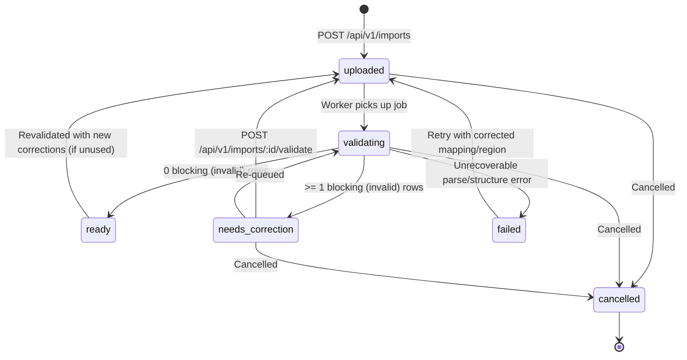
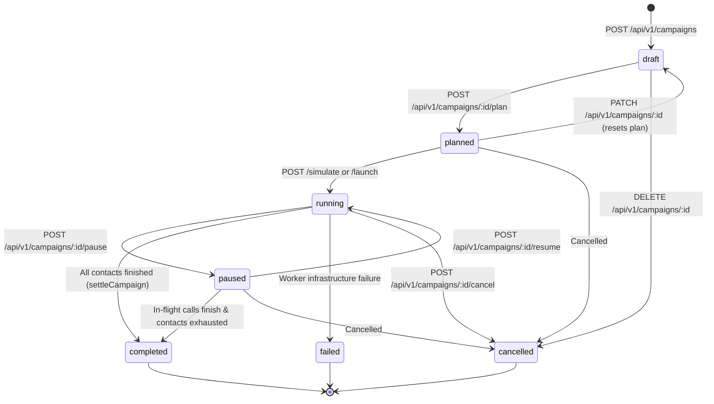
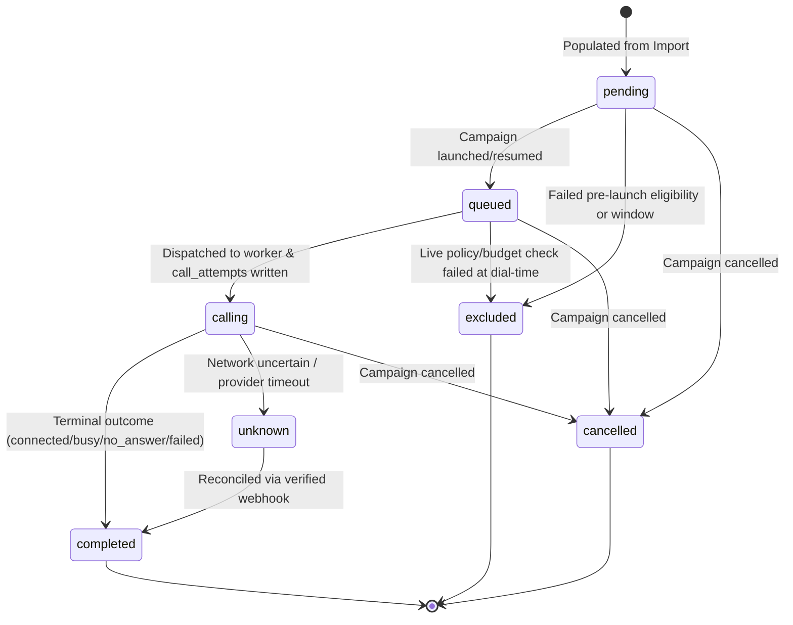
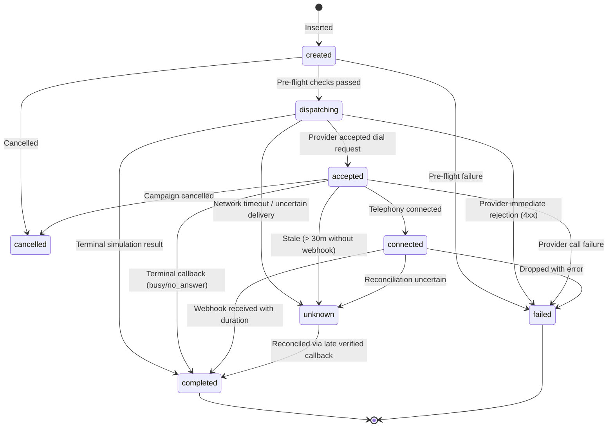
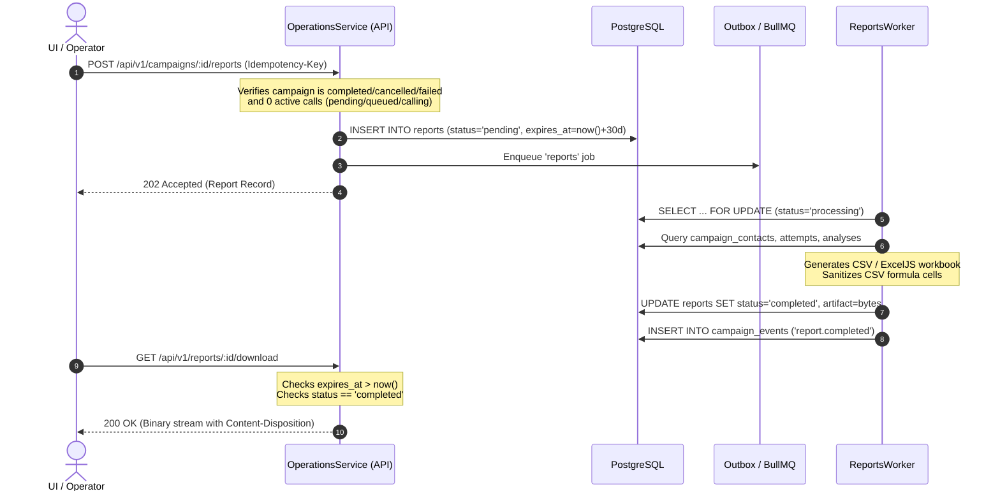

# Backend Domain, Lifecycle, and Data Model Audit

> **Target Audience:** Flutter Desktop & Mobile Engineers, UI/UX Designers, and Backend Integrators.  
> **Source Commit Context:** Audited directly from repository source code against production constraints.

---

## Executive Summary

The backend system implements a resilient, multi-tenant automated voice outreach engine supporting **Simulation** (local, deterministic, zero-cost mock) and **Live** (Sarvam AI voice platform) operating modes. 

Unlike traditional CRUD applications, this architecture is governed by:
1. **Multi-dimensional asynchronous lifecycles**: Campaigns, Campaign Contacts, Call Attempts, Analyses, Imports, and Reports each maintain independent state machines that progress asynchronously.
2. **Strict transactional safety**: Bounded HTTP provider boundaries end *outside* database transactions; atomic outbox publishers guarantee message delivery via BullMQ without relying on Redis as an execution authority.
3. **Conservative non-destructive fail-safes**: Uncertain external network conditions never trigger automatic redials. Paused or cancelled campaigns allow in-flight calls to terminate naturally without forced interruption.
4. **Append-only event streaming & cursor replay**: High-water mark bigint monotonic event cursors empower the UI client to recover seamlessly across server restarts or mobile connection dropouts.

---

## 1. Agent & Persona Model & Versioning Lifecycle

### 1.1 Data Model & Database Constraints

The agent and persona system is split across two relational tables in PostgreSQL:

* **`agents`** ([`packages/database/src/schema.ts#L74-L88`](file:///Users/kuroyami/CallingAgents/packages/database/src/schema.ts#L74-L88)):
  * `id`: UUID primary key (`defaultRandom()`).
  * `workspace_id`: Foreign key to `workspaces.id` ([`schema.ts#L26-L29`](file:///Users/kuroyami/CallingAgents/packages/database/src/schema.ts#L26-L29)).
  * `name`: Text, non-null.
  * `description`: Text, non-null.
  * `current_version`: Integer, default `1`, non-null.
  * `created_at`: Timestamp with time zone, default `now()`.
  * Indexes: Composite unique on `(workspace_id, id)` and b-tree on `(workspace_id, created_at, id)`.

* **`agent_versions`** ([`packages/database/src/schema.ts#L89-L110`](file:///Users/kuroyami/CallingAgents/packages/database/src/schema.ts#L89-L110)):
  * `id`: UUID primary key.
  * `workspace_id`: Foreign key to `workspaces.id`.
  * `agent_id`: UUID, foreign key referencing composite `(agents.workspaceId, agents.id)`.
  * `version`: Integer, positive constraint `CHECK (version > 0)`.
  * `instructions`: Text, non-null (represents the persona prompt).
  * `language`: Text, default `'English'`, non-null.
  * `questions`: JSONB array of strings (`string[]`), default `[]`, non-null.
  * `created_at`: Timestamp with time zone, default `now()`.
  * Constraints: Unique on `(workspace_id, id)`, unique on `(agent_id, version)`.

* **Starter Personas**: Pre-seeded when a workspace is created ([`packages/database/src/personas.ts#L2-L66`](file:///Users/kuroyami/CallingAgents/packages/database/src/personas.ts#L2-L66), [`apps/api/src/auth.ts#L95`](file:///Users/kuroyami/CallingAgents/apps/api/src/auth.ts#L95)). Five standard personas are inserted with initial version `1`:
  1. *Customer Discovery*
  2. *Appointment Coordinator*
  3. *Feedback Listener*
  4. *Event Outreach*
  5. *Service Follow-up*

### 1.2 Validation Rules & Contracts

Contract schemas are enforced via Zod in [`packages/contracts/src/index.ts#L94-L100`](file:///Users/kuroyami/CallingAgents/packages/contracts/src/index.ts#L94-L100):

* `name`: String, 1–100 characters, trimmed.
* `description`: String, 0–1,000 characters, defaults to empty string.
* `prompt`: String, 1–10,000 characters, trimmed (persisted to `agent_versions.instructions`).
* `questions`: Array of strings, 0–20 items, each item 1–300 characters, defaults to `[]`.
* `language`: String, 1–50 characters, defaults to `'English'`.

### 1.3 Immutability and Versioning Mechanics

Agent versions are **append-only and immutable** ([`apps/api/src/agents.ts#L62-L120`](file:///Users/kuroyami/CallingAgents/apps/api/src/agents.ts#L62-L120)):
1. **Creation** (`POST /api/v1/agents`):
   * An agent row is created with `current_version = 1`.
   * An `agent_versions` record is inserted with `version = 1`.
   * An audit entry `'agent.created'` is logged.
2. **Modification** (`PATCH /api/v1/agents/:id`):
   * The parent `agents` table is updated with the new `name`, `description`, and `current_version = existing.current_version + 1`.
   * A *brand new* row is appended to `agent_versions` with the incremented version number.
   * Prior versions are **never modified or deleted**.
   * An audit entry `'agent.version_created'` is recorded.
3. **Campaign Coupling & Historical Integrity**:
   * A campaign points directly to an immutable version: `campaigns.agent_version_id` references `agent_versions.id` ([`packages/database/src/schema.ts#L241`](file:///Users/kuroyami/CallingAgents/packages/database/src/schema.ts#L241)).
   * When an agent is updated, existing launched, planned, or completed campaigns **retain their historical `agent_version_id`**. They do not automatically upgrade.
   * A draft or planned campaign only re-resolves the latest `current_version` if explicitly edited via `PATCH /api/v1/campaigns/:id` ([`apps/api/src/campaigns.ts#L222-L227`](file:///Users/kuroyami/CallingAgents/apps/api/src/campaigns.ts#L222-L227)).

### 1.4 Agent Testing Sandbox

Operators can test agent conversational personas in simulation mode via `POST /api/v1/agents/:id/sandbox` ([`apps/api/src/agents.ts#L121-L131`](file:///Users/kuroyami/CallingAgents/apps/api/src/agents.ts#L121-L131)). This invokes `MockVoiceProvider.initiate` with a dummy destination (`+12025550100`), verifying prompt behavior without initiating telephony side effects.

---

## 2. Import & Contact Validation Lifecycle

### 2.1 Data Models & Constraints

* **`imports`** ([`packages/database/src/schema.ts#L111-L145`](file:///Users/kuroyami/CallingAgents/packages/database/src/schema.ts#L111-L145)):
  * `status`: Check constraint `IN ('uploaded', 'validating', 'ready', 'needs_correction', 'failed', 'cancelled')`.
  * `source_bytes`: PostgreSQL `bytea`, maximum size enforced by DB check: `CHECK (octet_length(source_bytes) <= 5242880)` (5 MiB).
  * `mapping`: JSONB object containing column mappings for `phone`, `name`, `email`, `consent`, `outcome`.
  * `region`: 2-letter ISO country code (`CHECK (region ~ '^[A-Z]{2}$')`).
  * `corrections`: JSONB mapping of source row indexes to corrected cell values.
  * `row_count`, `valid_count`, `error_count`: Integer statistics.
  * `failure_code`: Text failure identifier.

* **`contacts`** ([`packages/database/src/schema.ts#L146-L166`](file:///Users/kuroyami/CallingAgents/packages/database/src/schema.ts#L146-L166)):
  * `workspace_id`: Enforces tenant boundary.
  * `phone`: E.164 phone number, enforced by regex constraint `CHECK (phone ~ '^\+[1-9][0-9]{7,14}$')`.
  * `consent`: Boolean, defaults to `false`.
  * `synthetic`: Boolean, indicates simulation-only test destination.
  * Constraint: Composite unique on `(workspace_id, phone)` prevents duplicate contacts in a workspace.

* **`import_rows`** ([`packages/database/src/schema.ts#L167-L202`](file:///Users/kuroyami/CallingAgents/packages/database/src/schema.ts#L167-L202)):
  * `source_row`: Source line number from the uploaded file (1-based index).
  * `source_cells`: JSONB snapshot of all raw cells in the row.
  * `normalized_phone`: E.164 normalized string or null.
  * `issues`: JSONB array of validation issue descriptors `[{ code, message, field }]`.
  * `status`: Check constraint `IN ('valid', 'invalid', 'excluded', 'duplicate')`.
  * `contact_id`: Foreign key referencing `contacts.id` (set only when row is valid or excluded).

* **`consent_records` & `suppressions`** ([`packages/database/src/schema.ts#L203-L231`](file:///Users/kuroyami/CallingAgents/packages/database/src/schema.ts#L203-L231)):
  * `suppressions`: Workspace-level Do-Not-Call list keyed by `(workspace_id, phone)`.
  * `consent_records`: Immutable audit ledger recording `contact_id`, `granted` (boolean), `source`, and timestamp.

### 2.2 Import State Machine & Transitions

The allowed transition graph is codified in [`packages/contracts/src/index.ts#L366-L373`](file:///Users/kuroyami/CallingAgents/packages/contracts/src/index.ts#L366-L373):



### 2.3 Row Status Rules & Deduplication Mechanics

Row validation is processed sequentially in [`apps/worker/src/imports.ts#L160-L334`](file:///Users/kuroyami/CallingAgents/apps/worker/src/imports.ts#L160-L334):

1. **File Parsing & Dimension Constraints** ([`imports.ts#L66-L157`](file:///Users/kuroyami/CallingAgents/apps/worker/src/imports.ts#L66-L157)):
   * Supported formats: CSV (`text/csv`) and XLSX (`application/vnd.openxmlformats-officedocument.spreadsheetml.sheet`).
   * Max source file size: 5 MiB.
   * Maximum 50 columns; maximum 10,000 data rows (10,001 including header).
   * Headers must be non-empty, unique, and $\le 100$ characters each.
   * Individual cell string length capped at 2,000 characters (`CELL_LIMIT`).
   * **XLSX Zip-Bomb Defense** ([`imports.ts#L33-L65`](file:///Users/kuroyami/CallingAgents/apps/worker/src/imports.ts#L33-L65)): `validateXlsxArchive` analyzes the raw zip end-of-central-directory, capping entry count at 1,000 and total decompressed size at 50 MiB (`XLSX_EXPANDED_LIMIT`).
   * **Formula Injection Sanitization** ([`imports.ts#L158-L159`](file:///Users/kuroyami/CallingAgents/apps/worker/src/imports.ts#L158-L159)): Inputs beginning with formula triggers (`=`, `+`, `-`, `@`, fullwidth equivalents `＝＋－＠`, or leading control characters `\t`, `\r`, `\n`) are flagged with issue `SPREADSHEET_FORMULA`.

2. **Phone Normalization** ([`imports.ts#L16-L32`](file:///Users/kuroyami/CallingAgents/apps/worker/src/imports.ts#L16-L32)):
   * Uses `libphonenumber-js/max`. If phone lacks a leading `+`, `region` is mandatory (`REGION_REQUIRED`).
   * Number must be strictly valid without extensions. Normalizes to E.164.

3. **In-File Deduplication** ([`imports.ts#L230-L237`](file:///Users/kuroyami/CallingAgents/apps/worker/src/imports.ts#L230-L237)):
   * Tracked in an in-memory `seen = new Set<string>()`.
   * The first occurrence of a phone number continues to validation.
   * Subsequent occurrences in the same file are marked `status = 'duplicate'` with issue `DUPLICATE`.
   * Note: Duplicate rows are **non-blocking**; they do not force the import into `needs_correction`.

4. **Synthetic Destination Validation** ([`imports.ts#L244-L251`](file:///Users/kuroyami/CallingAgents/apps/worker/src/imports.ts#L244-L251)):
   * If `synthetic === true`, the phone must strictly match North American reserved test range: `/^\+1[2-9]\d{2}55501\d{2}$/` (555-0100 through 555-0199).
   * Numbers outside this range are marked `status = 'invalid'` with issue `SYNTHETIC_RANGE`.

5. **Suppression & Consent Checking** ([`imports.ts#L278-L305`](file:///Users/kuroyami/CallingAgents/apps/worker/src/imports.ts#L278-L305)):
   * **Suppressed**: If `suppressions` contains the phone, row status becomes `'excluded'`, issue `SUPPRESSED`.
   * **Consent Missing**: If cell value does not contain affirmative consent (`'true'`, `'yes'`, `'1'`) and existing contact lacks prior consent, row status becomes `'excluded'`, issue `CONSENT_MISSING`.
   * If consent is granted, an immutable ledger row is written to `consent_records` ([`imports.ts#L283-L290`](file:///Users/kuroyami/CallingAgents/apps/worker/src/imports.ts#L283-L290)).

6. **Aggregation to Import Status** ([`imports.ts#L307-L333`](file:///Users/kuroyami/CallingAgents/apps/worker/src/imports.ts#L307-L333)):
   * Rows with syntax/structural failures or invalid phone/synthetic range are `'invalid'`.
   * Count of `'invalid'` rows is `blocking`.
   * If `blocking > 0`, the import transitions to **`needs_correction`**.
   * If `blocking === 0`, the import transitions to **`ready`** (even if rows contain `duplicate` or `excluded` contacts).

```
┌─────────────────────────────────────────────────────────────┐
│                 Import Row Status Outcomes                  │
├──────────────┬───────────────────┬──────────────┬───────────┤
│ Row Status   │ Cause             │ Blocks File? │ Upserted? │
├──────────────┼───────────────────┼──────────────┼───────────┤
│ valid        │ Valid E.164 + ok  │ No           │ Yes       │
│ duplicate    │ Phone seen earlier│ No           │ No        │
│ excluded     │ Suppressed/no opt │ No           │ Yes       │
│ invalid      │ Bad phone / syntax│ YES          │ No        │
└──────────────┴───────────────────┴──────────────┴───────────┘
```

### 2.4 In-Place Corrections & Campaign Lock Rules

* **Cell Corrections API** (`POST /api/v1/imports/:id/validate`, [`apps/api/src/imports.ts#L101-L211`](file:///Users/kuroyami/CallingAgents/apps/api/src/imports.ts#L101-L211)):
  * Operators can submit cell patches (`corrections: [{ sourceRow, cells }]`) to fix typos or missing country codes without re-uploading the file.
  * Input is validated: only existing column names and existing row indexes can be modified; max 50 columns per row ([`imports.ts#L160-L182`](file:///Users/kuroyami/CallingAgents/apps/api/src/imports.ts#L160-L182)).
* **Campaign Immutability Lock** ([`apps/api/src/imports.ts#L138-L147`](file:///Users/kuroyami/CallingAgents/apps/api/src/imports.ts#L138-L147)):
  * Once an import has been associated with a campaign (`SELECT id FROM campaigns WHERE import_id = $1`), it is **strictly locked**.
  * Calling validate returns `409 Conflict` (`IMPORT_IN_USE`). To change data, operators must upload a new import revision.
* **Retention Expiry** ([`apps/worker/src/main.ts#L215-L232`](file:///Users/kuroyami/CallingAgents/apps/worker/src/main.ts#L215-L232)):
  * After `RETENTION_DAYS` (default 30 days), the worker clears `source_bytes` to `Buffer.alloc(0)`, clears `import_rows.source_cells`, and marks `failure_code = 'SOURCE_EXPIRED'`.
  * Attempting to revalidate an expired import returns `410 Gone` (`IMPORT_SOURCE_EXPIRED`) ([`apps/api/src/imports.ts#L117-L125`](file:///Users/kuroyami/CallingAgents/apps/api/src/imports.ts#L117-L125)).

---

## 3. Campaign Lifecycle & Business Rules

### 3.1 Data Model & Campaign Contacts

* **`campaigns`** ([`packages/database/src/schema.ts#L232-L270`](file:///Users/kuroyami/CallingAgents/packages/database/src/schema.ts#L232-L270)):
  * `mode`: Check constraint `IN ('simulation', 'live')`.
  * `status`: Check constraint `IN ('draft', 'planned', 'running', 'paused', 'completed', 'cancelled', 'failed')`.
  * `agent_version_id`: Points to exact historical version in `agent_versions`.
  * `import_id`: Points to validated `imports` row.
  * `policy`: JSONB object adhering to `PolicySchema` ([`packages/contracts/src/index.ts#L74-L89`](file:///Users/kuroyami/CallingAgents/packages/contracts/src/index.ts#L74-L89)):
    * `timezone`: Valid IANA timezone string (defaults to `'Asia/Kolkata'`).
    * `windowStart` & `windowEnd`: HH:mm format (defaults to `'00:00'` and `'23:59'`).
    * `concurrency`: 1–10 (defaults to `2`).
    * `budgetMinor`: Integer in INR paise (e.g., 10000 = ₹100.00).
    * `estimatedCostPerCallMinor`: Integer in paise (defaults to 500 = ₹5.00).
  * `plan`: JSONB snapshot conforming to `CampaignPlanSchema` ([`packages/contracts/src/index.ts#L202-L228`](file:///Users/kuroyami/CallingAgents/packages/contracts/src/index.ts#L202-L228)).
  * `launch_key`: Idempotency key from launch request.
  * `reserved_minor`: Running reservation total in paise (`CHECK (reserved_minor >= 0)`).

* **`campaign_contacts`** ([`packages/database/src/schema.ts#L271-L300`](file:///Users/kuroyami/CallingAgents/packages/database/src/schema.ts#L271-L300)):
  * Bridges campaigns and contacts: unique composite on `(campaign_id, contact_id)`.
  * `status`: Check constraint `IN ('pending', 'queued', 'calling', 'completed', 'excluded', 'unknown', 'cancelled')`.
  * `position`: Ordered dial sequence ($1, 2, 3, \dots$).
  * `reason`: Text exclusion/unknown reason code.

### 3.2 Campaign State Machine

Codified in [`packages/contracts/src/index.ts#L338-L346`](file:///Users/kuroyami/CallingAgents/packages/contracts/src/index.ts#L338-L346):



### 3.3 Contact State Machine

Codified in [`packages/contracts/src/index.ts#L347-L355`](file:///Users/kuroyami/CallingAgents/packages/contracts/src/index.ts#L347-L355):



### 3.4 Detailed Lifecycle Transition Rules

#### Step 1: Draft Creation (`POST /api/v1/campaigns`, [`apps/api/src/campaigns.ts#L150-L193`](file:///Users/kuroyami/CallingAgents/apps/api/src/campaigns.ts#L150-L193))
* Requires operator role (`requireWrite`).
* Import must be strictly in status `'ready'` ([`campaigns.ts#L121-L126`](file:///Users/kuroyami/CallingAgents/apps/api/src/campaigns.ts#L121-L126)); otherwise throws `409 Conflict` (`IMPORT_NOT_READY`).
* Agent latest `current_version` is resolved.
* `campaign_contacts` are populated in order of first row appearance in the import (`row_number() OVER(ORDER BY min(source_row))`) ([`campaigns.ts#L145-L148`](file:///Users/kuroyami/CallingAgents/apps/api/src/campaigns.ts#L145-L148)).
* Emits event `'campaign.created'`.

#### Step 2: Editing (`PATCH /api/v1/campaigns/:id`, [`apps/api/src/campaigns.ts#L194-L258`](file:///Users/kuroyami/CallingAgents/apps/api/src/campaigns.ts#L194-L258))
* Permitted **only** when campaign status is `'draft'` or `'planned'`. Editing a running, paused, or completed campaign throws `409 Conflict` (`CAMPAIGN_IMMUTABLE`).
* Modifying campaign settings resets status to `'draft'`, clears `plan = NULL`, repopulates `campaign_contacts`, and emits event `'campaign.updated'` with `{ planInvalidated: true }`.

#### Step 3: Planning (`POST /api/v1/campaigns/:id/plan`, [`apps/api/src/campaigns.ts#L296-L427`](file:///Users/kuroyami/CallingAgents/apps/api/src/campaigns.ts#L296-L427))
* **Optimistic Snapshot Verification** ([`apps/api/src/planning.ts#L9-L39`](file:///Users/kuroyami/CallingAgents/apps/api/src/planning.ts#L9-L39)): Records hash of campaign attributes before making AI model requests. If modified concurrently, rejects with `PLAN_STALE`.
* **Eligibility Evaluation** ([`campaigns.ts#L259-L295`](file:///Users/kuroyami/CallingAgents/apps/api/src/campaigns.ts#L259-L295)):
  * Checks `suppressions`: excluded with reason `'suppressed'`.
  * Checks consent: excluded with reason `'consent_missing'`.
  * Checks synthetic numbers: if `mode === 'live'` and contact is synthetic, excluded with reason `'synthetic_destination'`.
  * Row status updated to `'excluded'` or resets to `'pending'`.
* **AI Content Planner Generation** ([`packages/voice-provider/src/models.ts#L133-L189`](file:///Users/kuroyami/CallingAgents/packages/voice-provider/src/models.ts#L133-L189)):
  * Mode `'simulation'` or `MODEL_PROVIDER='local'`: Generates local deterministic plan (`deterministic-local`).
  * Mode `'live'` with Sarvam AI: Invokes Sarvam SDK structured completion `outreach_plan_content` returning conversation steps and questions.
* Stores plan JSON and transitions status to `'planned'`. Emits `'campaign.planned'`.

#### Step 4: Launching (`POST /simulate` or `POST /launch`, [`apps/api/src/campaigns.ts#L428-L545`](file:///Users/kuroyami/CallingAgents/apps/api/src/campaigns.ts#L428-L545))
* Requires `Idempotency-Key` header and body `{"confirmed": true}`.
* Campaign must be in status `'planned'`.
* **Idempotency Check**: If `campaign.launch_key === key`, returns existing campaign (safe duplicate). If already launched with another key, rejects with `LAUNCH_BLOCKED`.
* Rechecks eligibility: If `eligible !== plan.eligibleCount`, rejects with `PLAN_STALE`.
* **Live Mode Guardrails** ([`campaigns.ts#L466-L510`](file:///Users/kuroyami/CallingAgents/apps/api/src/campaigns.ts#L466-L510)):
  * Checks `liveReady(config)`: webhook security token and Sarvam credentials must be configured.
  * Destination allowlist: Every pending contact must exist in `ALLOWED_LIVE_DESTINATIONS`. Rejects with `DESTINATION_NOT_AUTHORIZED` (403) if any unlisted number is encountered.
  * Concurrency cap: Maximum 1 concurrent call permitted for initial live integration (`LIVE_CONCURRENCY_LIMIT`).
  * Budget check: `estimatedTotalMinor <= budgetMinor` required; otherwise rejects with `BUDGET_EXCEEDED`.
* Transitions campaign status to `'running'`, sets `launch_key`.
* Updates eligible `campaign_contacts` from `'pending'` to `'queued'` and writes an outbox row for BullMQ `dispatch` queue. Emits `'campaign.launched'`.

#### Step 5: Pause, Resume, and Cancel Actions ([`apps/api/src/campaigns.ts#L546-L612`](file:///Users/kuroyami/CallingAgents/apps/api/src/campaigns.ts#L546-L612))
* **Pause** (`POST /api/v1/campaigns/:id/pause`):
  * Status becomes `'paused'`.
  * **Critical business rule**: Active in-flight calls (`calling` status) **are NOT aborted**! The API sets `activeCallsMayContinue = true`. They complete normally. Contacts in `queued` status remain queued in DB without new worker dispatches.
* **Resume** (`POST /api/v1/campaigns/:id/resume`):
  * Status becomes `'running'`.
  * Scans all `queued` contacts in the campaign and enqueues outbox dispatch entries.
* **Cancel** (`POST /api/v1/campaigns/:id/cancel` or `DELETE`):
  * Status becomes `'cancelled'`.
  * Contacts in `pending` or `queued` status transition to `status = 'cancelled'`, `reason = 'campaign_cancelled'`.
  * In-flight `calling` contacts are allowed to reach natural completion so vendor callbacks reconcile cleanly.

#### Step 6: Automatic Campaign Settlement (`settleCampaign`, [`apps/worker/src/calls.ts#L28-L52`](file:///Users/kuroyami/CallingAgents/apps/worker/src/calls.ts#L28-L52))
* Triggered after every call attempt completion or exclusion.
* Counts remaining unfinished contacts: `SELECT count(*) FILTER(WHERE status IN ('pending','queued','calling')) AS unfinished`.
* When `unfinished === 0`:
  * Updates `campaigns` status to `'completed'` (from `'running'` or `'paused'`).
  * Emits event `'campaign.completed'`.

---

## 4. Call Attempt Lifecycle, Provider Dispatch, and Analysis

### 4.1 Data Models & Constraints

* **`call_attempts`** ([`packages/database/src/schema.ts#L301-L365`](file:///Users/kuroyami/CallingAgents/packages/database/src/schema.ts#L301-L365)):
  * `campaign_contact_id`: UUID, strictly unique constraint `unique('call_attempts_idx_1')`. **Enforces that a contact can have at most one dial attempt per campaign**.
  * `provider`: Check constraint `IN ('mock', 'sarvam')`.
  * `mode`: Check constraint `IN ('simulation', 'live')`.
  * `status`: Check constraint `IN ('created', 'dispatching', 'accepted', 'connected', 'completed', 'failed', 'unknown', 'cancelled')`.
  * `outcome`: Check constraint `IN ('connected', 'no_answer', 'busy', 'failed', 'unknown', 'cancelled')`.
  * `provider_attempt_id`: External provider identifier (unique per provider).
  * `duration_seconds`: Floating-point call duration.
  * `estimated_cost_minor`: Calculated cost in paise.
  * `failure_code`: Diagnostic code if call failed or timed out.

* **`analyses`** ([`packages/database/src/schema.ts#L366-L402`](file:///Users/kuroyami/CallingAgents/packages/database/src/schema.ts#L366-L402)):
  * `call_attempt_id`: UUID, unique foreign key to `call_attempts.id`.
  * `status`: Check constraint `IN ('pending', 'processing', 'completed', 'failed', 'cancelled')`.
  * `transcript`: JSONB array of `{ role: 'agent'|'user', text: string }`.
  * `extracted_fields`: JSONB object of variables collected during the call.
  * `summary`: Text summary of conversation.
  * `summary_source`: Check constraint `IN ('local', 'sarvam-sdk')`.
  * `expires_at`: Timestamp enforcing data retention.

* **`webhook_inbox`** ([`packages/database/src/schema.ts#L403-L429`](file:///Users/kuroyami/CallingAgents/packages/database/src/schema.ts#L403-L429)):
  * Deduplicated staging table for vendor webhooks: unique index on `(provider, provider_attempt_id)`.
  * Atomic insertion triggers BullMQ reconciliation outbox.

### 4.2 Attempt State Machine

Codified in [`packages/contracts/src/index.ts#L356-L365`](file:///Users/kuroyami/CallingAgents/packages/contracts/src/index.ts#L356-L365):



### 4.3 Dispatch Pre-Flight Checks & Concurrency Architecture

The worker processes contacts from BullMQ `outreach-dispatch` queue ([`apps/worker/src/calls.ts#L162-L350`](file:///Users/kuroyami/CallingAgents/apps/worker/src/calls.ts#L162-L350)):

1. **Transactional Locking Order**:
   * Acquires `SELECT ... FOR UPDATE` on `campaigns` row.
   * Acquires `SELECT ... FOR UPDATE` on `campaign_contacts` and `contacts` rows.
   * Ensures campaign is `'running'` and contact is in `'queued'` or `'calling'`.
2. **Existing Attempt Check**:
   * If a `call_attempts` record already exists:
     * If mock in `dispatching` or `accepted`, safely recovers local mock state without side effects ([`calls.ts#L196-L206`](file:///Users/kuroyami/CallingAgents/apps/worker/src/calls.ts#L196-L206)).
     * If Sarvam provider, returns null: **real phone dials are NEVER re-executed**.
3. **Dynamic Re-Check of Consent & Suppression**:
   * Queries `suppressions` for the phone number. If suppressed, updates contact to `status='excluded'`, `reason='SUPPRESSED'`.
   * Verifies `contact.consent === true`. If false, updates to `status='excluded'`, `reason='CONSENT_MISSING'`.
4. **Calling Window & Timezone Check** ([`packages/contracts/src/index.ts#L405-L419`](file:///Users/kuroyami/CallingAgents/packages/contracts/src/index.ts#L405-L419)):
   * Evaluates `isWithinCallingWindow(policy, now)` based on policy timezone.
   * If currently outside calling window, leaves contact in `'queued'` status and skips (it will be picked up on the next periodic recovery sweep once the window opens).
5. **Workspace Concurrency Bounds**:
   * Locks workspace row: `SELECT id FROM workspaces WHERE id = $1 FOR UPDATE`.
   * Counts active attempts in `('dispatching', 'accepted', 'connected')`.
   * Must not exceed `policy.concurrency` (and for live campaigns, max 1 active call per workspace).
6. **Global Sarvam Rate Limits & Advisory Lock** ([`apps/worker/src/calls.ts#L260-L268`](file:///Users/kuroyami/CallingAgents/apps/worker/src/calls.ts#L260-L268)):
   * All tenants share one configured Sarvam organization.
   * Worker acquires a PostgreSQL transaction advisory lock: `SELECT pg_advisory_xact_lock(78345193)`.
   * Enforces global limits across all workspaces:
     * Maximum **1 call in-flight** (`status IN ('dispatching', 'accepted', 'connected', 'unknown')`).
     * Maximum **20 starts per minute** (`started_at > now() - interval '1 minute'`).
   * **Crucial Rule**: Calls in status `'unknown'` **continue occupying the global concurrency slot** until reconciled or timed out.
7. **Budget Reservation**:
   * Checks `reserved_minor + estimatedCostPerCallMinor <= budgetMinor`.
   * If exceeded, contact transitions to `'excluded'` with reason `'BUDGET_EXCEEDED'`.
   * If within budget, increments `campaigns.reserved_minor` and writes a reservation entry to `usage_ledger`.
8. **Pre-Allocation of Attempt Record**:
   * An initial `call_attempts` record is inserted with `status = 'dispatching'`.
   * Contact transitions to `status = 'calling'`.
   * Database transaction **commits BEFORE making the external HTTP call**.

### 4.4 Provider Initiation & Error Handling

Dispatch executes outside the DB transaction ([`apps/worker/src/calls.ts#L351-L418`](file:///Users/kuroyami/CallingAgents/apps/worker/src/calls.ts#L351-L418)):

* **Mock Provider** (`MockVoiceProvider`, [`packages/voice-provider/src/index.ts#L27-L70`](file:///Users/kuroyami/CallingAgents/packages/voice-provider/src/index.ts#L27-L70)):
  * Deterministic outcome calculated from `sha256(localAttemptId) % 4`: yields `'connected'`, `'no_answer'`, `'busy'`, or `'failed'` (or uses scenario attribute if provided in contact attributes).
  * Returns immediate terminal outcome; applied directly via `applyTerminal`.
* **Sarvam Provider** (`SarvamVoiceProvider`, [`packages/voice-provider/src/index.ts#L113-L175`](file:///Users/kuroyami/CallingAgents/packages/voice-provider/src/index.ts#L113-L175)):
  * HTTP POST to `https://apps.sarvam.ai/api/outbounds/v1/orgs/:orgId/workspaces/:workspaceId/outbounds`.
  * Response classification:
    * `HTTP 200` + valid JSON `{ attempt_id }`: Sets attempt `status = 'accepted'`, stores `provider_attempt_id`. Emits `'attempt.accepted'`.
    * `HTTP 4xx` (e.g., 429 rate limit or 400 rejection): Sets attempt `status = 'failed'`, records `failure_code`. Applied as terminal failure (`localRejectionEvent`).
    * `HTTP 5xx`, network timeout, or unparseable response: Sets attempt `status = 'unknown'`, records `failure_code = 'PROVIDER_REQUEST_UNCERTAIN'`. **NEVER redials automatically**.

### 4.5 Webhook Ingress & Terminal Reconciliation

* **Ingress Route** (`POST /api/v1/webhooks/sarvam/:token`, [`apps/api/src/webhooks.ts#L9-L102`](file:///Users/kuroyami/CallingAgents/apps/api/src/webhooks.ts#L9-L102)):
  * Route protected by constant-time bearer token match (`crypto.timingSafeEqual`).
  * Normalizes webhook payload via `normalizeSarvamWebhook`.
  * Correlates with local attempt using `event.providerAttemptId` or `metadata.localAttemptId`.
  * **Deduplication & Conflict Handling**:
    * If identical `provider_attempt_id` already exists in `webhook_inbox`:
      * If outcome matches, acknowledges duplicate gracefully (`{ accepted: true, duplicate: true }`).
      * If outcome contradicts stored outcome, writes an audit record `'webhook.contradictory_terminal'` and does not corrupt state.
    * Inserts row into `webhook_inbox` and enqueues BullMQ `reconciliation` queue.
* **Terminal Application (`applyTerminal`)** ([`apps/worker/src/calls.ts#L53-L161`](file:///Users/kuroyami/CallingAgents/apps/worker/src/calls.ts#L53-L161)):
  * Acquires locks on campaign and attempt.
  * If attempt is already in `completed`, `failed`, or `cancelled`, ignores duplicate callback.
  * Calculates billing: simulation calls = ₹0; connected live calls billed at ₹3.50/min (350 paise per ceiling minute: `Math.ceil(duration / 60) * 350`).
  * Updates `call_attempts`: `status = outcome === 'failed' ? 'failed' : 'completed'`, sets `outcome`, `completed_at`, `duration_seconds`, `interaction_id`.
  * Updates `campaign_contacts`: `status = 'completed'`.
  * Enqueues `analyses` job into outbox.
  * Calls `settleCampaign` to check whether all campaign contacts have finished.

### 4.6 Analysis Pipeline & Transcript Processing

The worker processes analysis jobs from `outreach-analysis` queue ([`apps/worker/src/calls.ts#L453-L532`](file:///Users/kuroyami/CallingAgents/apps/worker/src/calls.ts#L453-L532)):

1. **Lease Token & Expiry Check**:
   * Atomically claims the analysis job using a random `processing_token` (UUID) and sets `processing_started_at = now()`.
   * Stale lease recovery: A job in `processing` older than `MODEL_TIMEOUT_MS + 5000` (min 10s) can be reclaimed.
   * If `expires_at <= now()`, marks `status = 'failed'`, `failure_code = 'ANALYSIS_EXPIRED'`.
2. **AI Summarization** (`ModelSummaryService`, [`packages/voice-provider/src/models.ts#L190-L246`](file:///Users/kuroyami/CallingAgents/packages/voice-provider/src/models.ts#L190-L246)):
   * Mode simulation, local model, or unconnected calls: Formats a deterministic local summary without external API calls (`summary_source = 'local'`).
   * Mode live connected calls: Calls Sarvam AI structured chat completion with prompt instruction `outreach_call_summary`.
   * Enforces prompt injection defense: transcript speech is treated as untrusted text, preventing prompt hijacking from manipulating extracted entities.
3. **Completion**:
   * Stores `summary`, `summary_source` (`'local'` | `'sarvam-sdk'`), `summary_model`, `summary_failure_code`.
   * Updates `analyses.status = 'completed'`. Emits `'analysis.completed'`.

---

## 5. Report Job Lifecycle & Artifact Storage

### 5.1 Data Model & Constraints

* **`reports`** ([`packages/database/src/schema.ts#L487-L521`](file:///Users/kuroyami/CallingAgents/packages/database/src/schema.ts#L487-L521)):
  * `campaign_id`: Foreign key referencing `campaigns.id`.
  * `format`: Check constraint `IN ('csv', 'xlsx')`.
  * `status`: Check constraint `IN ('pending', 'processing', 'completed', 'failed', 'cancelled')`.
  * `request_key`: Idempotency key, composite unique index on `(workspace_id, request_key)`.
  * `artifact`: PostgreSQL `bytea`, enforced by DB constraint: `CHECK (artifact IS NULL OR octet_length(artifact) <= 20971520)` (20 MiB limit).
  * `filename`, `content_type`, `row_count`, `failure_code`, `expires_at`, `created_at`.

### 5.2 Report Generation Lifecycle



### 5.3 Business Rules & Guardrails

1. **Pre-Conditions for Report Request** ([`apps/api/src/operations.ts#L96-L184`](file:///Users/kuroyami/CallingAgents/apps/api/src/operations.ts#L96-L184)):
   * Requires operator write role (`requireWrite`).
   * Campaign status must be terminal: `status IN ('completed', 'cancelled', 'failed')`.
   * Unfinished contacts check: `SELECT count(*) FROM campaign_contacts WHERE status IN ('pending', 'queued', 'calling')`. If count $> 0$, rejects with `409 Conflict` (`REPORT_NOT_READY`).
   * Idempotency: Duplicate `Idempotency-Key` returns existing report record.
2. **Report Generation & Formatting** ([`apps/worker/src/reports.ts#L10-L68`](file:///Users/kuroyami/CallingAgents/apps/worker/src/reports.ts#L10-L68)):
   * Exports 9 canonical headers: `Name`, `Phone`, `Mode`, `Contact status`, `Outcome`, `Duration seconds`, `Interest`, `Follow-up requested`, `Preferred time`.
   * **CSV Injection Defense** ([`reports.ts#L4-L9`](file:///Users/kuroyami/CallingAgents/apps/worker/src/reports.ts#L4-L9)): Values beginning with formula symbols are prefixed with a tab character (`\t`) inside quotes.
   * **ExcelJS Styling**: Bold headers, frozen first row, fixed column width (24).
3. **Artifact Storage & Download** ([`apps/api/src/operations.ts#L186-L233`](file:///Users/kuroyami/CallingAgents/apps/api/src/operations.ts#L186-L233)):
   * Generated artifacts are stored directly in PostgreSQL as binary `bytea` (capped at 20 MiB).
   * Download sets headers: `Cache-Control: private, no-store`, `X-Content-Type-Options: nosniff`, `Content-Disposition: attachment; filename="outreach-<id>.<format>"`.
   * Audit log event `'report.downloaded'` is recorded.
4. **Report Retention & Expiry** ([`apps/worker/src/main.ts#L209-L211`](file:///Users/kuroyami/CallingAgents/apps/worker/src/main.ts#L209-L211)):
   * Retention period controlled by `RETENTION_DAYS` (default 30 days).
   * Worker sweep executes: `UPDATE reports SET artifact = NULL, failure_code = 'ARTIFACT_EXPIRED' WHERE expires_at < now() AND artifact IS NOT NULL`.
   * Report row remains in `status = 'completed'` for metadata queries, but downloading an expired report returns `410 Gone` (`REPORT_EXPIRED`).

---

## 6. Reconnection, Replay Cursors, and Event Stream Models

### 6.1 Event Log Data Model

The system maintains two append-only event tables with 64-bit monotonically increasing identity keys:

* **`campaign_events`** ([`packages/database/src/schema.ts#L446-L466`](file:///Users/kuroyami/CallingAgents/packages/database/src/schema.ts#L446-L466)):
  * `id`: `bigint generated always as identity primary key`.
  * `workspace_id`: Tenant boundary.
  * `campaign_id`: Associated campaign.
  * `type`: Event discriminator string.
  * `payload`: JSONB payload.
  * `created_at`: Timestamp.
  * Indexes: Composite b-trees on `(campaign_id, id)` and `(workspace_id, id)`.

* **`attempt_events`** ([`packages/database/src/schema.ts#L467-L486`](file:///Users/kuroyami/CallingAgents/packages/database/src/schema.ts#L467-L486)):
  * Tracks detailed per-call events (`attempt.started`, `attempt.accepted`, `attempt.completed`, etc.).

### 6.2 Event Types Reference Catalog

| Event Name | Source | Key Payload Attributes |
|---|---|---|
| `campaign.created` | API | `{ mode }` |
| `campaign.updated` | API | `{ planInvalidated: true }` |
| `campaign.planned` | API | `{ mode, eligibleCount, planner, model }` |
| `campaign.launched` | API | `{ mode, eligibleCount }` |
| `campaign.paused` | API | `{ mode, activeCallsMayContinue: true }` |
| `campaign.running` | API | `{ mode, activeCallsMayContinue: false }` |
| `campaign.cancelled` | API | `{ mode, activeCallsMayContinue: true }` |
| `campaign.completed` | Worker | `{}` |
| `contact.excluded` | Worker | `{ campaignContactId, reason }` |
| `attempt.started` | Worker | `{ attemptId, campaignContactId, simulated }` |
| `attempt.accepted` | Worker | `{ attemptId }` |
| `attempt.completed` | Worker | `{ attemptId, campaignContactId, outcome, simulated }` |
| `attempt.unknown` | Worker | `{ attemptId, reason }` |
| `analysis.completed`| Worker | `{ analysisId, attemptId, summarySource, summaryFailureCode }` |
| `report.requested` | API | `{ reportId, format, mode }` |
| `report.completed` | Worker | `{ reportId, format, rowCount }` |

### 6.3 REST Replay Query vs. SSE Live Streaming

The backend provides two consumption modes:

#### 1. REST Cursor Query (`GET /api/v1/campaigns/:id/events`, [`apps/api/src/operations.ts#L234-L258`](file:///Users/kuroyami/CallingAgents/apps/api/src/operations.ts#L234-L258))
* Query parameters: `after` (bigint string cursor, defaults to `'0'`), `limit` (1–100, defaults to `50`).
* Query: `SELECT * FROM campaign_events WHERE workspace_id=$1 AND id > $2::bigint AND campaign_id=$3 ORDER BY id LIMIT $4`.
* Response returns `{ items: CampaignEvent[], nextCursor: string }`.

#### 2. Server-Sent Events (SSE) Stream (`GET /api/v1/campaigns/:id/stream`, [`apps/api/src/controllers.ts#L116-L175`](file:///Users/kuroyami/CallingAgents/apps/api/src/controllers.ts#L116-L175))
* **Cursor Ingress**: Reads starting cursor from `Last-Event-ID` HTTP header or `?after=` query parameter.
* **Headers Established**:
  * `Content-Type: text/event-stream`
  * `Cache-Control: no-cache, no-transform`
  * `Connection: keep-alive`
  * `X-Accel-Buffering: no`
* **Poll & Heartbeat Loop**:
  * Checks for new database events every 750ms.
  * Writes SSE event frame: `id: <bigint_id>\ndata: <JSON_string>\n\n`. Cursor advances on every write.
  * Every 15 seconds of inactivity, writes a comment heartbeat: `: heartbeat\n\n`.
  * Every 30 seconds, re-validates user authorization and session token.
* **Graceful Server Shutdown & Reconnect Signaling** ([`apps/api/src/streams.ts#L1-L42`](file:///Users/kuroyami/CallingAgents/apps/api/src/streams.ts#L1-L42)):
  * `StreamsService` implements NestJS `BeforeApplicationShutdown`.
  * When API receives `SIGTERM` / `SIGINT`, it iterates all active SSE streams, emits `event: reconnect\ndata: {"reason":"server_shutdown"}\n\n`, and ends the response cleanly before the HTTP port closes.
  * If Redis/DB connectivity fails during streaming, emits `event: reconnect\ndata: {"reason":"dependency_unavailable"}\n\n`.

### 6.4 BullMQ Outbox & Self-Healing Worker Recovery

Codified in [`apps/worker/src/main.ts#L88-L238`](file:///Users/kuroyami/CallingAgents/apps/worker/src/main.ts#L88-L238) and [`docs/architecture/queue-and-recovery.md`](file:///Users/kuroyami/CallingAgents/docs/architecture/queue-and-recovery.md):

* **Transactional Outbox**: Handlers write state updates and queue requests atomically to the `outbox` table within the same PostgreSQL transaction.
* **Outbox Publisher Loop**: Worker runs every 2 seconds, claiming rows using `SELECT ... FOR UPDATE SKIP LOCKED LIMIT 50`. Adds jobs to BullMQ queues (`outreach-imports`, `outreach-dispatch`, `outreach-reconciliation`, `outreach-analysis`, `outreach-reports`). Job ID format is `outbox-<UUID>`.
* **Retry Strategy**: 5 infrastructure retry attempts with exponential backoff: initial delay 1,000ms, jitter 0.3. Concurrency is 4 for `dispatch` and 2 for other queues.
* **Self-Healing Recovery Sweep**:
  * Re-enqueues unfinished imports, reports, analyses, and pending inbox webhooks.
  * Scans queued contacts for running campaigns using a rotating UUID cursor (`dispatchCursor`) to guarantee fairness across campaigns.
  * **Stale Call Detection**: Sarvam calls stuck in `dispatching` for $> 2$ minutes or `accepted` for $> 30$ minutes are transitioned to `status = 'unknown'`, `failure_code = 'PROVIDER_RECOVERY_UNCERTAIN'`. They are **never redialed**.

---

## 7. Mapping Backend States to User-Facing Display States

### 7.1 Principles for Flutter UI Mapping

To prevent operator confusion and ensure accurate presentation, the Flutter UI **must never flatten distinct lifecycles into a single status badge**. 

Specifically:
1. **Campaign Status $\neq$ Contact Status $\neq$ Attempt Outcome**: A campaign can be `paused`, while an individual contact is `calling`, and a completed call's outcome is `busy`. Collapsing these causes loss of critical context.
2. **In-Flight Transparency**: When a campaign is `paused` or `cancelled`, active calls continue until provider termination. The UI must explicitly display "Active calls finishing" using the backend-provided `activeCallsMayContinue` boolean.
3. **Reason Transparency**: For any `excluded`, `failed`, or `unknown` state, the UI must render the specific machine failure reason code alongside the badge.

---

### 7.2 Campaign Level Mapping

| Backend Status (`campaigns.status`) | Modifier Flag (`activeCallsMayContinue`) | UI Display Label | Badge Color / Icon | Meaning & Available User Actions |
|---|---|---|---|---|
| `draft` | `false` | **Draft** | Gray (`#9E9E9E`) / `Icons.edit` | Campaign being configured. Allowed: *Edit*, *Plan*, *Cancel*. |
| `planned` | `false` | **Planned** | Blue (`#2196F3`) / `Icons.assignment_turned_in` | Cost & eligibility calculated. Allowed: *Edit*, *Simulate*, *Launch*, *Cancel*. |
| `running` | `false` | **Running** | Green (`#4CAF50`) / `Icons.play_circle` | Active dialer dispatching calls. Allowed: *Pause*, *Cancel*. |
| `paused` | `true` | **Pausing (Calls active)** | Orange (`#FF9800`) / `Icons.hourglass_top` | Paused, but in-flight calls finishing. Allowed: *Resume*, *Cancel*. |
| `paused` | `false` | **Paused** | Amber (`#FFA000`) / `Icons.pause_circle` | Dispatch suspended, 0 active calls. Allowed: *Resume*, *Cancel*. |
| `completed`| `false` | **Completed** | Teal (`#009688`) / `Icons.check_circle` | All contacts processed. Allowed: *Request Report*. |
| `cancelled`| `true` | **Cancelling (Finishing)**| Red-Orange (`#FF5722`) / `Icons.stop_circle` | Cancelled, but in-flight calls finishing. |
| `cancelled`| `false` | **Cancelled** | Dark Gray (`#616161`) / `Icons.cancel` | Inactive. Unfinished contacts cancelled. Allowed: *Request Report*. |
| `failed` | `false` | **Failed** | Red (`#F44336`) / `Icons.error` | Unrecoverable worker error. Allowed: *Request Report*. |

---

### 7.3 Campaign Contact Level Mapping

| Backend Status (`campaign_contacts.status`) | Reason (`reason`) | Attempt Outcome (`outcome`) | UI Display Label | Badge Color | Explanation & Next Action |
|---|---|---|---|---|---|
| `pending` | `null` | `null` | **Pending** | Slate Gray | Awaiting campaign launch. |
| `queued` | `null` | `null` | **Queued** | Light Blue | Eligible, awaiting dial worker slot. |
| `calling` | `null` | `null` | **Dialing / In Call** | Purple | Call initiated, provider in-flight. |
| `completed` | `null` | `connected` | **Connected** | Green | Answered and conversation completed. |
| `completed` | `null` | `busy` | **Busy** | Orange | Destination line was busy. |
| `completed` | `null` | `no_answer` | **No Answer** | Amber | Rang out without answer. |
| `completed` | `null` | `failed` | **Call Failed** | Red | Provider connection/carrier drop. |
| `excluded` | `suppressed` | `null` | **Opted Out (DNC)** | Deep Orange | Excluded by workspace suppression list. |
| `excluded` | `consent_missing` | `null` | **Consent Missing** | Deep Orange | No explicit affirmative consent record. |
| `excluded` | `synthetic_destination`| `null`| **Synthetic Blocked** | Brown | Synthetic number blocked from live calling. |
| `excluded` | `BUDGET_EXCEEDED`| `null` | **Budget Exceeded** | Brown | Campaign cap reached before dialing. |
| `excluded` | `LIVE_POLICY_BLOCKED`| `null`| **Policy Blocked** | Red | Number not in live destination allowlist. |
| `unknown` | `PROVIDER_...` | `unknown` | **Status Unknown** | Red-Purple | Network uncertain. Manual review needed. |
| `cancelled` | `campaign_cancelled`| `null`| **Cancelled** | Gray | Cancelled before dialing commenced. |

---

### 7.4 Call Attempt & Analysis Mapping

| Attempt Status (`call_attempts.status`) | Outcome (`outcome`) | Analysis Status (`analyses.status`) | Summary Source (`summary_source`) | UI Display State | UI Representation & Behavior |
|---|---|---|---|---|---|
| `dispatching` | `null` | `null` | `null` | **Initiating Call** | Spinner with status "Allocating provider route". |
| `accepted` | `null` | `null` | `null` | **Ringing / Telephony**| Animated pulse indicator with provider attempt ID. |
| `completed` | `connected` | `pending` / `processing` | `null` | **Transcribing & Summarizing** | Linear progress bar: "AI analyzing conversation turns". |
| `completed` | `connected` | `completed` | `'sarvam-sdk'` | **AI Summary Ready (Sarvam)** | Verified Sparkle icon, transcript turns + structured summary. |
| `completed` | `connected` | `completed` | `'local'` | **Simulation Summary (Mock)** | Informational badge: "Synthetic conversation summary". |
| `completed` | `connected` | `failed` | `null` | **Analysis Unavailable** | Warning icon: "Summary generation failed or expired". |
| `completed` | `no_answer`/`busy`| `completed` | `'local'` | **No Call Content** | Neutral badge: "Destination did not answer; no transcript". |
| `unknown` | `unknown` | `null` | `null` | **Reconciliation Required** | Alert banner with "Operator reconciliation required". |

---

### 7.5 Import & Import Row Mapping

| Import Status (`imports.status`) | Blocking Rows (`valid_count` vs `error_count`) | UI Display State | Recommended UI Component |
|---|---|---|---|
| `uploaded` | Unprocessed | **Uploaded** | Card with loading skeleton. |
| `validating` | Processing | **Validating Spreadsheet** | Circular progress with "Checking formats, regions, and consent". |
| `ready` | `error_count >= 0`, `blocking == 0` | **Ready for Campaign** | Green check banner: "$N$ contacts valid. Select in campaign creation." |
| `needs_correction`| `blocking > 0` | **Needs Correction** | Warning banner: "$N$ invalid rows require cell corrections." Opens correction table. |
| `failed` | Parsing error | **Import Failed** | Error banner with failure code (`MALFORMED_CSV`, `XLSX_ARCHIVE_LIMIT`, etc.). |
| `cancelled` | Cancelled | **Cancelled** | Inactive archive state. |

**Import Row Display**:
* `valid`: Green row background, ready icon.
* `duplicate`: Yellow badge "Duplicate Phone (Will be ignored)".
* `excluded`: Orange badge "Consent Missing" or "Suppressed".
* `invalid`: Red highlight with editable inline input text field displaying the exact issue code (e.g. `INVALID_PHONE`, `REGION_REQUIRED`, `SPREADSHEET_FORMULA`).

---

### 7.6 Report Generation Mapping

| Report Status (`reports.status`) | Artifact Presence (`artifact != null`) | Failure Code (`failure_code`) | UI Display State | UI Action Button |
|---|---|---|---|---|
| `pending` | `false` | `null` | **Queued for Generation** | Disabled button: "Queued..." |
| `processing` | `false` | `null` | **Generating File** | Progress indicator: "Compiling CSV/XLSX..." |
| `completed` | `true` | `null` | **Report Ready** | Enabled primary button: **Download [CSV / XLSX]** |
| `completed` | `false` | `'ARTIFACT_EXPIRED'` | **Report Expired** | Disabled button: "Expired (Data retained 30 days)". Option to generate new report. |
| `failed` | `false` | String | **Report Failed** | Error icon with retry action button. |

---

## 8. Cross-Reference Verification Index

| Requirement / Concept | Source Code Implementation Path | Exact Lines |
|---|---|---|
| **Agents & Versions Schema** | `packages/database/src/schema.ts` | [Lines 74–110](file:///Users/kuroyami/CallingAgents/packages/database/src/schema.ts#L74-L110) |
| **Starter Personas Seed** | `packages/database/src/personas.ts` | [Lines 2–66](file:///Users/kuroyami/CallingAgents/packages/database/src/personas.ts#L2-L66) |
| **Agent Immutability & Save** | `apps/api/src/agents.ts` | [Lines 62–120](file:///Users/kuroyami/CallingAgents/apps/api/src/agents.ts#L62-L120) |
| **Import Schema & Limits** | `packages/database/src/schema.ts` | [Lines 111–145](file:///Users/kuroyami/CallingAgents/packages/database/src/schema.ts#L111-L145) |
| **Phone & XLSX Sanitization** | `apps/worker/src/imports.ts` | [Lines 16–65, 158–159](file:///Users/kuroyami/CallingAgents/apps/worker/src/imports.ts#L16-L65) |
| **Import Processing & Rows** | `apps/worker/src/imports.ts` | [Lines 160–342](file:///Users/kuroyami/CallingAgents/apps/worker/src/imports.ts#L160-L342) |
| **Cell Corrections API** | `apps/api/src/imports.ts` | [Lines 101–211](file:///Users/kuroyami/CallingAgents/apps/api/src/imports.ts#L101-L211) |
| **Campaign Schema** | `packages/database/src/schema.ts` | [Lines 232–270](file:///Users/kuroyami/CallingAgents/packages/database/src/schema.ts#L232-L270) |
| **Campaign State Transitions** | `packages/contracts/src/index.ts` | [Lines 337–388](file:///Users/kuroyami/CallingAgents/packages/contracts/src/index.ts#L337-L388) |
| **Campaign Planning Snapshot** | `apps/api/src/planning.ts` | [Lines 9–39](file:///Users/kuroyami/CallingAgents/apps/api/src/planning.ts#L9-L39) |
| **Campaign Launch Guardrails** | `apps/api/src/campaigns.ts` | [Lines 428–545](file:///Users/kuroyami/CallingAgents/apps/api/src/campaigns.ts#L428-L545) |
| **Campaign Pause/Cancel Rules**| `apps/api/src/campaigns.ts` | [Lines 546–612](file:///Users/kuroyami/CallingAgents/apps/api/src/campaigns.ts#L546-L612) |
| **Call Attempt Schema** | `packages/database/src/schema.ts` | [Lines 301–365](file:///Users/kuroyami/CallingAgents/packages/database/src/schema.ts#L301-L365) |
| **Dispatch Advisory Locks & Caps**| `apps/worker/src/calls.ts` | [Lines 245–291](file:///Users/kuroyami/CallingAgents/apps/worker/src/calls.ts#L245-L291) |
| **Voice Provider Dispatch** | `packages/voice-provider/src/index.ts` | [Lines 27–175](file:///Users/kuroyami/CallingAgents/packages/voice-provider/src/index.ts#L27-L175) |
| **Terminal Outcome Application** | `apps/worker/src/calls.ts` | [Lines 53–161](file:///Users/kuroyami/CallingAgents/apps/worker/src/calls.ts#L53-L161) |
| **Analysis Lease & Summary** | `apps/worker/src/calls.ts` | [Lines 453–532](file:///Users/kuroyami/CallingAgents/apps/worker/src/calls.ts#L453-L532) |
| **Report Generation & CSV Guard**| `apps/worker/src/reports.ts` | [Lines 4–105](file:///Users/kuroyami/CallingAgents/apps/worker/src/reports.ts#L4-L105) |
| **Report Download & Expiry (410)**| `apps/api/src/operations.ts` | [Lines 186–233](file:///Users/kuroyami/CallingAgents/apps/api/src/operations.ts#L186-L233) |
| **SSE Event Stream & Replay** | `apps/api/src/controllers.ts` | [Lines 116–175](file:///Users/kuroyami/CallingAgents/apps/api/src/controllers.ts#L116-L175) |
| **Graceful SSE Termination** | `apps/api/src/streams.ts` | [Lines 1–42](file:///Users/kuroyami/CallingAgents/apps/api/src/streams.ts#L1-L42) |
| **Worker Outbox & Recovery** | `apps/worker/src/main.ts` | [Lines 88–250](file:///Users/kuroyami/CallingAgents/apps/worker/src/main.ts#L88-L250) |
| **Queue & Recovery Architecture** | `docs/architecture/queue-and-recovery.md` | [Lines 1–23](file:///Users/kuroyami/CallingAgents/docs/architecture/queue-and-recovery.md#L1-L23) |
