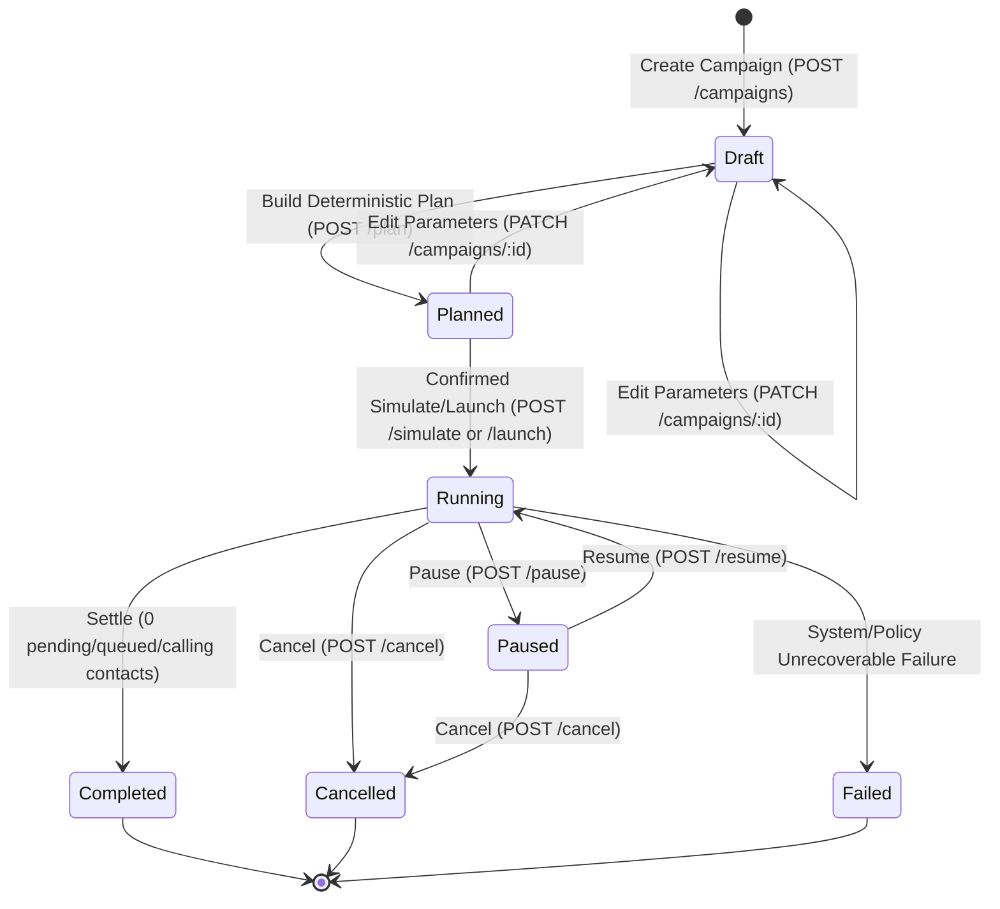

# Gate A: Comprehensive Backend Integration Audit

**Date:** 2026-10-26  
**Synthesized by:** Lead System & Integration Architect  
**Audited Sources:**
- `docs/flutter-ui/backend-audit/api-contracts.md` (Agent A)
- `docs/flutter-ui/backend-audit/domain-workflows.md` (Agent B)
- `docs/flutter-ui/backend-audit/sarvam-capabilities.md` (Agent C)
- `docs/flutter-ui/backend-audit/security-and-events.md` (Agent D)
- `docs/flutter-ui/backend-audit/dev-and-testing.md` (Agent E)
- Backend code: `apps/api/src/*`, `apps/worker/src/*`, `packages/*`, `docs/api/openapi.json`.

---

## 1. Existing Backend Capabilities & Code Entry Points

The backend is a production-grade, multi-tenant, mock-first campaign execution platform built with NestJS, Drizzle ORM (PostgreSQL), Redis (BullMQ), and Express.

### 1.1 Architecture & Services

```
┌────────────────────────────────────────────────────────────────────────┐
│                        Flutter Client (Dart/Dio)                       │
│             [Cookie: outreach_session=<token>, Idempotency-Key]        │
└───────────────────────────────────┬────────────────────────────────────┘
                                    │ HTTP / SSE (/api/v1)
                                    ▼
┌────────────────────────────────────────────────────────────────────────┐
│                     apps/api (NestJS 11.2.8, Port 3000)                │
│  - Controllers: Auth, Workspace, Agents, Imports, Campaigns, Public   │
│  - Middleware: verifyOrigin, SessionGuard, ResponseContractInterceptor │
│  - Database Pool: PostgreSQL 17 (Port 5442)                            │
│  - Transactional Outbox: Writes to `outbox` table                      │
└──────────────────┬─────────────────────────────────┬───────────────────┘
                   │ SQL (Pool)                      │ Publishes Outbox
                   ▼                                 ▼
┌───────────────────────────────────┐ ┌──────────────────────────────────┐
│       PostgreSQL 17 (Drizzle)     │ │   apps/worker (BullMQ, Port 3001)│
│  - 21 Tables                      │ │  - Queues: imports, calls,       │
│  - Bigint monotonic event identity│ │    analysis, reports, outbox     │
│  - Advisory Locks (Concurrency)   │ │  - Telephony / Mock Providers    │
│  - Bytea artifacts (reports/files)│ │  - Sarvam AI Chat Completions    │
└───────────────────────────────────┘ └──────────────────────────────────┘
```

### 1.2 Code Entry Points

- **API Process Bootstrap:** [`apps/api/src/main.ts`](file:///Users/kuroyami/CallingAgents/apps/api/src/main.ts) (Health probes, global validation filter, CORS/origin validation, port binding `0.0.0.0:3000`).
- **HTTP Routing & Controllers:** [`apps/api/src/controllers.ts`](file:///Users/kuroyami/CallingAgents/apps/api/src/controllers.ts) (45 endpoints).
- **Authentication & Authorization:** [`apps/api/src/auth.ts`](file:///Users/kuroyami/CallingAgents/apps/api/src/auth.ts) (`AuthService`, `SessionGuard`, `verifyOrigin`).
- **Campaign Execution & Planning:** [`apps/api/src/campaigns.ts`](file:///Users/kuroyami/CallingAgents/apps/api/src/campaigns.ts) (`CampaignsService`).
- **Persona & Agent Versioning:** [`apps/api/src/agents.ts`](file:///Users/kuroyami/CallingAgents/apps/api/src/agents.ts) (`AgentsService`).
- **Contact & File Imports:** [`apps/api/src/imports.ts`](file:///Users/kuroyami/CallingAgents/apps/api/src/imports.ts) (`ImportsService`).
- **Operations, Reports & Audit:** [`apps/api/src/operations.ts`](file:///Users/kuroyami/CallingAgents/apps/api/src/operations.ts) (`OperationsService`).
- **Real-Time SSE Streams:** [`apps/api/src/streams.ts`](file:///Users/kuroyami/CallingAgents/apps/api/src/streams.ts) (`StreamsService`).
- **Inbound Webhook Verification:** [`apps/api/src/webhooks.ts`](file:///Users/kuroyami/CallingAgents/apps/api/src/webhooks.ts) (`WebhooksService`).
- **Worker Queues & Dispatch:** [`apps/worker/src/main.ts`](file:///Users/kuroyami/CallingAgents/apps/worker/src/main.ts), [`apps/worker/src/calls.ts`](file:///Users/kuroyami/CallingAgents/apps/worker/src/calls.ts), [`apps/worker/src/imports.ts`](file:///Users/kuroyami/CallingAgents/apps/worker/src/imports.ts), [`apps/worker/src/reports.ts`](file:///Users/kuroyami/CallingAgents/apps/worker/src/reports.ts).

---

## 2. Verified Flutter-Facing API Contract Table

Every route is backed by concrete controller code, runtime Zod contracts (`ResponseContractInterceptor`), and OpenAPI 3.1 specifications (`docs/api/openapi.json`).

| Method | Endpoint | Auth & Guards | Request Body / Query | Success Response Schema | Status / Availability | Code Evidence |
| :--- | :--- | :--- | :--- | :--- | :--- | :--- |
| `POST` | `/api/v1/auth/demo` | Public (dev only) | `{ email: string, name?: string }` | `SessionIdentity` + sets `Set-Cookie: outreach_session` | 200 `verified` | `auth.ts#L58-L137` |
| `POST` | `/api/v1/auth/logout` | Public / Session | None | `{ signedOut: true }` + clears cookie | 200 `verified` | `auth.ts#L161-L170` |
| `GET` | `/api/v1/me` | `SessionGuard` | None | `SessionIdentity` (`userId, workspaceId, role, email, name`) | 200 `verified` | `operations.ts#L24-L35` |
| `GET` | `/api/v1/overview` | `SessionGuard` | None | `{ simulation: Aggregates, live: Aggregates }` | 200 `verified` | `operations.ts#L36-L55` |
| `GET` | `/api/v1/integrations` | `SessionGuard` | None | `{ ready: bool, provider: string, voice: {...}, model: {...}, telephony: {...} }` | 200 `verified` | `operations.ts#L56-L95` |
| `GET` | `/api/v1/settings` | `SessionGuard` | None | Workspace settings object | 200 `verified` | `operations.ts#L185-L195` |
| `PATCH`| `/api/v1/settings` | `SessionGuard` + `requireWrite` | `{ name?, timezone?, settings? }` | Updated Workspace | 200 `verified` | `operations.ts#L196-L215` |
| `GET` | `/api/v1/audit` | `SessionGuard` | `?limit=20&cursor=0` | `{ items: AuditLogItem[], nextCursor }` | 200 `verified` | `operations.ts#L216-L235` |
| `GET` | `/api/v1/agents` | `SessionGuard` | `?limit=50&cursor=0` | `{ items: AgentWithVersion[], nextCursor }` | 200 `verified` | `agents.ts#L22-L40` |
| `POST` | `/api/v1/agents` | `SessionGuard` + `requireWrite` | `{ name, description, instructions, language?, questions? }` | `AgentWithVersion` | 201 `verified` | `agents.ts#L41-L61` |
| `GET` | `/api/v1/agents/:id` | `SessionGuard` | None | `AgentWithVersion` | 200 `verified` | `agents.ts#L62-L80` |
| `PATCH`| `/api/v1/agents/:id`| `SessionGuard` + `requireWrite` | `{ name?, description?, instructions?, language?, questions? }` | `AgentWithVersion` (new version appended) | 200 `verified` | `agents.ts#L81-L120` |
| `GET` | `/api/v1/agents/:id/versions` | `SessionGuard` | None | `AgentVersion[]` | 200 `verified` | `agents.ts#L121-L135` |
| `POST` | `/api/v1/agents/:id/sandbox` | `SessionGuard` | None | Synthetic preview turn (`{ role, text }`) | 200 `verified` | `agents.ts#L136-L150` |
| `GET` | `/api/v1/imports` | `SessionGuard` | `?limit=50&cursor=0` | `{ items: ImportRecord[], nextCursor }` | 200 `verified` | `imports.ts#L25-L42` |
| `POST` | `/api/v1/imports` | `SessionGuard` + `requireWrite` | `{ filename, contentBase64, mapping, region?, synthetic? }` | `ImportRecord` (`status: "validating"`) | 202 `verified` | `imports.ts#L43-L64` |
| `GET` | `/api/v1/imports/:id` | `SessionGuard` | None | `ImportRecord` | 200 `verified` | `imports.ts#L65-L80` |
| `GET` | `/api/v1/imports/:id/rows` | `SessionGuard` | `?limit=50&cursor=0&status=invalid` | `{ items: ImportRow[], nextCursor }` | 200 `verified` | `imports.ts#L81-L110` |
| `POST` | `/api/v1/imports/:id/validate` | `SessionGuard` + `requireWrite` | `{ mapping?, region?, corrections? }` | `ImportRecord` | 202 `verified` | `imports.ts#L111-L135` |
| `GET` | `/api/v1/contacts` | `SessionGuard` | `?limit=50&cursor=0` | `{ items: Contact[], nextCursor }` | 200 `verified` | `imports.ts#L136-L155` |
| `POST` | `/api/v1/contacts/:id/suppress` | `SessionGuard` + `requireWrite` | `{ reason: string }` | `{ phone, reason, suppressed: true }` | 200 `verified` | `imports.ts#L156-L175` |
| `GET` | `/api/v1/campaigns` | `SessionGuard` | `?limit=50&cursor=0` | `{ items: CampaignListItem[], nextCursor }` | 200 `verified` | `campaigns.ts#L30-L55` |
| `POST` | `/api/v1/campaigns` | `SessionGuard` + `requireWrite` | `{ name, objective, mode, agentVersionId, importId, policy }` | `CampaignDetail` (`status: "draft"`) | 201 `verified` | `campaigns.ts#L56-L105` |
| `GET` | `/api/v1/campaigns/:id` | `SessionGuard` | None | `CampaignDetail` | 200 `verified` | `campaigns.ts#L106-L125` |
| `PATCH`| `/api/v1/campaigns/:id`| `SessionGuard` + `requireWrite` | Editable fields (only if `draft` or `planned`) | `CampaignDetail` (resets to `draft`) | 200 `verified` | `campaigns.ts#L228-L248` |
| `DELETE`| `/api/v1/campaigns/:id`| `SessionGuard` + `requireWrite`| None | `{ cancelled: true }` | 200 `verified` | `campaigns.ts#L299-L304` |
| `POST` | `/api/v1/campaigns/:id/plan` | `SessionGuard` + `requireWrite` | None | `CampaignDetail` (`status: "planned"`, plan populated) | 200 `verified` | `campaigns.ts#L126-L180` |
| `POST` | `/api/v1/campaigns/:id/simulate` | `SessionGuard` + `requireWrite` + `Idempotency-Key` | `{ confirmed: true }` | `CampaignDetail` (`status: "running"`) | 200 `verified` | `campaigns.ts#L181-L227` |
| `POST` | `/api/v1/campaigns/:id/launch` | `SessionGuard` + `requireWrite` + `Idempotency-Key` | `{ confirmed: true }` | `CampaignDetail` (`status: "running"`) | 200 `verified` | `campaigns.ts#L181-L227` |
| `POST` | `/api/v1/campaigns/:id/pause` | `SessionGuard` + `requireWrite` | None | `CampaignDetail` (`status: "paused"`) | 200 `verified` | `campaigns.ts#L249-L270` |
| `POST` | `/api/v1/campaigns/:id/resume` | `SessionGuard` + `requireWrite` | None | `CampaignDetail` (`status: "running"`) | 200 `verified` | `campaigns.ts#L271-L290` |
| `POST` | `/api/v1/campaigns/:id/cancel` | `SessionGuard` + `requireWrite` | None | `CampaignDetail` (`status: "cancelled"`) | 200 `verified` | `campaigns.ts#L291-L304` |
| `GET` | `/api/v1/campaigns/:id/contacts` | `SessionGuard` | `?limit=50&cursor=0` | `{ items: CampaignContactItem[], nextCursor }` | 200 `verified` | `campaigns.ts#L305-L330` |
| `GET` | `/api/v1/campaigns/:id/attempts` | `SessionGuard` | `?limit=50&cursor=0` | `{ items: CallAttemptItem[], nextCursor }` | 200 `verified` | `campaigns.ts#L331-L355` |
| `GET` | `/api/v1/calls/:id` | `SessionGuard` | None | `CallDetail` (attempt, analysis, transcript turns) | 200 `verified` | `campaigns.ts#L356-L390` |
| `GET` | `/api/v1/campaigns/:id/events` | `SessionGuard` | `?after=0&limit=50` | `{ items: CampaignEvent[], nextCursor }` | 200 `verified` | `operations.ts#L240-L265` |
| `GET` | `/api/v1/campaigns/:id/stream` | `SessionGuard` | `?after=0` or `Last-Event-ID` | SSE stream (`text/event-stream`, 15s heartbeat) | 200 `verified` | `controllers.ts#L116-L175` |
| `GET` | `/api/v1/events` | `SessionGuard` | `?after=0&limit=50` | `{ items: WorkspaceEvent[], nextCursor }` | 200 `verified` | `operations.ts#L266-L285` |
| `GET` | `/api/v1/reports` | `SessionGuard` | `?limit=50&cursor=0` | `{ items: ReportItem[], nextCursor }` | 200 `verified` | `operations.ts#L96-L115` |
| `POST` | `/api/v1/campaigns/:id/reports` | `SessionGuard` + `requireWrite` + `Idempotency-Key` | `{ format: "csv" \| "xlsx" }` | `ReportItem` (`status: "pending"`) | 202 `verified` | `operations.ts#L116-L155` |
| `GET` | `/api/v1/reports/:id/download` | `SessionGuard` + `requireWrite` | None | Binary file stream (`application/octet-stream` or `text/csv`) | 200 `verified` | `operations.ts#L156-L184` |

---

## 3. Verified Domain & State-Transition Map



### 3.1 Sub-Lifecycles & Invariants

1. **Campaign Contact Lifecycle:**  
   `pending` $\rightarrow$ `queued` $\rightarrow$ `calling` $\rightarrow$ `completed` | `excluded` (suppression/consent) | `cancelled`.  
   *Invariant:* In-flight calls are not forcibly aborted when pausing or cancelling; `activeCallsMayContinue = true`. The campaign settles to `completed` or `cancelled` only when all active dispatches terminate.
2. **Call Attempt Outcome Lifecycle:**  
   `created` $\rightarrow$ `dispatching` $\rightarrow$ `accepted` $\rightarrow$ `connected` | `no_answer` | `busy` | `failed` | `unknown`.  
   *Invariant:* Outcome `unknown` (caused by ambiguous provider timeouts) retains its concurrency slot and is NEVER redialed automatically to prevent harassment.
3. **Import Lifecycle:**  
   `uploaded` $\rightarrow$ `validating` $\rightarrow$ `ready` (if 0 blocking invalid rows) | `needs_correction` (if $\ge 1$ invalid rows).  
   *Invariant:* An import referenced by an existing campaign cannot be edited or re-validated (`409 Conflict: IMPORT_IN_USE`).
4. **Analysis Lifecycle:**  
   `pending` $\rightarrow$ `processing` $\rightarrow$ `completed` | `failed`.  
   *Invariant:* Transcripts and analysis are scrubbed after `RETENTION_DAYS` (30 days default).

---

## 4. Agent / Persona / Sarvam Agent / Voice Feature Matrix

| Capability | Backend Support | Provider Support | Evidence & Status | UI Representation Rule |
| :--- | :--- | :--- | :--- | :--- |
| **Outreach Intern Persona** | Fully supported in DB (`agents`, `agent_versions`) | Local application level | `verified` (`schema.ts#L74-L110`) | Display as selectable Outreach Persona; editable instructions/questions. |
| **Sarvam Agent ID (`app_id`)** | Single server config (`SARVAM_APP_ID`) | Server environment level | `verified` (`voice-provider/src/index.ts#L128`) | Read from `/integrations`; show as fixed server-configured agent ID. |
| **Committed Agent Version** | Pinned server config (`SARVAM_APP_VERSION`) | Sarvam Dashboard level | `verified` (`index.ts#L129`) | Display committed version tag (e.g. `v1`). |
| **Voice / Speaker Listing API** | None | Public API lacks catalog endpoint | `missing` (`sarvam-capabilities.md`) | **DO NOT show fake voice catalog or picker.** Display configured voice status from `/integrations`. |
| **Audio Voice Preview API** | None | No public audio preview endpoint | `missing` (`sarvam-capabilities.md`) | **DO NOT render dead audio player.** State that voice is previewable in Sarvam Dashboard. |
| **Agent Sandbox Turn** | Text simulation turn | Local Mock Provider | `verified` (`agents.ts#L136-L150`) | Offer text-based persona sandbox preview without audio playback. |
| **Telephony Connection** | Managed by server | Pre-configured in Sarvam | `verified` (`index.ts#L130`) | Display caller ID and connection status from `/integrations`. |
| **Cost Pulse Tracking** | Usage ledger in DB | ₹3.50/min pulse estimates | `verified` (`schema.ts#L522-L547`) | Display cost reservation disclaimer (estimates, not live bank billing). |

---

## 5. Real-Time Event Strategy & Reconnection Semantics

1. **Transport Protocol:**  
   Server-Sent Events (SSE) via `GET /api/v1/campaigns/:id/stream`.
2. **Reconnection & Cursor Resumption:**  
   - Event IDs are 64-bit monotonically increasing integers (`bigint`).
   - The Flutter client must pass `Last-Event-ID: <id>` header or `?after=<id>` query parameter upon reconnect.
   - The backend checks for events matching `id > cursor` every 750ms and flushes events with `id: <id>\ndata: <json>\n\n`.
3. **Heartbeat & Disconnect Protection:**  
   - Emits `: heartbeat\n\n` every 15 seconds to prevent mobile cellular/Wi-Fi socket timeout.
   - Re-authenticates the session identity every 30 seconds.
4. **Shutdown & Reconnect Signals:**  
   - Graceful server shutdown emits `event: reconnect\ndata: {"reason":"server_shutdown"}\n\n`.
   - Dependency failure emits `event: reconnect\ndata: {"reason":"dependency_unavailable"}\n\n`.
5. **Fallback Polling:**  
   - REST polling endpoint `GET /api/v1/campaigns/:id/events?after=<id>&limit=50` is available if SSE is blocked by client network middleboxes.

---

## 6. Prioritized Backend Gap List

| Priority | Feature / Gap | Impact on Flutter UI | Classification | Resolution / Workaround |
| :--- | :--- | :--- | :--- | :--- |
| **P1** | **Cookie vs Bearer Header Auth** | Native mobile network clients typically use `Authorization: Bearer <token>` rather than cookies. | *Can work around safely* | Use `dio_cookie_manager` with `cookie_jar` or inject `Cookie: outreach_session=<token>` header via a Dio interceptor. Backend change optional; cookie header is fully functional. |
| **P2** | **Voice Catalog Listing Endpoint** | UI cannot dynamically list Sarvam voices (e.g. Meera, Bulbul). | *Missing Provider Capability* | Truth-telling UI: Show configured agent metadata from `/integrations` and explain that voice customization is governed in the Sarvam Dashboard. |
| **P2** | **Voice Audio Sample Preview** | UI cannot play an audio snippet of the voice. | *Missing Provider Capability* | Offer text-based persona sandbox (`POST /agents/:id/sandbox`). Do not invent synthetic MP3s or fake players. |
| **P3** | **Active Call Disconnect / Telephony Termination** | Pausing/cancelling a campaign does not terminate an active PSTN phone call in Sarvam. | *Documented Limitation* | Accurately badge UI: "Pausing (Calls active)" and display clear disclaimer that in-flight calls finish naturally. |

---

## 7. Contract Discrepancies & Resolutions

1. **File Upload Format:**  
   *Discrepancy:* Generic expectations assumed `multipart/form-data`.  
   *Verified Reality:* `POST /api/v1/imports` accepts JSON Base64 `{ filename, contentBase64, mapping, region, synthetic }`. Flutter client will read file bytes and Base64 encode into JSON.
2. **Idempotency Header:**  
   *Discrepancy:* Some REST frameworks use `X-Idempotency-Key`.  
   *Verified Reality:* Backend strictly validates `Idempotency-Key` (8–128 alphanumeric characters) on `/simulate`, `/launch`, and `/reports`.
3. **Origin & CSRF:**  
   *Discrepancy:* Web browsers enforce Origin; native mobile HTTP clients do not have browser Origin.  
   *Verified Reality:* In `apps/api/src/auth.ts`, native requests without an `Origin` header pass `verifyOrigin` safely.

---

## 8. Questions & Assumptions (Evidence Register)

| Topic | Assessment | Label | Source Evidence |
| :--- | :--- | :--- | :--- |
| Live calls trigger real phone dial | Gated behind strict environment flags, consent, allowlist, and deliberate confirmation | `verified` | `packages/voice-provider/src/index.ts#L120-L125` |
| Simulation places real calls | Never; purely synthetic via SHA-256 hash | `verified` | `packages/voice-provider/src/index.ts#L30-L70` |
| In-app live voice mic stream | Not supported or required; calls are outbound PSTN | `verified` | `ADR-004-sarvam-live-boundary.md` |
| Voice selection dropdown | No public Sarvam API exists to enumerate voices | `missing` | `docs/flutter-ui/backend-audit/sarvam-capabilities.md` |
| Demo workspace auto-seeding | Auto-seeds 5 starter personas upon first login | `verified` | `apps/api/src/auth.ts#L95`, `packages/database/src/personas.ts` |

---

## 9. Recommended Integration Approach

1. **Target Architecture:** Scaffold clean feature-first Flutter package in `apps/flutter_app`.
2. **Network Layer:** Use `dio` configured with:
   - Base URL configurable per platform (`http://localhost:3000` for desktop/iOS simulator, `http://10.0.2.2:3000` for Android emulator).
   - `Cookie` header injector / persistent cookie jar holding `outreach_session`.
   - `Idempotency-Key` auto-generator for mutation endpoints.
   - Normalized `ApiException` mapper translating `{ error: { code, message, details } }`.
3. **State Management:** `flutter_riverpod` with structured Notifiers and AsyncValue states.
4. **Real-Time Layer:** SSE stream subscriber via standard HTTP chunked stream with automatic backoff reconnection and `Last-Event-ID` tracking.
5. **Truth-Telling UI:** Honor all backend facts: text-only sandbox, clear simulation vs live badges, explicit launch confirmation dialogs, and clear disclaimers regarding Sarvam dashboard voice configuration.

**Gate A Status:** **APPROVED**. Proceed to Phase 2 (UX / Design Research).
