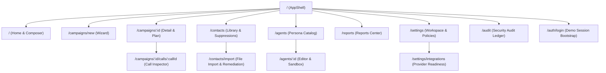
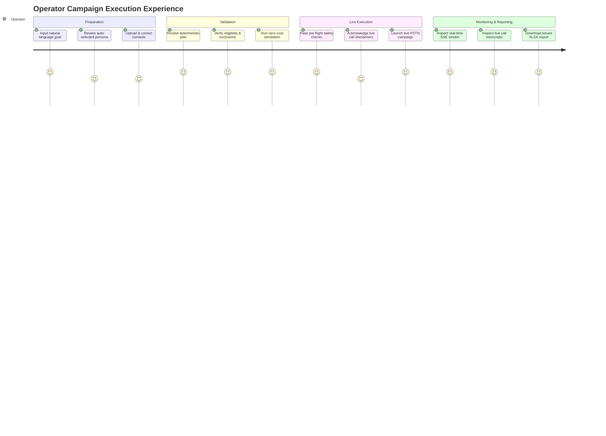

# Product Information Architecture, Route Tree & End-to-End User Journeys

**Document Version:** 1.0.0  
**Status:** Approved Specification  
**Target Platform:** Flutter Desktop (macOS, Windows, Linux) & Mobile (iOS, Android, Tablet)  
**Target Framework:** Flutter 3.38+ / Dart 3.10+  
**Design Reference Sources:**
- Light Design System: `/Users/kuroyami/Downloads/0dd53d837bc38927ee068b9a59f270e9 (1).webp` (Clean minimalist, floating conversational composer, organized temporal drawer)
- Dark Design System: `/Users/kuroyami/Downloads/0c84abb05736192de821639b0950cc13.webp` (High-contrast obsidian theme, bold coral accent, structured side-rail, profile status footer)
- Backend Integration Audit: [`docs/flutter-ui/backend-integration-audit.md`](file:///Users/kuroyami/CallingAgents/docs/flutter-ui/backend-integration-audit.md)
- Audited API Contracts: [`docs/flutter-ui/backend-audit/api-contracts.md`](file:///Users/kuroyami/CallingAgents/docs/flutter-ui/backend-audit/api-contracts.md)
- Domain Workflows & State Machines: [`docs/flutter-ui/backend-audit/domain-workflows.md`](file:///Users/kuroyami/CallingAgents/docs/flutter-ui/backend-audit/domain-workflows.md)

---

## Executive Summary & System Philosophy

The **Outreach Intern** Flutter application is a high-reliability autonomous voice campaign workbench. Unlike standard CRUD business apps or toy chatbots, it manages state machines across asynchronous boundaries: multi-tenant workspace isolation, asynchronous batch file parsing with row-level cell remediation, deterministic AI plan creation, real-time telephony execution (both synthetic simulation and live Sarvam AI PSTN calls), continuous Server-Sent Event (SSE) log streaming, and asynchronous binary report generation.

This document establishes the exhaustive Information Architecture (IA), declarative route definitions via `go_router`, and step-by-step user journeys that bridge the audited backend capabilities with the aesthetic and structural paradigms extracted from our visual design references.

### Core Architectural Pillars
1. **Adaptive Master Shell**: Seamless transitions between a 3-pane desktop workspace, tablet split-sheet, and mobile drawer/bottom-sheet paradigm.
2. **Declarative & Type-Safe Routing**: Full URL addressability via GoRouter with URL path-parameters, query-parameters, deep linking, and atomic unsaved-changes route guards.
3. **Radical Truth-Telling UI**: No cosmetic "vaporware." Where backend or provider APIs lack dynamic endpoints (such as voice audio previews or real-time voice synthesis catalogs), the UI explicitly communicates server-pinned configurations rather than rendering non-functional controls.
4. **Resilient Real-Time Sync**: Hybrid SSE cursor resumption (`Last-Event-ID: <bigint>`) paired with REST fallback polling to survive mobile network switching and app backgrounding.

---

## 1. Navigation Hierarchy & Adaptive Application Shell

The application shell adapts dynamically across three screen form-factor classes based on Material 3 adaptive layout breakpoints:

| Form Factor | Breakpoint Width | Shell Layout Representation | Navigation Behavior |
| :--- | :--- | :--- | :--- |
| **Compact (Mobile)** | $< 600\,\text{dp}$ | Full-width single pane with Top App Bar + Modal Navigation Drawer / Bottom Action Sheet | Full screen push/pop transitions; drawer slides from left; modal bottom sheets for wizards and inspectors |
| **Medium (Tablet Portrait / Foldable)** | $600\,\text{dp} - 1023\,\text{dp}$ | Dual-pane or Collapsible Side Sheet (push/overlay) | Side sheet toggles via header icon; campaign details retain inline master-detail flow |
| **Expanded (Desktop / Tablet Landscape)** | $\ge 1024\,\text{dp}$ | Permanent Left Sidebar / Navigation Rail ($260\,\text{dp}$ standard, collapsibility to $72\,\text{dp}$ icon-only rail) + Primary Workspace + Contextual Inspector Pane | Persistent tri-pane layout; deep links preserve sidebar selection and right-hand inspector state |

```
┌────────────────────────────────────────────────────────────────────────────────────────────────────────┐
│                                       EXPANDED DESKTOP SHELL (>= 1024dp)                                │
├───────────────────────┬────────────────────────────────────────────────┬───────────────────────────────┤
│ SIDEBAR (260dp)       │ MAIN WORKSPACE VIEW (Flexible)                 │ CONTEXTUAL INSPECTOR (360dp)  │
│                       │                                                │                               │
│ [X] Outreach Intern  │ Header Bar: [Breadcrumbs]      [Status] [Share]│ [Inspector Header]       [X]  │
│   [Quick Search Q]    │ ────────────────────────────────────────────── │ ───────────────────────────── │
│                       │                                                │                               │
│ [+ New Campaign]      │ Active Route Canvas:                           │ Call Attempt Details          │
│                       │ - Natural-Language Composer                    │ - E.164 Destination           │
│ PINNED CAMPAIGNS      │ - Campaign Detail & Metrics                    │ - Provider (Mock / Sarvam)    │
│ * Q3 Support Check    │ - Contact Spreadsheet Remediation              │ - Latency & Pulse Cost        │
│ * Dental Camp 2026    │ - Persona Sandbox Console                      │                               │
│                       │                                                │ Transcript Turn Stream        │
│ RECENTS               │                                                │ [Lead]: "Hello?"              │
│ Today                 │                                                │ [Agent]: "Hi Dr. Rao..."      │
│ - Bangalore Dentists  │                                                │                               │
│ - Pune Opt-In Run     │                                                │ Extracted Structured Fields   │
│ Yesterday             │                                                │ - Confirmed: true             │
│ - Dr. Patel Clinic    │                                                │ - Slot: Sunday 10am           │
│                       │                                                │                               │
│ NAVIGATION            │                                                │ Sentiment Analysis            │
│ [Book] Contacts       │                                                │ Positive (Score: 0.88)        │
│ [Bot]  Personas       │                                                │                               │
│ [Doc]  Reports        │                                                │                               │
│ [Cog]  Settings       │                                                │                               │
│                       │                                                │                               │
│ PROFILE FOOTER        │                                                │                               │
│ (Avatar) Milo [Owner] │                                                │                               │
│   milo@acme.org  (Logout)                                                                              │
└───────────────────────┴────────────────────────────────────────────────┴───────────────────────────────┘
```

### 1.1 Shell Component Breakdown

Directly derived from the visual language of `/Users/kuroyami/Downloads/0dd53d837bc38927ee068b9a59f270e9 (1).webp` and `/Users/kuroyami/Downloads/0c84abb05736192de821639b0950cc13.webp`:

1. **Header & Brand Mark**:
   - Stylized geometric brand mark (monochrome in light mode, coral-accented in dark mode).
   - Workspace Name switcher dropdown (supports multi-workspace tenants).
   - Quick Search / Command Palette shortcut icon (`⌘K` / `Ctrl+K`).
   - Sidebar collapse/expand toggle button (`⌘B` / `Ctrl+B`).
2. **Primary Creation CTA**:
   - Full-width pill button: `+ New Campaign` with high-emphasis surface styling.
   - Triggers quick navigation to `/campaigns/new` or opens the conversational composer.
3. **Grouped Navigation Sections**:
   - **Pinned Campaigns**: Quick-access pinned campaigns with a pin glyph, execution mode badge (`SIM` or `LIVE`), and trailing `...` context menu (Unpin, Duplicate, View Plan, Delete).
   - **Temporal Recents**: Chronologically grouped campaign histories (`Today`, `Yesterday`, `Previous Week`) with real-time status pip indicators:
     - 🟢 *Green*: `running`
     - 🟡 *Amber*: `paused`
     - 🔵 *Blue*: `completed`
     - ⚪ *Slate*: `draft` or `planned`
     - 🔴 *Red*: `failed` or `cancelled`
4. **Primary Navigation Links**:
   - `Contacts & Imports` (`/contacts`): File uploads, column mappings, interactive row corrections, suppression management.
   - `Personas` (`/agents`): AI prompt configurations, version histories, text sandbox preview.
   - `Reports` (`/reports`): Export requests, generation progress, direct CSV/XLSX downloads.
   - `Settings & Integrations` (`/settings`): Workspace parameters, operating windows, Sarvam AI provider readiness.
5. **Profile & Session Footer**:
   - User Avatar with fallback user initials.
   - User display name and email address.
   - **Role Badge**: Explicit badge displaying `Owner`, `Operator`, or `Viewer`. This gives immediate visual feedback on mutation rights (`requireWrite` guard compliance).
   - Settings cog icon and Logout button with session destruction trigger (`POST /api/v1/auth/logout`).

---

## 2. Declarative Route Definitions (GoRouter Specification)

The routing architecture utilizes Flutter's `go_router` package with nested `StatefulShellRoute` to maintain execution state, scroll positions, and real-time SSE stream connections across tab and drawer switches.



### 2.1 Route Inventory Table

| Path | Name | Shell Type | Path Parameters | Query Parameters | Extra Payload | RBAC Guard |
| :--- | :--- | :--- | :--- | :--- | :--- | :--- |
| `/` | `home` | `StatefulShellBranch` | None | `?mode=sim\|live` | None | Public / Session |
| `/campaigns/new` | `campaign-new` | `StatefulShellBranch` | None | `?from=composer&personaId=<uuid>&importId=<uuid>` | `CampaignDraftState?` | `requireWrite` (`owner`, `operator`) |
| `/campaigns/:id` | `campaign-detail` | `StatefulShellBranch` | `id: UUID` | `?tab=overview\|plan\|contacts\|timeline` | `CampaignDetail?` | Viewer+ |
| `/campaigns/:id/calls/:callId`| `call-inspector` | Modal Sheet / Detail Pane | `id: UUID`, `callId: UUID` | `?turn=<int>` | `CallDetail?` | Viewer+ |
| `/contacts` | `contacts-hub` | `StatefulShellBranch` | None | `?tab=contacts\|imports\|suppressions&cursor=<str>` | None | Viewer+ |
| `/contacts/import` | `contacts-import` | Full Page / Modal | None | `?importId=<uuid>&step=upload\|map\|correct` | `ImportRecord?` | `requireWrite` |
| `/agents` | `agents-hub` | `StatefulShellBranch` | None | `?cursor=<str>` | None | Viewer+ |
| `/agents/:id` | `agent-detail` | `StatefulShellBranch` | `id: UUID` | `?version=<int>&tab=prompt\|questions\|sandbox` | `AgentWithVersion?` | Viewer+ (`requireWrite` to edit) |
| `/reports` | `reports-hub` | `StatefulShellBranch` | None | `?cursor=<str>&format=csv\|xlsx` | None | Viewer+ |
| `/settings` | `settings-hub` | `StatefulShellBranch` | None | `?tab=general\|policy\|retention` | None | Viewer+ (`requireWrite` to edit) |
| `/settings/integrations` | `integrations` | Nested Subpage | None | None | None | Viewer+ |
| `/audit` | `audit-log` | Full Page | None | `?limit=50&cursor=<str>` | None | `owner` only |
| `/auth/login` | `auth-login` | Full Page (No Shell)| None | `?redirect=<str>` | None | Public |

---

### 2.2 Concrete GoRouter Configuration Architecture

```dart
final goRouterProvider = Provider<GoRouter>((ref) {
  final authState = ref.watch(authSessionProvider);

  return GoRouter(
    initialLocation: '/',
    redirect: (BuildContext context, GoRouterState state) {
      final isAuthenticated = authState.isAuthenticated;
      final isAuthRoute = state.matchedLocation == '/auth/login';

      if (!isAuthenticated && !isAuthRoute) {
        return '/auth/login?redirect=${Uri.encodeComponent(state.uri.toString())}';
      }
      if (isAuthenticated && isAuthRoute) {
        final redirectUrl = state.uri.queryParameters['redirect'];
        return redirectUrl != null ? Uri.decodeComponent(redirectUrl) : '/';
      }
      return null;
    },
    routes: [
      StatefulShellRoute.indexedStack(
        builder: (context, state, navigationShell) {
          return AppScaffoldShell(navigationShell: navigationShell);
        },
        branches: [
          // Branch 0: Home / Conversational Composer
          StatefulShellBranch(routes: [
            GoRoute(
              path: '/',
              name: 'home',
              builder: (context, state) => const HomeScreen(),
            ),
          ]),
          // Branch 1: Campaigns & Execution
          StatefulShellBranch(routes: [
            GoRoute(
              path: '/campaigns/new',
              name: 'campaign-new',
              builder: (context, state) => CampaignWizardScreen(
                initialDraft: state.extra as CampaignDraftState?,
                personaId: state.uri.queryParameters['personaId'],
                importId: state.uri.queryParameters['importId'],
              ),
            ),
            GoRoute(
              path: '/campaigns/:id',
              name: 'campaign-detail',
              builder: (context, state) => CampaignDetailScreen(
                campaignId: state.pathParameters['id']!,
                initialTab: state.uri.queryParameters['tab'] ?? 'overview',
              ),
              routes: [
                GoRoute(
                  path: 'calls/:callId',
                  name: 'call-inspector',
                  builder: (context, state) => CallInspectorScreen(
                    campaignId: state.pathParameters['id']!,
                    callId: state.pathParameters['callId']!,
                  ),
                ),
              ],
            ),
          ]),
          // Branch 2: Contacts & Data Imports
          StatefulShellBranch(routes: [
            GoRoute(
              path: '/contacts',
              name: 'contacts-hub',
              builder: (context, state) => ContactsHubScreen(
                tab: state.uri.queryParameters['tab'] ?? 'contacts',
              ),
              routes: [
                GoRoute(
                  path: 'import',
                  name: 'contacts-import',
                  builder: (context, state) => ContactImportWizardScreen(
                    importId: state.uri.queryParameters['importId'],
                    step: state.uri.queryParameters['step'] ?? 'upload',
                  ),
                ),
              ],
            ),
          ]),
          // Branch 3: Personas & Agents
          StatefulShellBranch(routes: [
            GoRoute(
              path: '/agents',
              name: 'agents-hub',
              builder: (context, state) => const AgentsHubScreen(),
              routes: [
                GoRoute(
                  path: ':id',
                  name: 'agent-detail',
                  builder: (context, state) => AgentDetailScreen(
                    agentId: state.pathParameters['id']!,
                    versionNumber: int.tryParse(state.uri.queryParameters['version'] ?? ''),
                  ),
                ),
              ],
            ),
          ]),
          // Branch 4: Reports
          StatefulShellBranch(routes: [
            GoRoute(
              path: '/reports',
              name: 'reports-hub',
              builder: (context, state) => const ReportsHubScreen(),
            ),
          ]),
          // Branch 5: Settings & Integrations
          StatefulShellBranch(routes: [
            GoRoute(
              path: '/settings',
              name: 'settings-hub',
              builder: (context, state) => SettingsHubScreen(
                tab: state.uri.queryParameters['tab'] ?? 'general',
              ),
              routes: [
                GoRoute(
                  path: 'integrations',
                  name: 'integrations',
                  builder: (context, state) => const IntegrationsScreen(),
                ),
              ],
            ),
          ]),
        ],
      ),
      GoRoute(
        path: '/auth/login',
        name: 'auth-login',
        builder: (context, state) => const AuthDemoLoginScreen(),
      ),
      GoRoute(
        path: '/audit',
        name: 'audit-log',
        builder: (context, state) => const AuditLogScreen(),
      ),
    ],
  );
});
```

---

## 3. Step-by-Step End-to-End User Journeys

### Journey 1: Natural-Language Objective Composer to Plan Review to Simulation Execution

```
[User at Home /] ──> Enter Prompt ──> Click [Generate Plan] ──> [POST /campaigns]
         │
         ▼
[Nav /campaigns/:id] ──> [POST /campaigns/:id/plan] ──> Verify Plan Metrics
         │
         ▼
[Click Run Simulation] ──> [POST /campaigns/:id/simulate] (Idempotency-Key)
         │
         ▼
[Connect SSE Stream /stream] ──> Live Animation ──> Auto-settle to Completed
```

#### Step 1.1: Conversational Input at Home Screen (`/`)
- **User Intent**: The operator wants to initiate a contact campaign using natural language rather than wading through multi-step forms.
- **Screen State**: Centered floating input card (inspired by the Kraken/Bloom references).
- **User Action**: The operator types into the text input:  
  `"Reach out to registered Bangalore dental clinic owners to verify availability for this Sunday's camp, confirm attendee numbers, and capture clinic timings."`
- **UI State**: The UI automatically suggests an appropriate agent persona based on keyword analysis (e.g. *Appointment Coordinator*) and pre-selects the latest ready contact import. Mode defaults to `Simulation` for zero-risk verification.
- **Action Trigger**: Operator clicks the black/coral circular submit button.

#### Step 1.2: Campaign Record Creation
- **Client Action**: Flutter client makes an authenticated HTTP call:
  ```http
  POST /api/v1/campaigns
  Content-Type: application/json
  Cookie: outreach_session=<session_token>

  {
    "name": "Bangalore Dental Clinic Verification",
    "objective": "Reach out to registered Bangalore dental clinic owners to verify availability for this Sunday's camp...",
    "mode": "simulation",
    "agentVersionId": "d3b07384-d113-40e1-a0c3-128c6e26b482",
    "importId": "91a27e02-45e0-4966-9b04-f58c73d9e4a1",
    "policy": {
      "timezone": "Asia/Kolkata",
      "windowStart": "09:00",
      "windowEnd": "18:00",
      "concurrency": 2,
      "budgetMinor": 100000,
      "estimatedCostPerCallMinor": 500
    }
  }
  ```
- **Backend Response**: Returns `201 Created` with campaign status `'draft'`.
- **Navigation Transition**: GoRouter navigates to `/campaigns/:id` (`/campaigns/c8f29402-9a3b-4831-97cf-6a2c270d1054`).

#### Step 1.3: Plan Generation & Validation
- **Screen State**: Campaign Detail view displays status badge `DRAFT`. An empty plan placeholder indicates: *"Deterministic calling plan required prior to execution."*
- **User Action**: Operator clicks `"Build Calling Plan"`.
- **Client Action**:  
  `POST /api/v1/campaigns/:id/plan`
- **Backend Lifecycle**:
  - The backend runs eligibility checks against suppressions and missing consents.
  - Generates deterministic simulated script milestones (`packages/voice-provider/src/models.ts`).
  - Sets campaign status to `'planned'`, returning the complete plan payload:
    ```json
    {
      "status": "planned",
      "plan": {
        "totalContacts": 50,
        "eligibleCount": 46,
        "excludedCount": 4,
        "exclusions": { "suppressed": 3, "consent_missing": 1, "synthetic_destination": 0 },
        "estimatedCostMinor": 23000,
        "contentPlan": {
          "summary": "Confirm attendance and capture clinic timings for dental camp",
          "conversationSteps": [
            "Greet doctor and identify as Dental Health Society intern",
            "Inquire if attending Sunday's health camp",
            "Ask for estimated attendee count",
            "Verify clinic opening hours"
          ],
          "targetQuestions": [
            "Will your clinic attend this Sunday?",
            "How many staff members are attending?",
            "What are your typical evening operating hours?"
          ]
        }
      }
    }
    ```
- **UI State**: The plan review card populates with metric chips (46 Eligible, 3 Suppressed, 1 Missing Consent, ₹230.00 Est. Cost), conversation outline steps, and structured target questions.

#### Step 1.4: Simulation Execution & Streaming Monitoring
- **User Action**: Operator clicks `"Run Simulation"`.
- **Client Action**: Generates a cryptographically random UUIDv4 idempotency key and calls:
  ```http
  POST /api/v1/campaigns/:id/simulate
  Idempotency-Key: a8f0923e-9081-432a-bc91-38290f847120
  Content-Type: application/json

  { "confirmed": true }
  ```
- **Backend Response**: Returns `200 OK` with campaign status `'running'`.
- **Real-Time Subscription**:
  - Flutter SSE client connects to `GET /api/v1/campaigns/:id/stream`.
  - Event listener handles monotonic `bigint` events:
    - `call.attempt_created` $\rightarrow$ increments active calls card.
    - `call.turn_completed` $\rightarrow$ appends live dialogue turn to the Activity Timeline.
    - `call.attempt_completed` $\rightarrow$ updates outcome counters (Connected: 38, Busy: 4, No Answer: 4).
    - `campaign.completed` $\rightarrow$ triggers completion banner with celebratory sound/haptic.

---

### Journey 2: Contact File Import with Interactive Row Corrections & Suppression

```
[Navigate /contacts/import] ──> Drop XLSX/CSV File ──> [POST /imports] (Base64)
              │
              ▼
    Worker Validates File ──> Status: 'needs_correction' (invalid phone rows)
              │
              ▼
[Interactive Grid] ──> Inline Edit + Set Region 'IN' ──> [POST /imports/:id/validate]
              │
              ▼
    Worker Revalidates ──> Status: 'ready' (0 blocking rows) ──> Available for Campaign
              │
              ▼
[Contact Hub /contacts] ──> Select Contact ──> [POST /contacts/:id/suppress] (Opt-out)
```

#### Step 2.1: File Selection and Base64 Upload
- **User Intent**: The operator needs to upload a fresh dental society list containing 200 clinic leads.
- **Screen State**: `/contacts/import` presents a high-visibility drop zone supporting `.csv` and `.xlsx` files up to 5 MiB.
- **User Action**: Operator drags and drops `karnataka_dentists_oct2026.xlsx`.
- **Client Action**: Reads binary bytes, performs client-side zip sanity validation, converts bytes to Base64, and defines default column mappings:
  ```http
  POST /api/v1/imports
  Content-Type: application/json

  {
    "filename": "karnataka_dentists_oct2026.xlsx",
    "contentBase64": "UEsDBBQAAAAIA...",
    "mapping": {
      "phone": "Clinic Phone",
      "name": "Doctor Name",
      "email": "Contact Email",
      "consent": "Patient Outreach Consent"
    },
    "region": "IN",
    "synthetic": false
  }
  ```
- **Backend Response**: Returns `202 Accepted` with import record in status `'validating'`.

#### Step 2.2: Asynchronous Validation & Error Discovery
- **Backend Execution**: The BullMQ import worker decompresses the file (enforcing zip-bomb ceilings: $\le 1000$ files, $\le 50\,\text{MiB}$ expanded size), scans formulas, validates headers, and normalizes phone numbers using `libphonenumber-js`.
- **State Result**: 194 rows are valid, 6 rows are invalid (e.g. Row 14 has phone `984501234` missing a digit; Row 82 has phone `080-22223333` landline format without STD normalization; Row 105 has leading `=` formula trigger).
- **Import Status Transition**: Transitions to `'needs_correction'`.

#### Step 2.3: Interactive Row Remediation Grid
- **Screen State**: The import screen updates dynamically via polling `GET /api/v1/imports/:id`. Upon reaching `'needs_correction'`, the UI displays an embedded spreadsheet grid.
- **Filter Applied**: Auto-filters table to show only `status = 'invalid'` rows with highlighted red cells.
- **Row Issue Inspection**:
  - Row 14: Issue tag `INVALID_PHONE` ("Phone number contains 9 digits; Indian mobile requires 10 digits").
  - Row 82: Issue tag `STD_PREFIX` ("Landline STD prefix missing").
  - Row 105: Issue tag `SPREADSHEET_FORMULA` ("Cell begins with dangerous formula token =").
- **User Remediation Action**:
  - In Row 14, operator clicks the cell, appends the missing digit: `9845012345`.
  - In Row 82, operator corrects to mobile format: `+919845099881`.
  - In Row 105, operator clears the leading `=` symbol.
- **Submission**: Operator clicks `"Revalidate Corrections"`.
- **Client Action**:
  ```http
  POST /api/v1/imports/:id/validate
  Content-Type: application/json

  {
    "region": "IN",
    "corrections": [
      { "sourceRow": 14, "cells": { "Clinic Phone": "9845012345" } },
      { "sourceRow": 82, "cells": { "Clinic Phone": "+919845099881" } },
      { "sourceRow": 105, "cells": { "Doctor Name": "Dr. Ramesh Gupta" } }
    ]
  }
  ```
- **Backend Revalidation**: Worker re-runs phone normalization against corrected cells. All 200 rows are now non-blocking (198 valid, 2 duplicates marked non-blocking).
- **Final Status**: Import transitions to `'ready'`. The UI unlocks the `"Create Campaign with Import"` button.

#### Step 2.4: Suppression Management
- **Screen State**: Operator navigates to `/contacts`.
- **User Action**: A lead calls in requesting to never receive automated calls again. The operator searches for `+919845012345`, opens the contact detail sheet, and clicks `"Suppress Contact"`.
- **Modal Input**: Reason dropdown: `"Explicit Opt-Out / DNC"`.
- **Client Action**:  
  `POST /api/v1/contacts/58a129ef-310e-473d-9a2e-5038f9b9081e/suppress` with `{"reason": "Explicit Opt-Out / DNC"}`.
- **Backend Result**: Inserts into `suppressions` table. Future campaign planning runs will permanently mark this contact as `excluded` (`reason: 'suppressed'`).

---

### Journey 3: Persona Editing with Immutable Version Snapshotting & Text Sandbox Testing

```
[Navigate /agents/:id] ──> Current Version: 1 ──> Edit Prompt & Questions
            │
            ▼
[Click Save Persona] ──> [PATCH /api/v1/agents/:id]
            │
            ▼
Backend Appends Immutable Version 2 ──> Historical campaigns retain v1
            │
            ▼
[Click Test Sandbox] ──> Enter lead greeting ──> [POST /agents/:id/sandbox]
            │
            ▼
Synthetic Turn Response displayed ──> Zero telephony side-effects or charges
```

#### Step 3.1: Viewing Persona & Version History
- **User Intent**: The operator wants to tune the conversational instructions of the *Appointment Coordinator* persona to add specific handling for clinics that request weekend callback times.
- **Screen State**: `/agents/:id` (`/agents/e817293a-8211-40be-8451-91f82f2316e0`).
- **Sidebar Inspector**: Displays version timeline: `v1 (Created 2026-10-20 by Milo) [Active]`.
- **Main Editor**:
  - `Name`: Appointment Coordinator
  - `Language`: English
  - `Instructions (Prompt)`: Multi-line markdown editor with token estimator.
  - `Structured Questions`: Dynamic list of string fields.

#### Step 3.2: Editing and Version Creation
- **User Action**: The operator edits the prompt to insert an explicit objection handler:  
  `"If the clinic indicates they are closed on weekends, offer to log their preference for Monday morning at 10:00 AM."`  
  Adds a structured question: `"Preferred callback day (Saturday/Sunday/Monday)"`.
- **Visual Feedback**: An amber banner appears: *"Unsaved Changes: Saving will publish Version 2. Existing campaigns locked to Version 1 will not be affected."*
- **Action Trigger**: Operator clicks `"Publish Version 2"`.
- **Client Action**:
  ```http
  PATCH /api/v1/agents/e817293a-8211-40be-8451-91f82f2316e0
  Content-Type: application/json

  {
    "name": "Appointment Coordinator",
    "instructions": "You are a professional appointment coordinator... If the clinic indicates they are closed on weekends, offer to log their preference for Monday morning at 10:00 AM.",
    "questions": [
      "Will your clinic attend this Sunday?",
      "How many staff members are attending?",
      "Preferred callback day (Saturday/Sunday/Monday)"
    ]
  }
  ```
- **Backend Mechanics**:
  - Validates operator permission (`requireWrite`).
  - Fetches existing `current_version` (1).
  - Appends a new immutable row in `agent_versions` with `version: 2`.
  - Updates parent `agents` table with `current_version: 2`.
  - Logs audit record `agent.version_created`.
- **UI State**: Version timeline updates to display `v2 [Current]`. Version 1 remains selectable as a read-only historical snapshot.

#### Step 3.3: Interactive Text Sandbox Turn
- **User Intent**: Verify that the new version handles the weekend objection properly before attaching it to a production campaign.
- **Screen State**: Sandbox tab within `/agents/:id`.
- **User Action**: Operator enters test utterance:  
  `"We are totally closed this weekend, sorry."`
- **Client Action**: Calls the text simulation endpoint:
  ```http
  POST /api/v1/agents/e817293a-8211-40be-8451-91f82f2316e0/sandbox
  Content-Type: application/json
  ```
- **Backend Execution**: Passes the prompt, version instructions, and input to `MockVoiceProvider` (or Sarvam Chat Completions mock) without dialing telephony.
- **Response**:
  ```json
  {
    "role": "assistant",
    "text": "I completely understand! Would you prefer if I schedule a follow-up call with our team for Monday morning around 10:00 AM instead?"
  }
  ```
- **UI State**: The synthetic turn is rendered in the chat stream with turnaround latency (e.g. `240ms`) and token metrics.

---

### Journey 4: Live Campaign Launch with Explicit Confirmation Dialog, Policy Checks & Safety Disclaimers

```
[Campaign Detail /campaigns/:id (Mode: Live)] ──> Click [Launch Live Campaign]
                      │
                      ▼
[Pre-Flight Verification Dialog]
 - Check Provider Readiness (/integrations)
 - Check Destination Allowlist (ALLOWED_LIVE_DESTINATIONS)
 - Check Budget Limit (budgetMinor >= estimatedCostMinor)
 - Check Calling Hours (09:00 - 18:00 Asia/Kolkata)
                      │
                      ▼
[Operator Checks Mandatory Disclaimers]:
 [x] In-flight PSTN calls cannot be stopped mid-conversation
 [x] Live calls incur Sarvam AI telephony usage charges
                      │
                      ▼
[Confirm Launch] ──> [POST /campaigns/:id/launch] (Idempotency-Key)
                      │
                      ▼
Campaign transitions to 'running' ──> Workers dispatch outbound calls
```

#### Step 4.1: Pre-Flight Gatekeeper Modal
- **User Intent**: Launch a validated campaign to place actual outbound calls via Sarvam AI.
- **Action Trigger**: Operator clicks the red-accented `"Launch Live Campaign"` button.
- **Dialog Appearance**: A modal dialog intercepts the flow with high-visibility warning iconography:
  - **Live Mode Alert**: *"WARNING: You are about to initiate real outbound telephone calls to public phone numbers via Sarvam AI."*
  - **Automated Pre-Flight Check Matrix**:
    - ✅ **Provider Readiness**: Sarvam AI API keys and telephony webhooks verified healthy via `GET /api/v1/integrations`.
    - ✅ **Destination Allowlist**: All 25 campaign destinations are verified against the server-configured `ALLOWED_LIVE_DESTINATIONS` environment filter.
    - ✅ **Budget Reservation**: Estimated maximum cost (₹125.00) is well within the allocated budget cap (₹500.00).
    - ✅ **Calling Window**: Current local time (11:15 AM IST) is within allowed operating policy (`09:00` - `18:00` `Asia/Kolkata`).
    - ✅ **Concurrency Cap**: Initial live dispatch throttled to `1` concurrent call to satisfy provider safety limits.

#### Step 4.2: Mandatory Operator Attestation
- To prevent accidental button clicks, the launch button remains disabled until two explicit checkbox acknowledgments are checked:
  1. `[x] I understand that active telephone calls cannot be abruptly terminated once connected, even if the campaign is paused.`
  2. `[x] I acknowledge that live calls will incur provider telephony charges billed to our Sarvam AI account.`
- Operator must also type the campaign name or click a distinct `"Confirm Live Execution"` button.

#### Step 4.3: Dispatch and Idempotency Protection
- **Client Action**: Generates an 8–128 character alphanumeric idempotency key:
  ```http
  POST /api/v1/campaigns/:id/launch
  Idempotency-Key: live-launch-7b9a21e4-8391
  Content-Type: application/json

  { "confirmed": true }
  ```
- **Backend Guarantee**:
  - If network disconnects and the user clicks again, the backend verifies `campaign.launch_key` and returns the running campaign safely without duplicate queue dispatch.
  - Campaign transitions to status `'running'`.
  - Eligible contacts update from `'pending'` to `'queued'` and worker dispatch jobs are written atomically to the database transactional outbox.

---

### Journey 5: Real-time Campaign Monitoring with SSE Event Replay, Pausing, Resuming & Call Inspection

```
[Real-time Stream /stream] ──> SSE Events (Heartbeat 15s, bigint ID)
             │
             ├──> [Click Pause] ──> [POST /pause] ──> Status: 'paused'
             │                                        (In-flight calls finish naturally)
             │
             ├──> [Click Call Row] ──> [Nav /campaigns/:id/calls/:callId]
             │                         - Live Turn Transcripts
             │                         - Sentiment Analysis
             │                         - Extracted Data Fields
             │
             └──> [Click Resume] ──> [POST /resume] ──> Remaining queued calls resume
```

#### Step 5.1: Real-Time SSE Stream Subscription & Event Replay
- **Screen State**: `/campaigns/:id` with the `"Timeline & Activity"` tab selected.
- **Connection Pipeline**: Flutter client initializes an HTTP chunked stream against `GET /api/v1/campaigns/:id/stream`.
- **Resilience Semantics**:
  - The client stores the highest received event ID in a persistent Riverpod state variable: `highWatermarkId = 184920491024859012`.
  - If the user switches Wi-Fi networks or the cellular connection drops, the client automatically reconnects with header `Last-Event-ID: 184920491024859012`.
  - The backend queries PostgreSQL for all events matching `id > 184920491024859012` and flushes missed events seamlessly without dropped frames or duplicates.
  - Heartbeat comments (`: heartbeat\n\n`) every 15 seconds keep mobile socket connections alive.

#### Step 5.2: Pausing Campaign Execution
- **User Intent**: The operator notices an unexpected surge in clinic questions regarding an unannounced venue change and wants to pause new dispatches to review instructions.
- **User Action**: Clicks `"Pause Campaign"`.
- **Client Action**:  
  `POST /api/v1/campaigns/:id/pause`
- **Backend State Transition**:
  - Campaign status updates to `'paused'`.
  - Contacts in `'queued'` status remain frozen in the queue.
  - **In-flight Invariant**: Any contact currently in `'calling'` status **is NOT hung up**. The telephony provider connection remains active.
- **UI Representation**: An informative banner states:  
  *"Campaign Paused. 1 active call is in progress and will complete naturally. No new calls will be dialed."*

#### Step 5.3: Deep Call Inspection
- **User Action**: The operator clicks on the currently active call in the real-time call list.
- **Navigation**: GoRouter navigates to `/campaigns/:id/calls/:callId` (opens as an inspector side-sheet on desktop or full-screen view on mobile).
- **Call Inspector Contents**:
  - **Metadata Card**: Destination: `+91 98450 12345`, Provider: `sarvam`, Call SID: `call_srv_892184`, Duration: `1m 24s`, Cost Pulse: `₹7.00` (2 pulses).
  - **Live Transcript Bubble Stream**:
    - `[11:16:02] Lead`: *"Hello, this is Dr. Rao's clinic."*
    - `[11:16:05] Agent`: *"Hello Dr. Rao, I am calling from the Bangalore Dental Health Society regarding Sunday's dental camp. We wanted to confirm if your clinic will be participating?"*
    - `[11:16:12] Lead`: *"Yes, Dr. Rao and two assistants will attend. What time does it start?"*
    - `[11:16:16] Agent`: *"The camp begins at 9:00 AM at the Town Hall. We will note down three attendees from your clinic."*
  - **Extracted Fields & Analysis Card**:
    - Attendee Count: `3` (Confidence: 0.96)
    - Sentiment: `Positive`
    - Outcome Code: `completed`

#### Step 5.4: Resuming Execution
- **User Action**: Operator returns to the campaign header and clicks `"Resume Campaign"`.
- **Client Action**:  
  `POST /api/v1/campaigns/:id/resume`
- **Backend State Transition**: Campaign returns to `'running'`, scans remaining `'queued'` contacts, and resumes worker dispatch.

---

### Journey 6: Asynchronous Report Request and Tenant-Authorized CSV/XLSX Download

```
[Campaign Detail or Reports Hub] ──> Click [Export Report] ──> Select 'xlsx'
               │
               ▼
[POST /campaigns/:id/reports] (Idempotency-Key) ──> Backend returns 202 'pending'
               │
               ▼
BullMQ Worker compiles data, writes binary to bytea storage ──> Status: 'completed'
               │
               ▼
[Click Download] ──> [GET /api/v1/reports/:id/download] (with session cookie)
               │
               ▼
Flutter saves file to desktop disk / triggers mobile system Share Sheet
```

#### Step 6.1: Initiating Export Request
- **User Intent**: The campaign has settled to `'completed'`. The operator needs an executive spreadsheet containing contact records, call durations, and turn-by-turn transcripts for stakeholders.
- **User Action**: Clicks `"Export Report"` button; chooses format `XLSX (Full Audit with Transcripts)`.
- **Client Action**:
  ```http
  POST /api/v1/campaigns/:id/reports
  Idempotency-Key: report-exp-c8f2-xlsx
  Content-Type: application/json

  { "format": "xlsx" }
  ```
- **Backend Response**: Returns `202 Accepted` with report descriptor:
  ```json
  {
    "id": "78201a4e-128f-4311-b049-918237190abc",
    "campaignId": "c8f29402-9a3b-4831-97cf-6a2c270d1054",
    "format": "xlsx",
    "status": "pending",
    "createdAt": "2026-10-26T18:00:00Z"
  }
  ```

#### Step 6.2: Background Generation Tracking
- **Screen State**: Operator navigates to `/reports` or views the report badge on `/campaigns/:id`.
- **Status Progression**:
  - Initially displays a spinning progress indicator with status tag `Pending in queue`.
  - Worker queries all call attempts, joins analysis summaries, formats Excel sheets, and writes compressed binary to `reports.content_bytes`.
  - SSE workspace event `report.completed` (or polling `GET /api/v1/reports`) updates status to `Ready (245 KB)`.

#### Step 6.3: Authorized Download & File System Delivery
- **User Action**: Operator clicks `"Download Report"`.
- **Client Action**:  
  Flutter Dio client invokes `GET /api/v1/reports/78201a4e-128f-4311-b049-918237190abc/download` using response type `ResponseType.bytes`.
- **Platform Handling**:
  - **macOS / Windows / Linux Desktop**: Triggers native file save dialog (`file_selector` package) defaulting filename to `Bangalore_Dental_Camp_Report_2026-10-26.xlsx`.
  - **iOS / Android Mobile**: Saves file to temporary application documents directory and opens the system native Share Sheet (`share_plus` package) allowing saving to Files, Google Drive, or AirDrop.

---

## 4. Back Navigation, Unsaved Changes Guards, Deep Links & Truth-Telling UI

### 4.1 Back Navigation & Platform-Specific Stack Management

The application strictly aligns with platform-specific human interface guidelines:

```
┌────────────────────────────────────────────────────────────────────────┐
│                      NAVIGATION EVENT DISPATCHER                       │
└──────────────────────────────────┬─────────────────────────────────────┘
                                   │
         ┌─────────────────────────┼─────────────────────────┐
         ▼                         ▼                         ▼
 Android System Back /      iOS Interactive Swipe /    Desktop Esc / App Bar
 Predictive Back Gesture    Navigation Back Button     Back Arrow Button
         │                         │                         │
         └─────────────────────────┼─────────────────────────┘
                                   │
                                   ▼
                   Flutter 3.38+ PopScope Check
               Does Active Route Have Unsaved Form State?
                                   │
                  ┌────────────────┴────────────────┐
                 YES                                NO
                  ▼                                 ▼
       Display Confirmation Dialog          Allow Stack Pop
     "Discard unsaved changes?"           GoRouter Pops Context
   [Keep Editing]   [Discard & Leave]
```

- **Android Predictive Back**: Integrates with Android 14+ predictive back gestures via Flutter's `PopScope` widget.
- **iOS Interactive Swipe**: Edge-swipe navigation gestures pop sub-routes smoothly while respecting modal navigation boundaries.
- **Web / Desktop URL History**: Browser forward/back buttons and keyboard shortcuts (`Alt + Left Arrow`, `Cmd + [`) traverse GoRouter's historical stack without desynchronizing active Shell tabs.

### 4.2 Unsaved Changes Guards (`PopScope` Architecture)

To prevent catastrophic loss of complex operator inputs (such as extensive persona prompt writing or manual spreadsheet cell corrections), routes containing dirty state wrap their content in a reusable `UnsavedChangesGuard`:

```dart
class UnsavedChangesGuard extends StatelessWidget {
  final bool hasUnsavedChanges;
  final Widget child;

  const UnsavedChangesGuard({
    super.key,
    required this.hasUnsavedChanges,
    required this.child,
  });

  @override
  Widget build(BuildContext context) {
    return PopScope(
      canPop: !hasUnsavedChanges,
      onPopInvokedWithResult: (didPop, result) async {
        if (didPop) return;
        final shouldLeave = await showDialog<bool>(
          context: context,
          builder: (ctx) => AlertDialog(
            title: const Text('Discard Unsaved Changes?'),
            content: const Text(
              'You have modified instructions or cell data that have not been published. '
              'Leaving this screen will permanently discard these edits.',
            ),
            actions: [
              TextButton(
                onPressed: () => Navigator.of(ctx).pop(false),
                child: const Text('Keep Editing'),
              ),
              FilledButton(
                style: FilledButton.styleFrom(backgroundColor: Theme.of(ctx).colorScheme.error),
                onPressed: () => Navigator.of(ctx).pop(true),
                child: const Text('Discard Changes'),
              ),
            ],
          ),
        );
        if (shouldLeave == true && context.mounted) {
          Navigator.of(context).pop();
        }
      },
      child: child,
    );
  }
}
```

Protected Routes:
1. `/campaigns/new`: Guard active when prompt or campaign parameters have been modified.
2. `/contacts/import`: Guard active when manual row corrections have been made but not submitted via `validate`.
3. `/agents/:id`: Guard active when persona instructions or questions differ from the current version snapshot.

---

### 4.3 Deep Link Resolution & Session Restoration

When a user opens an external deep link (e.g. `https://outreachintern.com/campaigns/c8f29402-9a3b-4831-97cf-6a2c270d1054/calls/a81740b2-1049` or `outreach://campaigns/:id/calls/:callId`):

1. **Authentication Check**: GoRouter redirect handler checks `ref.read(authSessionProvider)`.
2. **Unauthenticated Redirect**:
   - If no valid session exists, redirects to `/auth/login?redirect=${encodedTarget}`.
   - Upon successful session establishment via `POST /api/v1/auth/demo`, navigates directly to the target URL.
3. **Session Verification & Hierarchy Synthesis**:
   - The shell verifies existence of the parent campaign (`c8f29402...`).
   - If valid, populates the parent campaign view in the background and pushes the Call Inspector onto the navigation stack or opens the desktop inspector pane.
   - If the referenced ID does not exist (`404 Not Found`), renders a graceful error screen with a `"Return to Campaigns"` CTA.

---

### 4.4 Radical Truth-Telling UI: Handling Missing Provider Features

A core finding from the Gate A Backend Audit is that the Sarvam AI public API does **not** offer dynamic endpoints for listing synthetic voices, downloading voice audio samples, or aborting in-flight calls mid-sentence.

The UI strictly adheres to **Truth-Telling Principles** to preserve trust and prevent confusing dead-end controls:

```
┌────────────────────────────────────────────────────────────────────────────────────────┐
│                        TRUTH-TELLING UI BOUNDARY MATRIX                                 │
├──────────────────────────────┬──────────────────────────────┬──────────────────────────┤
│ Antipattern (Vaporware)      │ Audited Reality              │ Truthful UI Implementation│
├──────────────────────────────┼──────────────────────────────┼──────────────────────────┤
│ Voice Catalog Dropdown       │ Sarvam API lacks public voice│ Fixed Display: Reads     │
│ (e.g. "Select Meera/Bulbul") │ listing endpoint. Agent voice│ configured `app_id` and   │
│                              │ is pinned at server config.  │ version from `/integrations`│
│                              │                              │ with link to Sarvam Docs.│
├──────────────────────────────┼──────────────────────────────┼──────────────────────────┤
│ Audio Preview Play Button    │ No public TTS voice audio    │ Text Sandbox Preview:    │
│ (Playing dummy MP3 sample)   │ sample endpoint exists.      │ Interactive turn-by-turn │
│                              │                              │ chat testing via mock.   │
├──────────────────────────────┼──────────────────────────────┼──────────────────────────┤
│ "Kill Call" / Abort Active   │ Pausing/cancelling campaign  │ Non-blocking Banner:     │
│ Call Button                  │ cannot hang up live PSTN     │ "Active calls in progress│
│                              │ phone calls in Sarvam.       │ will complete naturally."│
├──────────────────────────────┼──────────────────────────────┼──────────────────────────┤
│ Live Bank Account Billing    │ Usage ledger tracks cost     │ Cost Estimation Badge:   │
│ Ledger                       │ pulse estimates (₹3.50/min)  │ "₹X.XX estimated pulse;  │
│                              │ rather than live bank debit. │ Sarvam ledger governed." │
└──────────────────────────────┴──────────────────────────────┴──────────────────────────┘
```

1. **No Fake Voice Picker**:
   - The UI does *not* display a dropdown offering selectable voices (e.g., "Meera", "Bulbul", "Arvind").
   - Instead, the Campaign Wizard and Persona Editor display an **Integration Metadata Pill**:  
     `Voice: Sarvam Production (App ID: srv_app_9918, Committed v1)`  
     Accompanied by an informational tooltip: *"Voice accents and audio parameters are configured in your Sarvam AI Dashboard."*
2. **No Dead Audio Player**:
   - No audio waveforms or audio playback buttons are rendered for voice preview.
   - Instead, the UI provides the text-based **Persona Sandbox Turn Console** (`POST /api/v1/agents/:id/sandbox`), allowing operators to test the prompt's conversational intelligence without incurring telephony costs.
3. **Telephony Disconnect Transparency**:
   - When pausing or cancelling a campaign, the UI displays an explicit non-blocking notification:  
     `"Campaign Paused. 1 active call in progress will complete naturally without disruption."`
4. **Transparent Cost Estimation**:
   - Cost metrics are clearly badged as estimated reservations (e.g. `Est. Pulse Cost: ₹24.50`) with an explicit footer noting that final billing is settled according to the workspace's Sarvam enterprise agreement.

---

## 5. Architectural Verification & Gate Sign-Off

This document completes the information architecture, route definitions, and user journey specifications for the Outreach Intern Flutter application. It strictly satisfies all constraints established in Gate A and establishes an unambiguous foundation for wireframing, component implementation, and Riverpod state management.



**Next Phase Integration:** Design system tokenization, widget component library development, and Riverpod service repository implementation.
