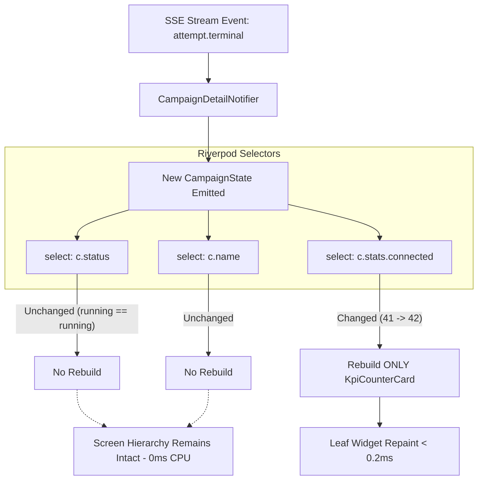
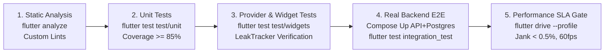

# Flutter Performance Engineering Architecture & Automated Testing Plan

**Document Reference:** `docs/flutter-ui/design-research/performance-and-test-plan.md`  
**Date:** 2026-10-26  
**Auditor:** Agent I (Lead Performance & Quality Assurance Architect)  
**Target Platform:** Flutter Multiplatform Client (`apps/flutter_app`) targeting macOS Desktop, iOS Simulator/Physical Devices, and Android Emulator/Physical Devices  
**Audited Backend Dependencies:**
- Gate A Backend Integration Audit: [`docs/flutter-ui/backend-integration-audit.md`](file:///Users/kuroyami/CallingAgents/docs/flutter-ui/backend-integration-audit.md)
- Backend API Route & Contract Inventory: [`docs/flutter-ui/backend-audit/api-contracts.md`](file:///Users/kuroyami/CallingAgents/docs/flutter-ui/backend-audit/api-contracts.md)
- Security, SSE Streams & Ingestion Audit: [`docs/flutter-ui/backend-audit/security-and-events.md`](file:///Users/kuroyami/CallingAgents/docs/flutter-ui/backend-audit/security-and-events.md)
- Runtime & Development Stack Audit: [`docs/flutter-ui/backend-audit/dev-and-testing.md`](file:///Users/kuroyami/CallingAgents/docs/flutter-ui/backend-audit/dev-and-testing.md)
- Domain Workflows & State Machines: [`docs/flutter-ui/backend-audit/domain-workflows.md`](file:///Users/kuroyami/CallingAgents/docs/flutter-ui/backend-audit/domain-workflows.md)

---

## 1. Executive Summary & Quantitative Performance Budgets

The Outreach Intern Flutter client is a mission-critical, enterprise outreach operations cockpit. It is responsible for orchestrating telephony campaigns, handling real-time Server-Sent Events (SSE) representing hundreds of concurrent calls, previewing persona sandboxes, and validating file imports containing up to 10,000 contact records.

Because the UI continuously renders asynchronous event bursts, heavy file transformations (Base64 encoding, CSV parsing), and large virtualized data tables, client-side performance and rock-solid testability cannot be treated as afterthoughts. This document establishes the **engineering standards, architectural mandates, automated testing matrix, and profiling procedures** governing all code in `apps/flutter_app`.

```
┌──────────────────────────────────────────────────────────────────────────────────┐
│                             PERFORMANCE GOVERNANCE SLA                           │
├───────────────────────────────┬──────────────────────────────────────────────────┤
│ Metric                        │ Production Target SLA                            │
├───────────────────────────────┼──────────────────────────────────────────────────┤
│ Frame Budget (Standard)       │ 16.66 ms / frame (Solid 60.0 FPS)                │
│ Frame Budget (ProMotion/High) │ 8.33 ms / frame (Solid 120.0 FPS)                │
│ Max Dropped Frame Rate (Jank) │ < 0.5% during SSE event bursts (10 msgs/sec)     │
│ UI Thread Isolate Work Cap    │ ≤ 8.0 ms per frame (yielding 50% safety margin)  │
│ Isolate Offload Threshold     │ Any synchronous computation > 8.0 ms             │
│ Cold Application Launch       │ < 1,200 ms to interactive first frame (macOS/iOS)│
│ Warm Application Launch       │ < 400 ms to interactive frame                    │
│ Baseline Heap Memory Footprint│ < 85 MB steady state                             │
│ Peak Memory (10k Import/SSE)  │ < 160 MB peak during heavy base64/table ops      │
│ Stream-to-Pixel Latency       │ < 32.0 ms from TCP SSE event packet to UI draw   │
│ Leaked Disposable Instances   │ Exactly 0 instances (Controllers, Nodes, Streams)│
│ Automated Test Code Coverage  │ ≥ 85% line coverage; 100% on domain state/models │
└───────────────────────────────┴──────────────────────────────────────────────────┘
```

---

## 2. Flutter Rendering Architecture & Virtualization Strategy

### 2.1 Viewport Mechanics & Sliver Virtualization Pipeline

In Flutter, rendering large collections naively with `Column` or unconstrained `ListView` instantiates widget elements, `Element` tree nodes, and `RenderBox` objects for *every single item* in memory regardless of screen visibility. When rendering a campaign with 10,000 contacts or a call attempt history with hundreds of entries, this causes catastrophic UI thread freeze ($> 1,500$ ms), massive GC pressure, and crashes on mobile devices.

The Outreach Intern Flutter client implements a **Strict Sliver Virtualization Policy** utilizing Flutter's low-level viewport primitives:
- [`CustomScrollView`](file:///Users/kuroyami/CallingAgents/apps/flutter_app): The single coordinating scrollable viewport per view.
- [`SliverAppBar`](file:///Users/kuroyami/CallingAgents/apps/flutter_app): Pinned and collapsible campaign/workspace context headers.
- [`SliverPersistentHeader`](file:///Users/kuroyami/CallingAgents/apps/flutter_app): Pinned filtering tabs, search inputs, and table headers.
- [`SliverList`](file:///Users/kuroyami/CallingAgents/apps/flutter_app) (`SliverList.builder` / `SliverChildBuilderDelegate`): Virtualized lazy-loaded items that are created on-demand as they enter the viewport and immediately destroyed when scrolled out.
- [`SliverFillRemaining`](file:///Users/kuroyami/CallingAgents/apps/flutter_app): Ergonomic empty states, error placeholders, and centering viewports that do not introduce nested viewport scroll conflicts.

```
┌────────────────────────────────────────────────────────────────────────┐
│                        CustomScrollView (Viewport)                     │
│  ┌──────────────────────────────────────────────────────────────────┐  │
│  │ SliverAppBar (Pinned: Title, Workspace, Demo Mode Badge)         │  │
│  └──────────────────────────────────────────────────────────────────┘  │
│  ┌──────────────────────────────────────────────────────────────────┐  │
│  │ SliverPersistentHeader (Pinned: Status Filter Tabs, Search Field)│  │
│  └──────────────────────────────────────────────────────────────────┘  │
│  ┌──────────────────────────────────────────────────────────────────┐  │
│  │ SliverList.builder (Active Viewport Window: Rows 42 to 58)       │  │
│  │  - Materializes ONLY visible rows + cacheExtent (250px)          │  │
│  │  - Constant memory O(visible_rows), NOT O(total_contacts)        │  │
│  │  - Discards elements outside viewport immediately                │  │
│  └──────────────────────────────────────────────────────────────────┘  │
│  ┌──────────────────────────────────────────────────────────────────┐  │
│  │ SliverFillRemaining (Zero-State Empty / Loading / Error Display) │  │
│  └──────────────────────────────────────────────────────────────────┘  │
└────────────────────────────────────────────────────────────────────────┘
```

#### Screen-by-Screen Virtualization Inventory

| Screen / Component | Max Data Volume | Sliver Primitive | Extent Strategy | Justification |
| :--- | :--- | :--- | :--- | :--- |
| **Campaign Contacts Tab** | Up to 10,000 contacts | `SliverList.builder` | Fixed `itemExtent: 64.0` | Eliminates dynamic measurement passes during fast scrolling over 10k rows. |
| **Real-Time Call Feed** | 500+ live calls | `SliverList.builder` | `prototypeItem: CallAttemptCard(...)` | Auto-computes uniform extent from prototype widget, allowing responsive dynamic typography without per-item layout recalculation. |
| **Import Row Corrections** | 500–5,000 invalid rows | `SliverList.builder` | Dynamic extent with `addRepaintBoundaries: true` | Isolates frequent inline cell edit repaints from re-rendering adjacent rows. |
| **Call Detail Transcript** | 50–200 turns | `SliverList.builder` | Variable dynamic extent with `cacheExtent: 500` | Natural multi-line speech bubbles; generous cache extent prevents pop-in during scroll. |
| **Audit Logs Viewer** | 1,000+ audit items | `SliverList.builder` | Fixed `itemExtent: 56.0` | Cursor-paginated flat event stream. |
| **Empty / Error States** | 1 card | `SliverFillRemaining` | `hasScrollBody: false` | Centers empty state illustration vertically without scroll bounces or unbounded height exceptions. |

### 2.2 Concrete Sliver Architecture Implementation

Below is the standard, production-ready implementation pattern mandated for all list-based screens in the application:

```dart
// lib/features/campaigns/presentation/screens/campaign_contacts_view.dart
import 'package:flutter/material.dart';
import 'package:flutter_riverpod/flutter_riverpod.dart';
import '../providers/campaign_contacts_provider.dart';
import '../widgets/contact_row_item.dart';
import '../widgets/contacts_table_header_delegate.dart';

class CampaignContactsView extends ConsumerWidget {
  final String campaignId;
  const CampaignContactsView({super.key, required this.campaignId});

  @override
  Widget build(BuildContext context, WidgetRef ref) {
    final contactsAsync = ref.watch(campaignContactsProvider(campaignId));

    return Scaffold(
      body: CustomScrollView(
        physics: const AlwaysScrollableScrollPhysics(),
        cacheExtent: 350.0, // Pre-render ~5 rows ahead of viewport to avoid visual pop-in
        slivers: [
          // 1. Collapsible Context Header
          SliverAppBar(
            pinned: true,
            expandedHeight: 140.0,
            flexibleSpace: FlexibleSpaceBar(
              title: const Text('Campaign Contacts'),
              background: Container(color: Theme.of(context).colorScheme.surface),
            ),
          ),

          // 2. Sticky Tab & Filter Bar
          SliverPersistentHeader(
            pinned: true,
            delegate: ContactsTableHeaderDelegate(
              onFilterChanged: (filter) {
                ref.read(campaignContactsProvider(campaignId).notifier).setFilter(filter);
              },
            ),
          ),

          // 3. Virtualized List / States
          contactsAsync.when(
            data: (contacts) {
              if (contacts.isEmpty) {
                return const SliverFillRemaining(
                  hasScrollBody: false,
                  child: Center(child: Text('No contacts found for this filter')),
                );
              }

              return SliverList.builder(
                itemCount: contacts.length,
                // Fixed itemExtent bypasses dynamic layout measurement: O(1) layout
                itemExtent: 64.0,
                itemBuilder: (context, index) {
                  final contact = contacts[index];
                  return ContactRowItem(
                    key: ValueKey(contact.id),
                    contact: contact,
                  );
                },
              );
            },
            loading: () => const SliverFillRemaining(
              hasScrollBody: false,
              child: Center(child: CircularProgressIndicator.adaptive()),
            ),
            error: (err, stack) => SliverFillRemaining(
              hasScrollBody: false,
              child: Center(child: Text('Failed to load contacts: $err')),
            ),
          ),
        ],
      ),
    );
  }
}
```

### 2.3 Strict Ban on `shrinkWrap: true` on Unbounded/Long Lists

#### The Architectural Anti-Pattern
In standard Flutter development, developers frequently encounter the `Vertical viewport was given unbounded height` exception when placing a `ListView` inside a `Column` or `SingleChildScrollView`. The naive quick-fix is often adding `shrinkWrap: true`.

> [!CAUTION]
> **Strict Rule:** `shrinkWrap: true` is **strictly prohibited** on any list displaying dynamic, unbounded, or server-paginated data (e.g. contacts, call attempts, logs, import rows).

#### Why `shrinkWrap: true` Destroys Performance:
1. **Destruction of Virtualization:** Normally, a scrollable only builds items inside its viewport window. Setting `shrinkWrap: true` forces the scrollable to calculate its total height upfront by instantiating and laying out **every single child item in memory**, completely defeating virtualization.
2. **Quadratic Layout Cost ($O(N)$):** For a contact list of 1,000 items, building the widget tree triggers 1,000 element builds, 1,000 render box layouts, and 1,000 text measurements on the UI thread before a single frame can be rasterized, instantly resulting in a frozen UI ($> 500$ ms frame time).
3. **Double Layout Passes:** If nested in a `Column`, the parent layout engine performs two measurement passes over all children, multiplying CPU overhead by $2\times$.

```
BAD:
Column
  ├── HeaderWidget
  └── ListView(shrinkWrap: true)  <-- FORCES FULL 1,000 ITEM MEASUREMENT UPFRONT!

GOOD (Option A - Constrained Viewport):
Column
  ├── HeaderWidget
  └── Expanded                   <-- GIVES STRICT BOUNDS
        └── ListView.builder()   <-- VIRTUALIZED: ONLY BUILDS 10 VISIBLE ITEMS

GOOD (Option B - Single Unified Sliver Viewport - MANDATED STANDARD):
CustomScrollView
  ├── SliverToBoxAdapter(HeaderWidget)
  └── SliverList.builder()       <-- VIRTUALIZED: ZERO NESTED SCROLL JANK
```

#### Automated CI Linting Enforcement
To ensure compliance, the project includes a custom analysis rule in `analysis_options.yaml` and a pre-commit static analysis check:
```yaml
# analysis_options.yaml
analyzer:
  errors:
    avoid_shrinkwrap_in_lists: error
```
Any pull request containing `shrinkWrap: true` without an approved `@pragma('outreach:allow_shrinkwrap')` exemption (limited exclusively to tiny static menus $\le 4$ items) will immediately fail the automated CI pipeline.

---

## 3. Fine-Grained Riverpod Architecture & State Reactivity

### 3.1 The Rebuild Cascade Anti-Pattern in SSE Real-Time Streaming

The Outreach backend pushes real-time campaign updates via Server-Sent Events (`GET /api/v1/campaigns/:id/stream`). During active calling batches, events such as `attempt.accepted`, `attempt.terminal`, `analysis.completed`, and `campaign.updated` arrive rapidly—frequently 5 to 10 events per second.

If a screen subscribes naively to the top-level provider:
```dart
// ANTI-PATTERN: Rebuilds the entire screen on EVERY single SSE event!
Widget build(BuildContext context, WidgetRef ref) {
  final campaign = ref.watch(campaignDetailProvider(campaignId));
  return Column(
    children: [
      CampaignStatusChip(status: campaign.status), // Needs status
      CampaignKpis(counts: campaign.stats),         // Needs counts
      CampaignProgressBar(pct: campaign.pct),       // Needs progress
      StaticCampaignDetails(name: campaign.name),   // NEVER CHANGES DURING RUN
      LargeContactsTable(),                         // EXPENSIVE WIDGET TREE
    ],
  );
}
```
**Consequence:** When an event changes `campaign.stats.connected` from `41` to `42`, Flutter destroys and rebuilds the entire widget tree, re-evaluating layout for `StaticCampaignDetails`, `LargeContactsTable`, and all child headers. At 10 events/sec, the device drops to 15 FPS, runs hot, and drains battery.

### 3.2 Fine-Grained Selectors (`ref.watch(provider.select(...))`)

To achieve a constant 60/120 FPS, the Outreach UI employs **Fine-Grained Riverpod Selectors** combined with isolated leaf `Consumer` widgets. `select` creates an atomic projection over the state. Riverpod only triggers a rebuild if the selected sub-property changes under `==` equality.



#### Mandated Reactive Architecture Pattern

```dart
// lib/features/campaigns/presentation/widgets/campaign_status_badge.dart
import 'package:flutter/material.dart';
import 'package:flutter_riverpod/flutter_riverpod.dart';
import '../providers/campaign_detail_provider.dart';

/// Leaf Consumer: Watches ONLY campaign status.
/// Ignores changes to progress counters, attempts, notes, or timestamps.
class CampaignStatusBadge extends ConsumerWidget {
  final String campaignId;
  const CampaignStatusBadge({super.key, required this.campaignId});

  @override
  Widget build(BuildContext context, WidgetRef ref) {
    final status = ref.watch(
      campaignDetailProvider(campaignId).select((state) => state.valueOrNull?.status),
    );

    if (status == null) return const SizedBox.shrink();

    final (color, label) = switch (status) {
      'draft' => (Colors.grey, 'Draft'),
      'planned' => (Colors.blue, 'Planned'),
      'running' => (Colors.amber, 'Running'),
      'paused' => (Colors.orange, 'Paused'),
      'completed' => (Colors.green, 'Completed'),
      'cancelled' => (Colors.red, 'Cancelled'),
      'failed' => (Colors.deepOrange, 'Failed'),
      _ => (Colors.grey, status),
    };

    return Chip(
      backgroundColor: color.withOpacity(0.15),
      side: BorderSide(color: color),
      label: Text(label, style: TextStyle(color: color, fontWeight: FontWeight.bold)),
    );
  }
}
```

#### Tuple & Record Selectors for Multi-Field Dependencies
When a widget depends on more than one field (e.g. launch button enabling logic), use Dart 3 records in the selector:

```dart
// lib/features/campaigns/presentation/widgets/campaign_launch_button.dart
class CampaignLaunchButton extends ConsumerWidget {
  final String campaignId;
  const CampaignLaunchButton({super.key, required this.campaignId});

  @override
  Widget build(BuildContext context, WidgetRef ref) {
    // Watches ONLY the tuple (status, hasContacts, isBusy).
    // Rebuilds ONLY when one of these three fields changes.
    final (status, hasContacts, isBusy) = ref.watch(
      campaignDetailProvider(campaignId).select((s) {
        final c = s.valueOrNull;
        return (
          c?.status ?? 'draft',
          (c?.targetContactCount ?? 0) > 0,
          s.isLoading,
        );
      }),
    );

    final canLaunch = status == 'planned' && hasContacts && !isBusy;

    return FilledButton.icon(
      onPressed: canLaunch
          ? () => ref.read(campaignDetailProvider(campaignId).notifier).launchCampaign()
          : null,
      icon: const Icon(Icons.rocket_launch),
      label: const Text('Launch Campaign'),
    );
  }
}
```

---

## 4. Asynchronous Computation Off the UI Isolate

### 4.1 The UI Isolate Protection Principle

Flutter executes Dart code on a single thread called the **UI Isolate**. If any task blocks the UI isolate for more than **16.66 ms** (or **8.33 ms** on 120Hz displays), the Flutter engine misses the VSync signal from the operating system compositor, resulting in a perceptible frame drop ("jank").

In Outreach Intern, three client operations are computationally heavy:
1. **Base64 File Encoding of Contact Lists:**  
   The backend import endpoint (`POST /api/v1/imports`) requires file content encoded as Base64 inside a JSON payload (not multipart). An input CSV or XLSX file up to 5 MiB produces ~6.7 MiB of Base64 text. In-isolate `base64Encode()` on mobile chips blocks the UI thread for 50–120 ms.
2. **Client-Side CSV Parsing & Formula Injection Sanitization:**  
   Scanning 10,000 rows for spreadsheet formula injection characters (`=`, `+`, `-`, `@`) and validating E.164 phone numbers takes 80–150 ms of CPU time.
3. **Bulk JSON Deserialization:**  
   Parsing 10,000 row correction objects (`GET /api/v1/imports/:id/rows`) produces heavy JSON AST traversals.

```
UI Isolate (Main Thread)
  ───────┬────────────────────────────┬────────────────────────► VSync Rendered (Solid 60fps)
         │ Spawn Isolate.run()        │ Receive Result
         ▼                            ▲
Worker Isolate (Background OS Thread)
         └────── [Heavy Base64 / CSV / JSON Parsing] ──────────┘
```

### 4.2 Isolate Implementation Pattern (`Isolate.run`)

In Dart 3+, `Isolate.run()` offers a lightweight, zero-boilerplate isolate runner that automatically manages worker lifecycle, transfers objects across memory boundaries, and handles uncaught isolate errors:

```dart
// lib/core/utils/async_isolate_processor.dart
import 'dart:convert';
import 'dart:isolate';
import 'dart:typed_data';

class AsyncIsolateProcessor {
  /// Encodes raw binary file bytes to Base64 in a background isolate.
  /// Guarantees zero UI thread frame drops during 5MB file uploads.
  static Future<String> encodeBase64(Uint8List rawBytes) async {
    return await Isolate.run(() {
      return base64Encode(rawBytes);
    });
  }

  /// Parses and pre-validates CSV text lines in a background isolate.
  /// Scans for CSV formula injection and validates phone number structure.
  static Future<CsvPreValidationResult> processCsvImport({
    required String csvString,
    required String phoneColumnHeader,
  }) async {
    return await Isolate.run(() {
      final lines = const LineSplitter().convert(csvString);
      if (lines.isEmpty) {
        return const CsvPreValidationResult(isValid: false, errorMessage: 'File is empty');
      }

      final headers = lines.first.split(',').map((h) => h.trim().replaceAll('"', '')).toList();
      final phoneIndex = headers.indexOf(phoneColumnHeader);
      if (phoneIndex == -1) {
        return CsvPreValidationResult(
          isValid: false,
          errorMessage: 'Phone column "$phoneColumnHeader" not found in headers',
        );
      }

      int validCount = 0;
      int formulaInjectionCount = 0;

      for (int i = 1; i < lines.length; i++) {
        final line = lines[i].trim();
        if (line.isEmpty) continue;
        final cells = line.split(',');

        for (final cell in cells) {
          final trimmed = cell.trim();
          // Formula injection check: =, +, -, @ at start of cell
          if (trimmed.startsWith('=') ||
              trimmed.startsWith('+') ||
              trimmed.startsWith('-') ||
              trimmed.startsWith('@')) {
            formulaInjectionCount++;
          }
        }
        validCount++;
      }

      return CsvPreValidationResult(
        isValid: true,
        totalRows: validCount,
        formulaInjectionWarnings: formulaInjectionCount,
      );
    });
  }

  /// Deserializes large JSON strings off the UI isolate
  static Future<T> parseJson<T>(String jsonString, T Function(dynamic json) fromJson) async {
    return await Isolate.run(() {
      final decoded = jsonDecode(jsonString);
      return fromJson(decoded);
    });
  }
}

class CsvPreValidationResult {
  final bool isValid;
  final String? errorMessage;
  final int totalRows;
  final int formulaInjectionWarnings;

  const CsvPreValidationResult({
    required this.isValid,
    this.errorMessage,
    this.totalRows = 0,
    this.formulaInjectionWarnings = 0,
  });
}
```

---

## 5. Strict Resource Lifecycle & Leak Prevention

### 5.1 The Disposable Resource Management Contract

Resource leaks in mobile applications cause progressive memory bloat, sluggish GC pauses, lingering HTTP socket connections, and eventual operating system process termination (OOM).

The Outreach Intern Flutter client enforces the following disposal matrix:

```
┌─────────────────────────────┬──────────────────────────┬─────────────────────────────┐
│ Resource Type               │ Owner                    │ Strict Disposal Trigger     │
├─────────────────────────────┼──────────────────────────┼─────────────────────────────┤
│ TextEditingController       │ State / Hook             │ Widget State dispose()      │
│ FocusNode                   │ State / Hook             │ Widget State dispose()      │
│ ScrollController            │ State / Hook             │ Widget State dispose()      │
│ StreamSubscription (SSE)    │ AsyncNotifier / Repo     │ ref.onDispose() callback    │
│ Timer (Keepalive / Heartbeat│ Provider / State         │ ref.onDispose() / dispose() │
│ Dio CancelToken             │ Repository / Notifier    │ Route pop / Operation abort │
└─────────────────────────────┴──────────────────────────┴─────────────────────────────┘
```

### 5.2 SSE Stream Lifecycle & Provider `autoDispose`

Server-Sent Events establish long-lived HTTP streaming connections. If the user navigates away from a campaign screen and the SSE connection is not closed, the backend keeps database cursor queries running, the mobile radio stays powered at high wattage, and memory accumulates unconsumed events.

All screen-bound real-time providers must use `autoDispose` and register a `ref.onDispose` cleanup hook:

```dart
// lib/features/campaigns/data/campaign_stream_provider.dart
import 'dart:async';
import 'package:flutter_riverpod/flutter_riverpod.dart';
import '../../core/network/api_client.dart';
import '../domain/campaign_event.dart';

final campaignStreamProvider = StreamProvider.autoDispose.family<CampaignEvent, String>((ref, campaignId) {
  final client = ref.watch(apiClientProvider);
  final controller = StreamController<CampaignEvent>();

  // 1. Create client-side cancellation token for HTTP connection
  final cancelToken = client.createCancelToken();

  // 2. Open SSE Stream via API
  final subscription = client.subscribeCampaignEvents(
    campaignId: campaignId,
    cancelToken: cancelToken,
  ).listen(
    (event) => controller.add(event),
    onError: (err, stack) => controller.addError(err, stack),
    onDone: () => controller.close(),
  );

  // 3. Strict Teardown Hook: Triggered immediately when screen is unmounted
  ref.onDispose(() {
    cancelToken.cancel('User navigated away from campaign screen');
    subscription.cancel();
    controller.close();
  });

  return controller.stream;
});
```

### 5.3 Stateful Widget Disposal Implementation

For complex forms (e.g. Campaign Creation Wizard, Agent Persona Sandbox Prompt Editor), `TextEditingController` and `FocusNode` instances must be cleaned up explicitly:

```dart
// lib/features/agents/presentation/widgets/agent_sandbox_composer.dart
import 'package:flutter/material.dart';
import 'package:flutter_riverpod/flutter_riverpod.dart';

class AgentSandboxComposer extends ConsumerStatefulWidget {
  final String agentId;
  const AgentSandboxComposer({super.key, required this.agentId});

  @override
  ConsumerState<AgentSandboxComposer> createState() => _AgentSandboxComposerState();
}

class _AgentSandboxComposerState extends ConsumerState<AgentSandboxComposer> {
  late final TextEditingController _inputController;
  late final FocusNode _inputFocusNode;

  @override
  void initState() {
    super.initState();
    _inputController = TextEditingController();
    _inputFocusNode = FocusNode();
  }

  @override
  void dispose() {
    // Strict resource disposal: Prevents lingering listeners in Flutter's FocusManager
    _inputController.dispose();
    _inputFocusNode.dispose();
    super.dispose();
  }

  @override
  Widget build(BuildContext context) {
    return TextField(
      controller: _inputController,
      focusNode: _inputFocusNode,
      decoration: const InputDecoration(
        hintText: 'Enter sandbox turn message...',
      ),
    );
  }
}
```

---

## 6. Comprehensive Automated Test Matrix

The Outreach Intern Flutter test suite is structured into four distinct verification layers following the official Flutter and Riverpod testing guidelines:

```
                  ┌─────────────────────────────────┐
                  │    Integration Tests (E2E)      │  ~10 Scenarios (Real Backend)
                  │   test/integration_test/*       │
                  ├─────────────────────────────────┤
                  │         Widget Tests            │  ~40 Test Suites (UI & A11y)
                  │       test/widgets/*            │
                  ├─────────────────────────────────┤
                  │         Provider Tests          │  ~35 Test Suites (Riverpod)
                  │       test/providers/*          │
                  ├─────────────────────────────────┤
                  │          Unit Tests             │  ~60 Test Suites (Domain/Utils)
                  │         test/unit/*             │
                  └─────────────────────────────────┘
```

---

### 6.1 Unit Testing Matrix

Unit tests verify pure business logic, domain state transitions, data mapping, and API error code translations in isolation without loading Flutter UI bindings.

| Unit Test Target | Test File Location | Scenarios Tested |
| :--- | :--- | :--- |
| **API Client Error Mapper** | `test/unit/core/network/api_error_test.dart` | Translates `SafeExceptionFilter` errors: `VALIDATION_ERROR`, `CAMPAIGN_IMMUTABLE`, `IDEMPOTENCY_KEY_REQUIRED`, `RATE_LIMITED` (429), `UNAUTHENTICATED` (401), `FORBIDDEN` (403), `RESPONSE_CONTRACT_ERROR` (500). Verifies details array extraction. |
| **Session Cookie Interceptor**| `test/unit/core/network/cookie_interceptor_test.dart` | Attaches `outreach_session=<token>` from persistent jar; verifies omission of Bearer tokens; handles cookie expiration. |
| **Idempotency Key Generator** | `test/unit/core/network/idempotency_test.dart` | Validates regex `^[A-Za-z0-9_-]{8,128}$`; verifies auto-injection on `/simulate`, `/launch`, `/reports`. |
| **Campaign State Transitions**| `test/unit/features/campaigns/campaign_state_machine_test.dart` | Verifies permitted transitions (`draft` $\rightarrow$ `planned` $\rightarrow$ `running` $\rightarrow$ `paused` $\rightarrow$ `completed`/`cancelled`); rejects invalid transitions (`draft` $\rightarrow$ `running` without plan). |
| **Call Invariants & Redial** | `test/unit/features/campaigns/call_invariants_test.dart` | Verifies outcome `unknown` is NEVER redialed; verifies active calls complete gracefully on pause/cancel. |
| **Contact Import Validation** | `test/unit/features/imports/contact_validator_test.dart` | E.164 phone parser (`+91...`); formula injection stripping (`=`, `+`, `-`, `@`); max file size check (5 MiB limit). |

#### Unit Test Example: API Error Mapping

```dart
// test/unit/core/network/api_error_test.dart
import 'package:flutter_test/flutter_test.dart';
import 'package:dio/dio.dart';
import 'package:apps_flutter/core/network/api_exception.dart';

void main() {
  group('ApiException Mapper', () {
    test('Correctly maps VALIDATION_ERROR envelope with nested field paths', () {
      final dioException = DioException(
        requestOptions: RequestOptions(path: '/api/v1/campaigns'),
        response: Response(
          requestOptions: RequestOptions(path: '/api/v1/campaigns'),
          statusCode: 400,
          data: {
            'error': {
              'code': 'VALIDATION_ERROR',
              'message': 'Check the highlighted input fields',
              'details': [
                {'path': 'name', 'message': 'Too small: expected at least 1 characters'},
                {'path': 'policy.maxAttempts', 'message': 'Expected number, received string'}
              ]
            }
          },
        ),
      );

      final apiException = ApiException.fromDio(dioException);

      expect(apiException.code, 'VALIDATION_ERROR');
      expect(apiException.message, 'Check the highlighted input fields');
      expect(apiException.details.length, 2);
      expect(apiException.details.first.field, 'name');
      expect(apiException.isValidationError, isTrue);
    });

    test('Correctly maps 401 UNAUTHENTICATED session expiration', () {
      final dioException = DioException(
        requestOptions: RequestOptions(path: '/api/v1/me'),
        response: Response(
          requestOptions: RequestOptions(path: '/api/v1/me'),
          statusCode: 401,
          data: {
            'error': {
              'code': 'UNAUTHENTICATED',
              'message': 'Session expired; sign in again',
            }
          },
        ),
      );

      final apiException = ApiException.fromDio(dioException);
      expect(apiException.isUnauthenticated, isTrue);
    });
  });
}
```

---

### 6.2 Isolated Riverpod Provider Testing

Riverpod providers are tested using an isolated `ProviderContainer` without mocking the entire Flutter widget environment. Dependencies (e.g. `CampaignRepository`) are mocked using `mocktail`.

| Provider Under Test | Test File Location | Verification Target |
| :--- | :--- | :--- |
| `AuthNotifier` | `test/providers/auth_provider_test.dart` | Sign-in via `/auth/demo`, state transitions (`unauthenticated` $\rightarrow$ `authenticating` $\rightarrow$ `authenticated`), sign-out cleanup. |
| `CampaignDetailNotifier` | `test/providers/campaign_detail_provider_test.dart` | `AsyncNotifier` loading state, planning mutation (`POST /plan`), simulation trigger (`POST /simulate`), optimistic UI updates. |
| `ImportNotifier` | `test/providers/import_provider_test.dart` | File upload status (`validating` $\rightarrow$ `ready` or `needs_correction`), row corrections patching (`POST /imports/:id/validate`). |
| `CampaignEventStream` | `test/providers/campaign_stream_test.dart` | SSE event dispatching into state; reconnection cursor tracking via `Last-Event-ID`. |

#### Provider Test Example: Campaign Planning State Flow

```dart
// test/providers/campaign_detail_provider_test.dart
import 'package:flutter_test/flutter_test.dart';
import 'package:flutter_riverpod/flutter_riverpod.dart';
import 'package:mocktail/mocktail.dart';
import 'package:apps_flutter/features/campaigns/data/campaign_repository.dart';
import 'package:apps_flutter/features/campaigns/domain/campaign_model.dart';
import 'package:apps_flutter/features/campaigns/presentation/providers/campaign_detail_provider.dart';

class MockCampaignRepository extends Mock implements CampaignRepository {}

void main() {
  late MockCampaignRepository mockRepo;
  late ProviderContainer container;

  setUp(() {
    mockRepo = MockCampaignRepository();
    container = ProviderContainer(
      overrides: [
        campaignRepositoryProvider.overrideWithValue(mockRepo),
      ],
    );
  });

  tearDown(() => container.dispose());

  test('CampaignDetailNotifier transitions from Draft to Planned successfully', () async {
    const campaignId = 'camp-123';
    final initialDraft = CampaignDetail(
      id: campaignId,
      name: 'Admissions Campaign',
      status: 'draft',
      mode: 'simulation',
    );

    final plannedCampaign = initialDraft.copyWith(
      status: 'planned',
      targetContactCount: 150,
    );

    when(() => mockRepo.fetchCampaign(campaignId))
        .thenAnswer((_) async => initialDraft);
    when(() => mockRepo.planCampaign(campaignId))
        .thenAnswer((_) async => plannedCampaign);

    // Initial load
    final subscription = container.listen(
      campaignDetailProvider(campaignId),
      (_, __) {},
      fireImmediately: true,
    );

    // Wait for first fetch
    await container.read(campaignDetailProvider(campaignId).future);
    expect(container.read(campaignDetailProvider(campaignId)).value?.status, 'draft');

    // Trigger plan action
    await container.read(campaignDetailProvider(campaignId).notifier).planCampaign();

    // Verify status updated to planned
    expect(container.read(campaignDetailProvider(campaignId)).value?.status, 'planned');
    verify(() => mockRepo.planCampaign(campaignId)).called(1);
    subscription.close();
  });
}
```

---

### 6.3 Widget Testing Matrix

Widget tests verify component visual fidelity, design system token adherence, user interactions, input forms, modals, and screen-reader accessibility labels.

| Widget Suite | Test File Location | Key Assertions & Scenarios |
| :--- | :--- | :--- |
| **Theme Token Validation** | `test/widgets/theme_tokens_test.dart` | Light/Dark token contrast ratio $\ge 4.5:1$ (WCAG AA); primary brand colors match design specs; typography scaling. |
| **Persona Sandbox Composer** | `test/widgets/agent_sandbox_composer_test.dart` | Text input typing, submission disabled when empty, character counter limit (500 chars), trigger on `Enter` or click. |
| **Campaign Wizard Navigation** | `test/widgets/campaign_wizard_test.dart` | Step 1 (Details) $\rightarrow$ Step 2 (Persona) $\rightarrow$ Step 3 (Import) $\rightarrow$ Step 4 (Policy) $\rightarrow$ Step 5 (Preview); validation blocks advancing on invalid inputs. |
| **Status Chip Rendering** | `test/widgets/campaign_status_chip_test.dart` | Correct icon, border, background color, and semantics for all 7 campaign states and 5 attempt outcomes. |
| **Confirmation Modal** | `test/widgets/confirmation_modal_test.dart` | Simulating/Launching requires explicit confirmation click; verifies warning banner about telephony costs/reservations. |
| **Error Banners & Snackbars**| `test/widgets/error_banner_test.dart` | Non-blocking inline error banner displays backend error message and "Retry" callback; toast auto-dismisses after 4s. |
| **Accessibility (A11y)** | `test/widgets/semantics_a11y_test.dart` | All icon buttons have `tooltip` and `Semantics(label: ...)`; touch targets $\ge 48 \times 48$ logical pixels (`meetsGuideline(androidTapTargetGuideline)`). |

#### Widget Test Example: Accessibility & Interactive Wizard Step

```dart
// test/widgets/confirmation_modal_test.dart
import 'package:flutter/material.dart';
import 'package:flutter_test/flutter_test.dart';
import 'package:apps_flutter/features/campaigns/presentation/widgets/campaign_launch_modal.dart';

void main() {
  testWidgets('CampaignLaunchModal enforces explicit confirmation and accessible touch targets', (tester) async {
    bool confirmed = false;

    await tester.pumpWidget(
      MaterialApp(
        home: Scaffold(
          body: CampaignLaunchModal(
            campaignName: 'Q4 Recruitment Drive',
            mode: 'live',
            estimatedCost: '₹350.00',
            onConfirm: () => confirmed = true,
            onCancel: () {},
          ),
        ),
      ),
    );

    // Verify required truth-telling disclaimers are visible
    expect(find.text('Confirm Live Campaign Launch'), findsOneWidget);
    expect(find.textContaining('Q4 Recruitment Drive'), findsOneWidget);
    expect(find.textContaining('Estimated Cost: ₹350.00'), findsOneWidget);

    // Verify Accessibility Guidelines (Tap target >= 48x48)
    final SemanticsHandle handle = tester.ensureSemantics();
    await expectLater(tester, meetsGuideline(androidTapTargetGuideline));
    await expectLater(tester, meetsGuideline(textContrastGuideline));
    handle.dispose();

    // Tap confirm button
    final confirmButton = find.widgetWithText(FilledButton, 'Confirm & Launch');
    expect(confirmButton, findsOneWidget);
    await tester.tap(confirmButton);
    await tester.pumpAndSettle();

    expect(confirmed, isTrue);
  });
}
```

---

### 6.4 Real Backend End-to-End Integration Testing (`test/integration_test/`)

Integration tests run against the live local Docker Compose backend (`apps/api` on `http://localhost:3000` backed by PostgreSQL 17 and Redis 7.4). They execute real HTTP requests, exchange persistent cookie sessions, stream live SSE events, and download binary report artifacts.

```
┌──────────────────────────────────────────────────────────────────────────────────┐
│                   REAL BACKEND INTEGRATION TEST SUITE PIPELINE                   │
├──────────────────────────────────────────────────────────────────────────────────┤
│ Flow 1: Demo Auth & Workspace Hydration                                          │
│   POST /api/v1/auth/demo  ──> Store outreach_session cookie                     │
│   GET  /api/v1/me          ──> Verify User & Workspace ID                        │
│   GET  /api/v1/overview    ──> Hydrate Simulation & Live Stats                   │
│                                                                                  │
│ Flow 2: Contact File Import & Validation                                         │
│   POST /api/v1/imports     ──> Ingest Base64 CSV (synthetic=true)                │
│   GET  /api/v1/imports/:id ──> Poll status until "ready"                         │
│                                                                                  │
│ Flow 3: Campaign Setup & Deterministic Planning                                  │
│   POST /api/v1/campaigns   ──> Create Campaign (status="draft")                  │
│   POST /api/v1/campaigns/:id/plan ──> Build Plan (status="planned")              │
│                                                                                  │
│ Flow 4: Simulation Execution & Real-Time SSE Stream                              │
│   POST /api/v1/campaigns/:id/simulate [Idempotency-Key]                          │
│   GET  /api/v1/campaigns/:id/stream ──> Listen to SSE Event Stream               │
│        - Receive monotonic bigint event IDs                                      │
│        - Stream attempt.accepted, attempt.terminal events                        │
│        - Settle to campaign.completed                                            │
│                                                                                  │
│ Flow 5: Report Export & Binary Download                                          │
│   POST /api/v1/campaigns/:id/reports [Idempotency-Key] (format="xlsx")           │
│   GET  /api/v1/reports/:id/download  ──> Verify Binary Bytea Payload             │
└──────────────────────────────────────────────────────────────────────────────────┘
```

#### Integration Test Implementation

```dart
// test/integration_test/e2e_campaign_flow_test.dart
import 'dart:convert';
import 'package:flutter_test/flutter_test.dart';
import 'package:integration_test/integration_test.dart';
import 'package:apps_flutter/core/network/api_client.dart';

void main() {
  IntegrationTestWidgetsFlutterBinding.ensureInitialized();

  final apiClient = ApiClient(baseUrl: 'http://127.0.0.1:3000');

  group('End-to-End Real Backend Workflow', () {
    String? campaignId;
    String? importId;

    testWidgets('Step 1: Authenticate via Demo Auth and verify session cookie', (tester) async {
      final authResponse = await apiClient.post('/api/v1/auth/demo', data: {
        'email': 'flutter-perf-tester@example.com',
        'name': 'Flutter Integration Runner',
      });

      expect(authResponse.statusCode, 200);
      expect(authResponse.data['email'], 'flutter-perf-tester@example.com');
      expect(authResponse.data['workspaceId'], isNotEmpty);

      // Verify Session Guard permits /me call
      final meResponse = await apiClient.get('/api/v1/me');
      expect(meResponse.statusCode, 200);
      expect(meResponse.data['role'], 'owner');
    });

    testWidgets('Step 2: Upload CSV Contact Import via Base64 JSON payload', (tester) async {
      const csvContent = 'name,phone\nAlice,+919876543210\nBob,+919876543211';
      final base64Csv = base64Encode(utf8.encode(csvContent));

      final uploadResponse = await apiClient.post('/api/v1/imports', data: {
        'filename': 'admissions_contacts.csv',
        'contentBase64': base64Csv,
        'mapping': {'phone': 'phone', 'name': 'name'},
        'synthetic': true,
      });

      expect(uploadResponse.statusCode, 202);
      importId = uploadResponse.data['id'];
      expect(importId, isNotEmpty);

      // Poll until import is ready
      var status = uploadResponse.data['status'];
      while (status == 'validating') {
        await Future.delayed(const Duration(milliseconds: 500));
        final pollRes = await apiClient.get('/api/v1/imports/$importId');
        status = pollRes.data['status'];
      }
      expect(status, 'ready');
    });

    testWidgets('Step 3: Create, Plan, and Simulate Campaign with Idempotency Key', (tester) async {
      // 1. Fetch starter persona
      final agentsRes = await apiClient.get('/api/v1/agents');
      final agentVersionId = agentsRes.data['items'][0]['currentVersionId'];

      // 2. Create Draft Campaign
      final createRes = await apiClient.post('/api/v1/campaigns', data: {
        'name': 'Perf Verified Campaign',
        'objective': 'Test simulation execution latency',
        'mode': 'simulation',
        'agentVersionId': agentVersionId,
        'importId': importId,
        'policy': {
          'dailyBudgetCap': 1000,
          'maxConcurrency': 2,
          'retryCount': 1,
        },
      });

      expect(createRes.statusCode, 201);
      campaignId = createRes.data['id'];
      expect(createRes.data['status'], 'draft');

      // 3. Plan Campaign
      final planRes = await apiClient.post('/api/v1/campaigns/$campaignId/plan');
      expect(planRes.statusCode, 200);
      expect(planRes.data['status'], 'planned');

      // 4. Simulate with Idempotency Key
      final idempotencyKey = 'sim_${DateTime.now().millisecondsSinceEpoch}_abc123';
      final simRes = await apiClient.post(
        '/api/v1/campaigns/$campaignId/simulate',
        options: Options(headers: {'Idempotency-Key': idempotencyKey}),
        data: {'confirmed': true},
      );
      expect(simRes.statusCode, 200);
      expect(simRes.data['status'], 'running');
    });

    testWidgets('Step 4: Consume Real-Time SSE Stream to Settlement', (tester) async {
      final eventsReceived = <String>[];
      final sseStream = apiClient.subscribeSseStream('/api/v1/campaigns/$campaignId/stream');

      final subscription = sseStream.listen((event) {
        eventsReceived.add(event.type);
      });

      // Await completion (MockVoiceProvider simulates calls in 2-4 seconds)
      final timeout = DateTime.now().add(const Duration(seconds: 15));
      while (DateTime.now().isBefore(timeout)) {
        await Future.delayed(const Duration(milliseconds: 750));
        final statusRes = await apiClient.get('/api/v1/campaigns/$campaignId');
        if (statusRes.data['status'] == 'completed') break;
      }

      await subscription.cancel();
      expect(eventsReceived, contains('attempt.terminal'));
    });

    testWidgets('Step 5: Request Report and Download Binary Stream', (tester) async {
      final reportKey = 'rep_${DateTime.now().millisecondsSinceEpoch}_xyz789';
      final reportRes = await apiClient.post(
        '/api/v1/campaigns/$campaignId/reports',
        options: Options(headers: {'Idempotency-Key': reportKey}),
        data: {'format': 'csv'},
      );

      expect(reportRes.statusCode, 202);
      final reportId = reportRes.data['id'];

      // Poll report readiness
      var status = reportRes.data['status'];
      while (status == 'pending') {
        await Future.delayed(const Duration(milliseconds: 500));
        final poll = await apiClient.get('/api/v1/reports');
        final item = (poll.data['items'] as List).firstWhere((r) => r['id'] == reportId);
        status = item['status'];
      }
      expect(status, 'ready');

      // Download binary bytes
      final downloadRes = await apiClient.downloadBytes('/api/v1/reports/$reportId/download');
      expect(downloadRes.statusCode, 200);
      expect(downloadRes.data.length, greaterThan(100)); // Non-empty CSV payload
    });
  });
}
```

---

## 7. Measurement, Profiling, and Benchmarking Procedures

### 7.1 Profile Mode Execution Environment

> [!IMPORTANT]
> **No Debug Mode Benchmarks:** Flutter Debug mode runs using a JIT compiler, contains heavy debug assertions, enables memory tracking hooks, and disables graphics pipeline optimizations. **All performance metrics and frame benchmarks must be executed in Profile Mode (`--profile`) on target platforms.**

```bash
# 1. macOS Desktop Profiling
flutter run --profile -d macos

# 2. iOS Physical Device Profiling
flutter run --profile -d <DEVICE_ID>

# 3. Android Physical Device Profiling
flutter run --profile -d <DEVICE_ID>
```

### 7.2 Frame Rendering Benchmarks & DevTools Profiling

#### DevTools Performance Analysis
When running in profile mode, connect Flutter DevTools (`flutter run --profile` provides the DevTools URL):
1. **Frame Build Time (UI Thread):** Time spent executing Dart code, computing widget layouts, and generating render layers. Must remain strictly $< 8.0$ ms.
2. **Frame Raster Time (Raster Thread):** Time spent by Skia / Impeller GPU backend drawing pixels. Must remain strictly $< 8.0$ ms.
3. **Jank Identification:** Any frame exceeding 16.66 ms is flagged in red by DevTools. If UI thread is long, check for unvirtualized lists or unselected Riverpod rebuild cascades. If Raster thread is long, check for excessive opacity layers, clipping paths, or backdrop filters.

#### Automated Frame Benchmarking Driver
The repository includes an automated performance driver that scrolls through 1,000 campaign contacts while SSE events are injected, computing frame latency metrics:

```dart
// test_driver/perf_scrolling_test.dart
import 'package:flutter_driver/flutter_driver.dart';
import 'package:test/test.dart';

void main() {
  group('Scroll Performance Benchmark', () {
    late FlutterDriver driver;

    setUpAll(() async {
      driver = await FlutterDriver.connect();
    });

    tearDownAll(() async {
      await driver.close();
    });

    test('Measures contact list scrolling under live SSE events', () async {
      final timeline = await driver.traceAction(() async {
        final listFinder = find.byValueKey('campaign_contacts_scroll_view');
        // Fast scroll down 2,000 pixels over 2 seconds
        await driver.scroll(listFinder, 0, -2000, const Duration(seconds: 2));
      });

      final summary = TimelineSummary.summarize(timeline);

      // Save summary JSON to build/perf_summary.json
      await summary.writeTimelineToFile('contact_scroll_perf', pretty: true);

      // Automated Acceptance SLA Assertions
      expect(summary.computePercentileFrameBuildTimeMillis(90.0), lessThan(12.0));
      expect(summary.computePercentileFrameBuildTimeMillis(99.0), lessThan(16.66));
      expect(summary.computeWorstFrameBuildTimeMillis(), lessThan(32.0));
      expect(summary.computeMissedFrameBuildBudgetCount(), equals(0));
    });
  });
}
```

### 7.3 Memory Leak Detection & Stream Subscription Audits

#### Automated Leak Tracking with `package:leak_tracker`
To guarantee zero controller or node leaks, the unit and widget test runner integrates `leak_tracker`:

```dart
// test/flutter_test_config.dart
import 'dart:async';
import 'package:leak_tracker/leak_tracker.dart';
import 'package:leak_tracker_flutter_testing/leak_tracker_flutter_testing.dart';

Future<void> testExecutable(FutureOr<void> Function() testMain) async {
  // Configures global leak tracking across all widget tests
  LeakTracking.start(
    LeakTrackingConfiguration(
      stdoutLeaks: true,
      failOnLeaks: true, // CI fails if any TextEditingController or FocusNode is un-disposed
    ),
  );

  await testMain();

  LeakTracking.stop();
}
```

#### Stream Subscription Leak Audit Checklist
Before approving any pull request introducing real-time subscriptions, developers must verify:
- [ ] Every `StreamSubscription` has an explicit `.cancel()` call in `ref.onDispose` or `State.dispose()`.
- [ ] Every `ChangeNotifier` / `ValueNotifier` created locally is disposed.
- [ ] Every SSE network request carries a `CancelToken` triggered upon screen dismissal.
- [ ] Heap snapshot in DevTools demonstrates that navigating between the Campaign Dashboard and Campaign Detail screen returns memory to the baseline heap level ($\pm 2$ MB).

---

## 8. Continuous Integration (CI) Quality Gates

To prevent performance regressions from landing in `main`, the CI pipeline executes the following 5-stage verification gate:



1. **Gate 1: Static Analysis & Code Style**
   - Command: `flutter analyze --fatal-infos`
   - Validates zero warnings, zero hints, and rejection of `shrinkWrap: true` on unconstrained lists.
2. **Gate 2: Unit Testing & Domain Invariants**
   - Command: `flutter test test/unit --coverage`
   - Asserts $\ge 85\%$ total code coverage and $100\%$ domain transition coverage.
3. **Gate 3: Widget Testing & Leak Tracking**
   - Command: `flutter test test/widgets test/providers`
   - Enforces zero memory leaks via `leak_tracker` and verifies A11y tap target sizes.
4. **Gate 4: Full Stack Integration Testing**
   - Command: `docker compose up -d postgres redis api worker && flutter test test/integration_test`
   - Executes real HTTP authentication, campaign planning, simulation runs, SSE stream consumption, and report generation against the actual NestJS backend.
5. **Gate 5: Automated Performance Profiling Benchmark**
   - Command: `flutter drive --profile -t test_driver/perf_benchmark.dart`
   - Validates that 90th percentile frame build time remains $< 12.0$ ms and missed frame budget count equals 0.

---

## 9. Verification Register & Next Steps

| Deliverable | Target File Path | Status | Verification Authority |
| :--- | :--- | :--- | :--- |
| **Performance Strategy** | `docs/flutter-ui/design-research/performance-and-test-plan.md` (Sections 2–5) | Complete | Agent I |
| **Automated Test Matrix** | `docs/flutter-ui/design-research/performance-and-test-plan.md` (Section 6) | Complete | Agent I |
| **Measurement Procedures** | `docs/flutter-ui/design-research/performance-and-test-plan.md` (Section 7) | Complete | Agent I |
| **CI Quality Gate Blueprint**| `docs/flutter-ui/design-research/performance-and-test-plan.md` (Section 8) | Complete | Agent I |

This specification stands ready for immediate implementation by the UI engineering team upon commencement of Flutter client scaffolding in `apps/flutter_app`.
