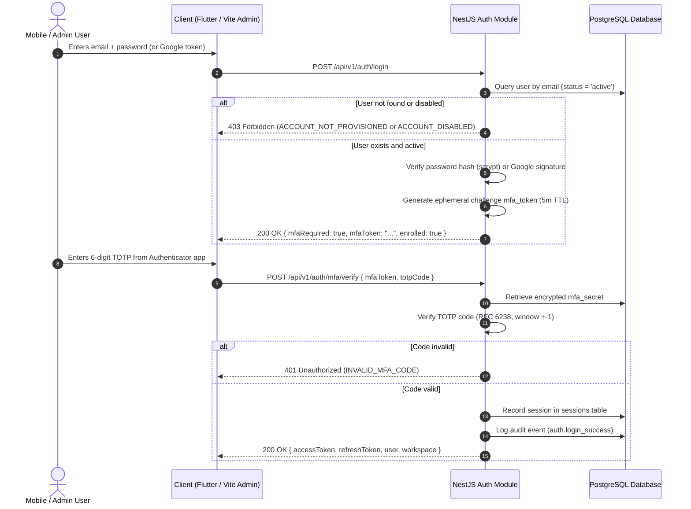

# Outreach Intern V3 — Authentication, MFA & Admin Authorization Design

**Document:** `docs/rebuild/04-auth-and-admin-design.md`  
**Date:** 2026-10-27  
**Status:** Approved (Phase 2 Design Pack Gate)  
**Lead Architect:** Principal Security Architect  

---

## 1. Authentication Architecture & Protocol Flows

### 1.1 Non-Negotiable Invariants
1. **Admin Provisioning Exclusivity:** Accounts can only be created via administrator invitation (`POST /api/v1/admin/users/invite`). There is no public registration API and no sign-up button on any client.
2. **Google Identity Matching:** Google Sign-In validates OpenID Connect ID tokens server-side. If the verified email does not match an existing, active user in PostgreSQL, the request is rejected with `ACCOUNT_NOT_PROVISIONED` (HTTP 403).
3. **Mandatory TOTP MFA:** All primary logins (both password and Google) enter a pending challenge state. Access tokens and session cookies are issued **only** after submitting a valid 6-digit TOTP code or single-use recovery code.

---

## 2. Step-by-Step Authentication Sequence

---

## 3. TOTP MFA & Recovery Code Specification

### 3.1 TOTP Standard Implementation
- **Algorithm:** RFC 6238 HMAC-SHA1
- **Period:** 30 seconds
- **Digits:** 6 digits
- **Drift Tolerance:** 1 step back, 1 step forward (±30s)
- **Secret Generation:** 20 bytes random base32 encoded string.
- **Secret Storage:** Stored in `users.mfa_secret` encrypted at rest using AES-256-GCM.

### 3.2 Backup Recovery Codes
- **Generation:** 8 single-use codes generated during MFA enrollment (formatted `XXXX-XXXX`).
- **Storage:** Stored in `mfa_recovery_codes` table as `SHA-256(code)`.
- **Spending Policy:** When a recovery code is used, its `used_at` timestamp is set in a database transaction. A spent code can never be reused.

---

## 4. Admin Management & Privilege Matrix

### 4.1 Admin Actions & Security Rules
1. **Invite User (`POST /api/v1/admin/users/invite`):**
   - Requires `admin` or `superadmin` role.
   - Generates a cryptographically random 32-byte token with 48-hour expiration.
   - Inserts record into `user_invitations` and logs audit event `user.invite`.
2. **Revoke User Sessions (`POST /api/v1/admin/users/:id/revoke-sessions`):**
   - Deletes all active sessions from `sessions` table where `user_id = :id`.
   - Increments `users.token_version`, instantly invalidating existing JWT access tokens.
3. **Reset User MFA (`POST /api/v1/admin/users/:id/reset-mfa`):**
   - Clears `mfa_secret`, sets `mfa_enabled = false`, and purges recovery codes.
   - Forces the user to enroll in MFA immediately on next login.
   - Requires mandatory administrative audit reason.
4. **Lock / Disable User (`PATCH /api/v1/admin/users/:id/status`):**
   - Updates `status` to `'disabled'` or `'locked'`.
   - Blocks subsequent login attempts and refresh calls.

---

## 5. First-Admin Bootstrap CLI

A dedicated TypeScript bootstrap utility (`scripts/bootstrap-admin.ts`) enables safe system initialization:
- **Command:** `npm run admin:bootstrap -- --email admin@example.com --name "Lead Administrator"`
- **Execution Invariants:**
  - Queries `users` table where `role = 'superadmin'`.
  - If a superadmin already exists, exits immediately with code 1 (`BOOTSTRAP_ALREADY_COMPLETED`).
  - Generates a 16-character secure random password, hashes it using Scrypt, creates the workspace and membership, and prints credentials to stdout once.
  - Forces password rotation and MFA setup upon initial login.
