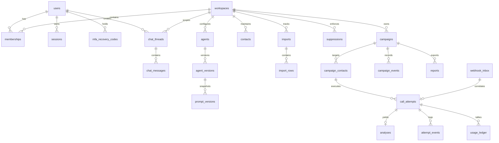

# Outreach Intern V3 — Data Model & Entity Relationship Diagram (ERD)

**Document:** `docs/rebuild/05-data-model-and-erd.md`  
**Date:** 2026-10-27  
**Status:** Approved (Phase 2 Design Pack Gate)  
**Lead Architect:** Principal Database Architect  

---

## 1. Entity-Relationship Diagram (ERD)

---

## 2. Table Specifications & Database Constraints

### 2.1 Identity, Authentication & Security Tables
1. **`users`**:
   - `id`: UUID (Primary Key, defaultRandom())
   - `email`: TEXT (Unique, Not Null, Lowercased)
   - `name`: TEXT (Not Null)
   - `password_hash`: TEXT (Nullable, Scrypt format)
   - `status`: TEXT (Not Null, Default `'active'`, Check: `status IN ('invited', 'active', 'disabled', 'locked')`)
   - `mfa_secret`: TEXT (Nullable, Encrypted Base32)
   - `mfa_enabled`: BOOLEAN (Not Null, Default `false`)
   - `token_version`: INTEGER (Not Null, Default `1`)
   - `failed_login_count`: INTEGER (Not Null, Default `0`)
   - `locked_until`: TIMESTAMP WITH TIME ZONE (Nullable)
   - `created_at`: TIMESTAMP WITH TIME ZONE (Not Null, defaultNow())
2. **`user_invitations`**:
   - `id`: UUID (Primary Key)
   - `workspace_id`: UUID (Foreign Key -> workspaces.id, Not Null)
   - `email`: TEXT (Not Null)
   - `role`: TEXT (Not Null, Check: `role IN ('admin', 'operator', 'viewer')`)
   - `token_hash`: TEXT (Unique, Not Null)
   - `expires_at`: TIMESTAMP WITH TIME ZONE (Not Null)
   - `created_at`: TIMESTAMP WITH TIME ZONE (Not Null, defaultNow())
3. **`mfa_recovery_codes`**:
   - `id`: UUID (Primary Key)
   - `user_id`: UUID (Foreign Key -> users.id, Not Null)
   - `code_hash`: TEXT (Not Null, SHA-256)
   - `used_at`: TIMESTAMP WITH TIME ZONE (Nullable)
   - `created_at`: TIMESTAMP WITH TIME ZONE (Not Null, defaultNow())
4. **`sessions`**:
   - `id`: UUID (Primary Key)
   - `token_hash`: TEXT (Unique, Not Null)
   - `user_id`: UUID (Foreign Key -> users.id, Not Null)
   - `workspace_id`: UUID (Foreign Key -> workspaces.id, Not Null)
   - `expires_at`: TIMESTAMP WITH TIME ZONE (Not Null)
   - `created_at`: TIMESTAMP WITH TIME ZONE (Not Null, defaultNow())

### 2.2 Conversational Planning Tables
5. **`chat_threads`**:
   - `id`: UUID (Primary Key)
   - `workspace_id`: UUID (Foreign Key -> workspaces.id, Not Null)
   - `user_id`: UUID (Foreign Key -> users.id, Not Null)
   - `title`: TEXT (Not Null, Default `'New Outreach Task'`)
   - `campaign_id`: UUID (Foreign Key -> campaigns.id, Nullable)
   - `created_at`: TIMESTAMP WITH TIME ZONE (Not Null, defaultNow())
   - `updated_at`: TIMESTAMP WITH TIME ZONE (Not Null, defaultNow())
6. **`chat_messages`**:
   - `id`: UUID (Primary Key)
   - `thread_id`: UUID (Foreign Key -> chat_threads.id, Not Null)
   - `role`: TEXT (Not Null, Check: `role IN ('user', 'assistant', 'system')`)
   - `content`: TEXT (Not Null)
   - `attachments`: JSONB (Not Null, Default `[]`)
   - `metadata`: JSONB (Not Null, Default `{}`)
   - `created_at`: TIMESTAMP WITH TIME ZONE (Not Null, defaultNow())

### 2.3 System Settings & Prompt Registry
7. **`prompt_versions`**:
   - `id`: UUID (Primary Key)
   - `agent_id`: UUID (Foreign Key -> agents.id, Not Null)
   - `version`: INTEGER (Not Null)
   - `prompt`: TEXT (Not Null)
   - `tools`: JSONB (Not Null, Default `[]`)
   - `skills`: JSONB (Not Null, Default `[]`)
   - `model_config_id`: TEXT (Nullable)
   - `created_at`: TIMESTAMP WITH TIME ZONE (Not Null, defaultNow())
8. **`system_settings`**:
   - `key`: TEXT (Primary Key)
   - `value`: JSONB (Not Null)
   - `updated_by`: UUID (Foreign Key -> users.id, Nullable)
   - `updated_at`: TIMESTAMP WITH TIME ZONE (Not Null, defaultNow())

### 2.4 Core Campaign, Call Attempt & Telephony Tables
9. **`campaigns`**:
   - `id`: UUID (Primary Key)
   - `workspace_id`: UUID (Foreign Key -> workspaces.id, Not Null)
   - `name`: TEXT (Not Null)
   - `objective`: TEXT (Not Null)
   - `mode`: TEXT (Not Null, Check: `mode IN ('simulation', 'live')`)
   - `status`: TEXT (Not Null, Check: `status IN ('draft', 'planned', 'running', 'paused', 'completed', 'cancelled', 'failed')`)
   - `agent_version_id`: UUID (Foreign Key -> agent_versions.id, Not Null)
   - `import_id`: UUID (Foreign Key -> imports.id, Not Null)
   - `policy`: JSONB (Not Null)
   - `plan`: JSONB (Nullable)
   - `launch_key`: TEXT (Nullable, Idempotency tracking)
   - `reserved_minor`: INTEGER (Not Null, Default 0)
   - `created_at`: TIMESTAMP WITH TIME ZONE (Not Null)
   - `updated_at`: TIMESTAMP WITH TIME ZONE (Not Null)
10. **`campaign_contacts`**:
    - `id`: UUID (Primary Key)
    - `workspace_id`: UUID (Foreign Key -> workspaces.id, Not Null)
    - `campaign_id`: UUID (Foreign Key -> campaigns.id, Not Null)
    - `contact_id`: UUID (Foreign Key -> contacts.id, Not Null)
    - `status`: TEXT (Not Null, Check: `status IN ('pending', 'queued', 'calling', 'completed', 'excluded', 'unknown', 'cancelled')`)
    - `reason`: TEXT (Nullable)
    - `position`: INTEGER (Not Null)
    - `created_at`: TIMESTAMP WITH TIME ZONE (Not Null)
11. **`call_attempts`**:
    - `id`: UUID (Primary Key)
    - `workspace_id`: UUID (Foreign Key -> workspaces.id, Not Null)
    - `campaign_id`: UUID (Foreign Key -> campaigns.id, Not Null)
    - `campaign_contact_id`: UUID (Foreign Key -> campaign_contacts.id, Not Null)
    - `provider`: TEXT (Not Null, Check: `provider IN ('mock', 'sarvam')`)
    - `mode`: TEXT (Not Null, Check: `mode IN ('simulation', 'live')`)
    - `status`: TEXT (Not Null, Check: `status IN ('created', 'dispatching', 'accepted', 'connected', 'completed', 'failed', 'unknown', 'cancelled')`)
    - `outcome`: TEXT (Nullable, Check: `outcome IN ('connected', 'no_answer', 'busy', 'failed', 'unknown', 'cancelled')`)
    - `provider_attempt_id`: TEXT (Nullable)
    - `agent_version_id`: UUID (Foreign Key -> agent_versions.id, Not Null)
    - `started_at`: TIMESTAMP WITH TIME ZONE (Not Null)
    - `completed_at`: TIMESTAMP WITH TIME ZONE (Nullable)
    - `duration_seconds`: DOUBLE PRECISION (Nullable)
    - `provider_config`: JSONB (Nullable)
    - `failure_code`: TEXT (Nullable)
    - `interaction_id`: TEXT (Nullable)
    - `estimated_cost_minor`: INTEGER (Default 0)
    - `created_at`: TIMESTAMP WITH TIME ZONE (Not Null)
12. **`analyses`**:
    - `id`: UUID (Primary Key)
    - `workspace_id`: UUID (Foreign Key -> workspaces.id, Not Null)
    - `call_attempt_id`: UUID (Foreign Key -> call_attempts.id, Unique, Not Null)
    - `status`: TEXT (Not Null, Check: `status IN ('pending', 'processing', 'completed', 'failed', 'cancelled')`)
    - `transcript`: JSONB (Nullable, Array of turns with role, text, en_text)
    - `extracted_fields`: JSONB (Nullable)
    - `summary`: TEXT (Nullable)
    - `summary_source`: TEXT (Not Null, Default `'local'`)
    - `summary_model`: TEXT (Nullable)
    - `mastra_run_id`: TEXT (Nullable)
    - `synthetic`: BOOLEAN (Not Null)
    - `failure_code`: TEXT (Nullable)
    - `expires_at`: TIMESTAMP WITH TIME ZONE (Not Null)
    - `created_at`: TIMESTAMP WITH TIME ZONE (Not Null)

---

## 3. Data Retention & Privacy Invariants

1. **Transcript & Recording Retention:** Transcripts and analysis artifacts expire according to `system_settings.retention_days` (default 30 days). Expired records have transcript and audio references zeroed out while retaining aggregate outcome tallies for reporting integrity.
2. **Phone Number Masking:** In API read models, phone numbers are masked (`+91 ••••• ••793`). Only authorized operators on specific single-contact detail endpoints can view the unmasked number with an audit trail entry.
