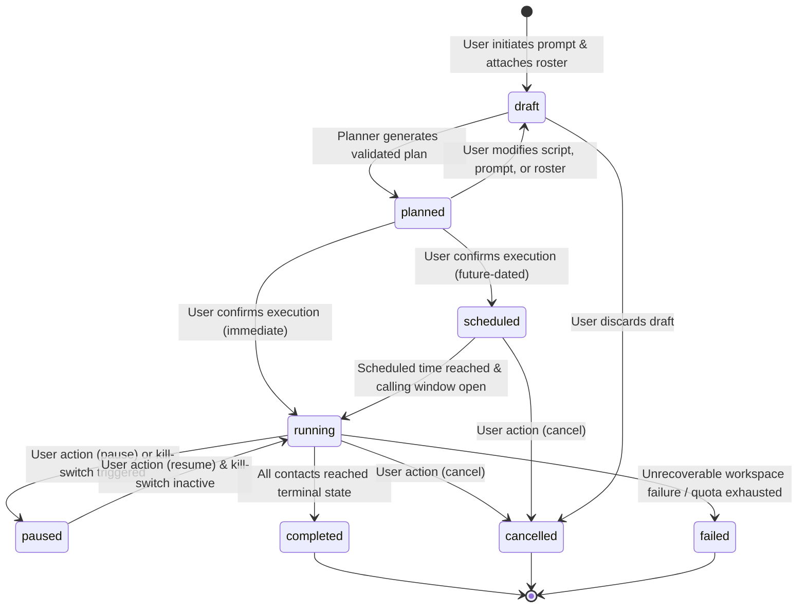
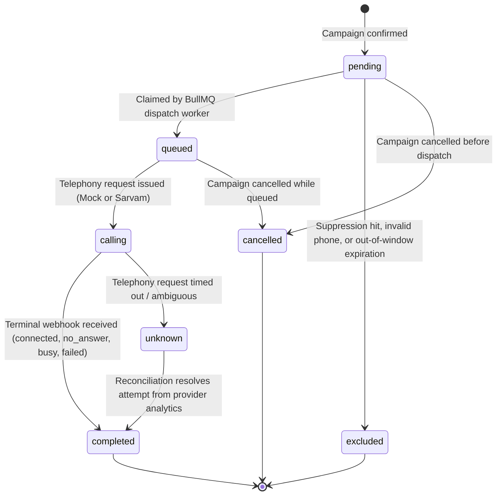

# Outreach Intern V3 — Campaign & Call State Machine Specifications

**Document:** `docs/rebuild/07-campaign-and-call-state-machines.md`  
**Date:** 2026-10-27  
**Status:** Approved (Phase 2 Design Pack Gate)  
**Lead Architect:** Principal Systems Architect  

---

## 1. Campaign State Machine

### 1.1 Transition Guards & Invariants
| From State | To State | Trigger / Event | Guard Conditions |
| :--- | :--- | :--- | :--- |
| `draft` | `planned` | Agent planning complete | Roster valid, agent version selected, plan hash computed |
| `planned` | `running` | `POST /campaigns/:id/confirm` | Mode verified, idempotency key new, snapshot hash matches, kill-switch OFF |
| `planned` | `scheduled` | `POST /campaigns/:id/confirm` | `scheduledAt > now()`, timezone valid, snapshot matches |
| `scheduled` | `running` | BullMQ delayed job / timer | Current local time within configured calling window |
| `running` | `paused` | `POST /campaigns/:id/action { pause }` | Running attempt locks held; no new dispatches allowed |
| `running` | `completed` | BullMQ settlement check | `pendingCount == 0 && callingCount == 0` |
| `running` | `cancelled` | `POST /campaigns/:id/action { cancel }` | Queued contact tasks marked `cancelled`; active calls drain |

---

## 2. Per-Contact Task & Call Attempt State Machine

### 2.1 Call Attempt Terminal States vs Outcomes
A single contact task in `campaign_contacts` can have multiple historical `call_attempts` if the campaign policy permits retries.
- **`status` (Operational Lifecycle):**
  - `created`: Database record inserted.
  - `dispatching`: Worker currently issuing HTTP call to provider.
  - `accepted`: Provider responded with HTTP 200 and `attempt_id`.
  - `connected`: Active telephony session established.
  - `completed`: Telephony session ended.
  - `failed`: Provider rejected call (HTTP 4xx/5xx).
  - `unknown`: Dispatch timed out without provider response; awaiting reconciliation.
  - `cancelled`: Attempt aborted before connection.
- **`outcome` (Call Disposition):**
  - `connected`: Speech turns exchanged.
  - `no_answer`: Ringing timeout exceeded.
  - `busy`: Line busy or rejected by user.
  - `failed`: Network/telephony carrier routing failure.
  - `unknown`: Outcome unresolved.
  - `cancelled`: Aborted.

### 2.2 Retry Policy & Invariance
- If an attempt ends with `no_answer` or `busy` AND `campaign.policy.maxRetries > attempt_number`:
  - The previous `call_attempt` record is marked `status: 'completed', outcome: 'no_answer'` (IMMUTABLE).
  - The worker enqueues a delayed dispatch job in BullMQ (backoff: 15 minutes).
  - When the delayed job fires, a **new** `call_attempt` row is inserted with `attempt_number = 2`.
  - Prior attempt records are NEVER overwritten or mutated.
