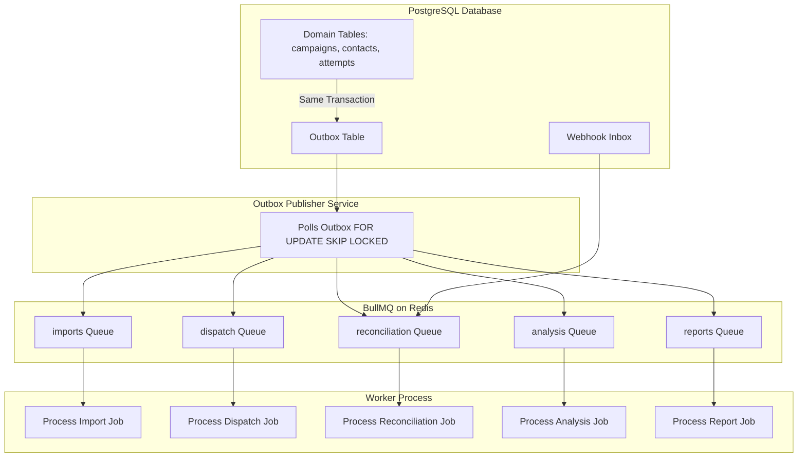

# Outreach Intern V3 — Queue, Scheduling & Recovery Engine Specification

**Document:** `docs/rebuild/10-queue-scheduling-recovery.md`  
**Date:** 2026-10-27  
**Status:** Approved (Phase 2 Design Pack Gate)  
**Lead Architect:** Principal Distributed Systems Architect  

---

## 1. BullMQ Queue Topology & Redis Invariants

### 1.1 Redis Persistence Configuration
To ensure queues and jobs survive process restarts and power loss:
- **Append-Only File (AOF):** Configured with `--appendonly yes` and `--appendfsync everysec`.
- **Eviction Policy:** Configured with `--maxmemory-policy noeviction`. Redis will reject memory writes rather than silently evict active BullMQ lock keys or waiting jobs.

### 1.2 The Five Operational Queues


---

## 2. Transactional Outbox Pattern & Reconnection Engine

Dual-write hazards (writing to PostgreSQL and Redis independently) are eliminated via the Transactional Outbox Pattern:

1. **Transactional Enqueue:** When an event occurs (e.g. user confirms campaign), the domain record and an outbox entry are committed together:
   ```sql
   INSERT INTO campaigns (...) VALUES (...);
   INSERT INTO outbox (workspace_id, kind, payload) VALUES ($1, 'dispatch', json_build_object('campaignId', $2));
   ```
2. **Outbox Publisher (`apps/worker/src/outbox.ts`):**
   - Continuously polls `outbox` records where `published_at IS NULL AND available_at <= now()`.
   - Uses `SELECT ... FOR UPDATE SKIP LOCKED` to allow multi-worker concurrency without collision.
   - Enqueues job to BullMQ with deterministic `jobId: "outbox-${outbox.id}"`.
   - Upon BullMQ acknowledgment, sets `published_at = now()`.
3. **Crash Recovery:** If Redis crashes or drops connections, the worker reconnection loop resumes publishing from PostgreSQL when Redis becomes healthy. No confirmed campaign or contact attempt is ever lost.

---

## 3. Ambiguous Outbound Dispatch & Provider Reconciliation

### 3.1 Network Timeout Problem
When a worker issues an HTTP POST to Sarvam (`https://apps.sarvam.ai/api/outbounds/v1/...`), the network connection may drop after Sarvam accepted the call but before returning the HTTP 200 response.
- **Strict Rule:** **NEVER BLINDLY REDIAL.** Redialing risks placing duplicate harassing phone calls to recipients.
- **Handling Procedure:**
  1. The worker catches the network timeout / socket error.
  2. Updates `call_attempts` status to `'unknown'`.
  3. Enqueues a job into `reconciliation` queue with a 2-minute backoff.
  4. The reconciliation processor queries the Sarvam analytics API using the call timestamp and destination phone number to determine if an attempt was registered.
  5. If an attempt is found, it correlates the `provider_attempt_id` and awaits the webhook.
  6. If confirmed unattempted by Sarvam, the attempt is marked `failed` with code `DISPATCH_TIMEOUT_UNRESOLVED`.

---

## 4. Scheduling & Timezone Policy

- **Timezone Invariant:** All scheduled call times are defined with an explicit IANA timezone (e.g. `Asia/Kolkata`) and stored alongside the UTC normalized `scheduled_at` timestamp.
- **Calling Window Enforcement:**
  - Before a call is dispatched, the worker computes the recipient's local time.
  - If current time is outside the campaign's allowed window (e.g. `10:00 - 18:00`), the job is delayed until the start of the next calling window.
- **Misfire Policy:** If a worker was offline during a scheduled call time, upon boot it checks if the current time is still within the window. If outside the window, the dispatch is deferred to the next valid window.

---

## 5. Global Telephony Kill-Switch

The worker checks the global kill-switch before claiming and before dialing any attempt:
- Stored in `system_settings` table under key `'telephony_kill_switch'`.
- Cached in Redis with a 5-second TTL to avoid database query overhead.
- When active, all dispatch jobs immediately exit and remain in `paused` state in BullMQ.
