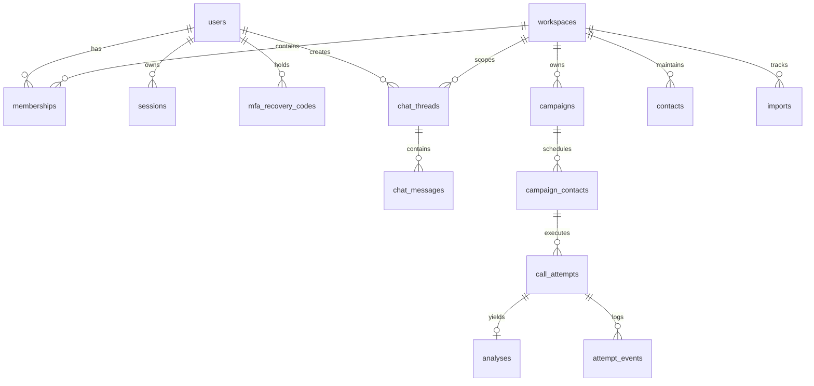

# Outreach Intern V3 — Data Model, Import Pipeline, Queues, Schedules & Reliability Research

**Document:** `docs/rebuild/research/data-queues-reliability.md`  
**Date:** 2026-10-27  
**Status:** Complete (Phase 1 Research — Agent E)  
**Author:** Data Architecture & Distributed Systems Workstream  
**Verified Source References:** Recorded in `docs/rebuild/source-register.md`

---

## 1. Relational Schema Architecture (PostgreSQL & Drizzle ORM)

Official Drizzle and Postgres references verified:
- Drizzle ORM Postgres: https://orm.drizzle.team/docs/get-started-postgresql
- Drizzle Migrations: https://orm.drizzle.team/docs/migrations
- Node-Postgres Pooling: https://node-postgres.com/features/pooling

### 1.1 Schema Additions for V3 Rebuild
The core 22 tables from V2 are retained and augmented with 7 essential tables to support conversation history, invitations, MFA, prompt registry, and admin settings:

### Table Definitions:
1. **`users` (Augmented):**
   - `password_hash`: text, nullable (for passwordless invites until set)
   - `status`: text (`'invited'`, `'active'`, `'disabled'`, `'locked'`)
   - `mfa_secret`: text, encrypted base32 secret
   - `mfa_enabled`: boolean, default `false`
   - `token_version`: integer, default `1` (incremented on logout-all)
   - `failed_login_count`: integer, default `0`
   - `locked_until`: timestamp with time zone, nullable
2. **`user_invitations`:**
   - `id`: uuid PK
   - `workspace_id`: uuid FK
   - `email`: text not null
   - `role`: text not null (`'admin'`, `'operator'`, `'viewer'`)
   - `token_hash`: text not null unique
   - `expires_at`: timestamp with time zone not null
   - `created_at`: timestamp with time zone defaultNow()
3. **`mfa_recovery_codes`:**
   - `id`: uuid PK
   - `user_id`: uuid FK
   - `code_hash`: text not null (SHA-256)
   - `used_at`: timestamp with time zone, nullable
   - `created_at`: timestamp with time zone defaultNow()
4. **`chat_threads`:**
   - `id`: uuid PK
   - `workspace_id`: uuid FK
   - `user_id`: uuid FK
   - `title`: text not null default `'New Outreach Task'`
   - `campaign_id`: uuid FK, nullable (linked draft or confirmed campaign)
   - `created_at`: timestamp with time zone defaultNow()
   - `updated_at`: timestamp with time zone defaultNow()
5. **`chat_messages`:**
   - `id`: uuid PK
   - `thread_id`: uuid FK
   - `role`: text not null (`'user'`, `'assistant'`, `'system'`)
   - `content`: text not null
   - `attachments`: jsonb default `[]` (file references, hashes, mime types)
   - `metadata`: jsonb default `{}` (tokens, mastraRunId, stepName)
   - `created_at`: timestamp with time zone defaultNow()
6. **`prompt_versions`:**
   - `id`: uuid PK
   - `agent_id`: uuid FK
   - `version`: integer not null
   - `prompt`: text not null
   - `tools`: jsonb not null default `[]`
   - `skills`: jsonb not null default `[]`
   - `model_config_id`: text
   - `created_at`: timestamp with time zone defaultNow()
7. **`system_settings`:**
   - `key`: text PK (e.g. `'telephony_kill_switch'`, `'default_calling_window'`, `'model_provider_config'`)
   - `value`: jsonb not null
   - `updated_by`: uuid FK
   - `updated_at`: timestamp with time zone defaultNow()

---

## 2. Multi-Format Contact Import Pipeline

### 2.1 Supported File Types & Safe Parsers
- **CSV**: Parsed via `csv-parse/sync` with `max_record_size: 65536`.
- **XLSX / XLS**: Parsed via `exceljs` with formula extraction disabled (`cell.result` or raw value; formulas are never evaluated).
- **TSV**: Tab-delimited text parsed via `csv-parse` with `{ delimiter: '\t' }`.
- **Plain Text (TXT)**: One contact per line format: `[Name, ]Phone Number[, Variable1...]`.
- **vCard (.vcf)**: Standard RFC 6350 parsing extracting `FN` (Full Name) and `TEL` (Telephone).

### 2.2 Phone Number Normalization & Safe Region Handling
- **Invariant:** Country code is **never guessed**.
- Number normalization is executed via `libphonenumber-js`.
- If phone is in E.164 (`+` prefix, e.g. `+919546730793`), it is validated directly.
- If national format (e.g. `9546730793`), it is parsed strictly using the workspace-configured default country (e.g. `'IN'`). If the number is ambiguous or missing a region, it is flagged with issue code `PHONE_COUNTRY_UNKNOWN` and blocked from dispatch.
- Storage: Always stored in normalized E.164 string (`+<country_code><number>`).

---

## 3. Queue Architecture & Recovery Engine (BullMQ + Redis)

Official BullMQ reference verified:
- BullMQ Production Guide: https://docs.bullmq.io/guide/going-to-production

### 3.1 Redis Configuration Invariants
- Persistence: AOF enabled (`appendonly yes`, `appendfsync everysec`).
- Eviction Policy: `maxmemory-policy noeviction` to prevent BullMQ lock keys or active jobs from being prematurely evicted under memory pressure.

### 3.2 Outbox Pattern & Transactional Publishing
To eliminate dual-write hazards between PostgreSQL and Redis:
1. Application transactions write domain state (e.g. `campaigns`, `campaign_contacts`) AND insert an event into the `outbox` table in the SAME database transaction.
2. The `OutboxPublisherService` polls uncommitted outbox entries (`published_at IS NULL`) with `SELECT ... FOR UPDATE SKIP LOCKED` and enqueues jobs into BullMQ.
3. Upon BullMQ acknowledgment, the outbox record is marked with `published_at = now()`.
4. If Redis crashes or drops messages, the outbox publisher automatically recovers and resends pending jobs upon Redis reconnect.

### 3.3 The 5 Operational Queues
1. `imports`: Asynchronous parsing and row validation for contact files.
2. `dispatch`: Enforces calling windows, suppression checks, concurrency slots, and provider API dispatch.
3. `reconciliation`: Resolves pending provider attempts whose HTTP call timed out or whose webhook was delayed.
4. `analysis`: Triggers Mastra Post-call Analysis Agent on completed transcripts.
5. `reports`: Generates CSV/XLSX export artifacts from canonical database queries.

### 3.4 Concurrency & Kill-Switch Safeguards
- Worker queries `system_settings` for `'telephony_kill_switch'` before every call attempt. If enabled, jobs are placed into `paused` state immediately.
- Concurrency bounded per campaign (e.g. max 2 concurrent outbound lines) using BullMQ rate limiters and Redis token bucket.
- Uncertain Outbound Timeouts: When Sarvam HTTP POST times out, attempt enters `unknown` status and enqueues to `reconciliation`. Worker **never** blindly redials without verifying the provider's attempt registry.
